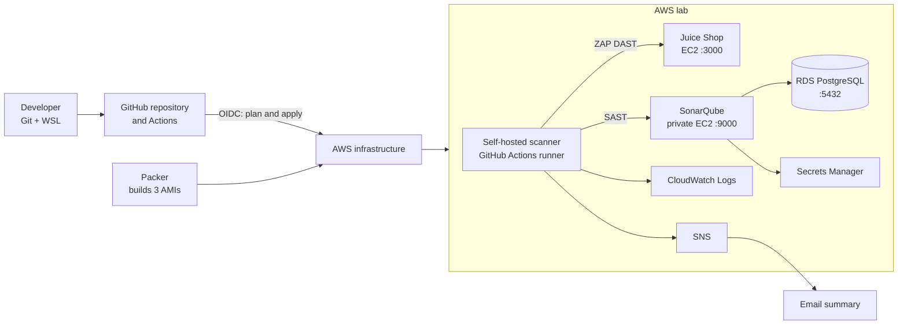

# Project 3 — Building a Secure CI/CD Pipeline on AWS

I built this lab to bring together application security, infrastructure as code and deployment automation in one working pipeline. My application is [OWASP Juice Shop](https://owasp.org/www-project-juice-shop/), an intentionally vulnerable web application. I use it as a safe lab target to see how security tools behave when they actually find issues.

The pipeline uses GitHub Actions, Packer and Terraform to deploy the lab on AWS, then combines secrets scanning, static analysis, dependency scanning and dynamic testing. CloudWatch records scan summaries, and SNS sends concise email notifications.

**This is a learning lab, not a production reference deployment.** Juice Shop is deliberately vulnerable. I restrict access to the lab, use test data, and scan only the application I own and have permission to test.

## What I built




The running lab consists of three EC2 instances—Juice Shop, SonarQube and a separate scanner runner—plus an RDS for PostgreSQL database. Packer uses temporary build instances to create images. GitHub hosts the Terraform runner; application security scans use my self-hosted EC2 runner.

I kept **separate workflows** for demonstrating and troubleshooting individual tools, and added one combined workflow to show the full sequence:

```text
Gitleaks + SonarQube + Dependency-Check
                ↓
        Terraform plan and approval
                ↓
     Terraform applies the saved plans
                ↓
       ZAP scans running Juice Shop
```

The three pre-deployment scans are independent jobs. Because this lab has one scanner runner, they are queued and run one at a time. The runner and SonarQube must already exist before this combined workflow starts; after a full teardown I bootstrap the lab infrastructure first.

Vulnerability and secret findings are **report-only** in this lab. A finding does not stop deployment. A scanner or reporting execution failure is different: it is reported as a failure rather than being presented as a clean scan, and can stop the combined workflow before deployment.

## Tools and why I used them

| Tool or service | What I used it for |
| --- | --- |
| GitHub Actions | Separate and combined workflows, reports and deployment approvals |
| Gitleaks | Scan repository history for potentially exposed secrets |
| SonarQube and SonarScanner | Static analysis and quality-profile checks on the Juice Shop source |
| OWASP Dependency-Check | Check packaged dependencies against vulnerability data |
| OWASP ZAP | Test the running application using an unauthenticated spider and bounded active scan |
| Packer | Build the Juice Shop, SonarQube and scanner-runner AMIs |
| Terraform | Create and destroy AWS infrastructure in separate layers |
| AWS IAM and GitHub OIDC | Give workflows and instances distinct, scoped identities |
| AWS Systems Manager | Manage instances without inbound SSH |
| RDS PostgreSQL and Secrets Manager | Persist SonarQube data and manage its database credentials |
| CloudWatch and SNS | Store aggregate scan summaries and send email notifications |

I did not add a container scanner, an Ansible admin node or a deployment-blocking SonarQube quality gate to this lab.

## Walkthrough

### 1. Prepare my workstation and AWS identity

I worked in WSL and used the AWS CLI, Packer, Terraform, Git, GitHub CLI and the Session Manager plugin. I authenticated with my IAM user using short-lived credentials; I did not use the AWS root user for the lab.

From my project directory I checked the active identity and installed tools:

```bash
cd ~/projects/project-3-secure-cicd-pipeline

aws sts get-caller-identity \
  --profile mds-devsecops-lab \
  --region us-east-1

packer version
terraform version
aws --version
session-manager-plugin --version
gh auth status
```

Before building an AMI I checked that the **Packer operator role**, rather than the IAM user directly, was being used:

```bash
aws sts get-caller-identity \
  --profile project-3-packer \
  --query Arn \
  --output text
```

The expected result is an assumed-role ARN for `project-3-packer-operator-role`. My IAM user's short-lived session is the source for that role profile. I do not place long-lived AWS keys in GitHub or bake them into images.

### 2. Bootstrap Packer access

Packer needs AWS access before the Terraform lab infrastructure exists, so I prepared two separate identities:

- **Packer operator role:** used by the Packer process to make the required EC2 and SSM API calls.
- **Packer builder role and instance profile:** attached to the temporary build instance, with Systems Manager access.

I documented the role setup and cleanup in [Packer IAM bootstrap](docs/packer-builder-iam-bootstrap.md). The operator's `iam:PassRole` permission is limited to the builder role and EC2.

Packer connects to its temporary builder using its SSH communicator **through an SSM tunnel**. There is no public inbound port 22 or SSH key for deployed lab hosts. Builder networking still needs a working outbound path for package downloads and Systems Manager.

### 3. Bake the three AMIs

I used Ubuntu 24.04 LTS as the base and created one image per role:

1. **Juice Shop:** the Node.js application, non-root service, SSM and CloudWatch configuration.
2. **SonarQube:** SonarQube, Java, SSM and CloudWatch, with a baked startup service that obtains runtime database settings and credentials.
3. **Scanner runner:** GitHub Actions runner software, Gitleaks, SonarScanner, Dependency-Check, ZAP, AWS CLI and supporting tools.

I applied OS updates and role-specific host hardening while building the images. Security groups and IAM permissions are separate AWS controls managed by Terraform. I use IMDSv2 on the instances.

For example, I can look up the current Canonical Ubuntu 24.04 AMD64 base image with:

```bash
aws ssm get-parameter \
  --profile mds-devsecops-lab \
  --region us-east-1 \
  --name /aws/service/canonical/ubuntu/server/24.04/stable/current/amd64/hvm/ebs-gp3/ami-id \
  --query 'Parameter.Value' \
  --output text
```

I initialize and validate a template before building it. The variables below are examples; the subnet and security group must belong to the same build VPC and must provide the required connectivity:

```bash
cd ~/projects/project-3-secure-cicd-pipeline

packer init packer/sonarqube

packer validate \
  -var 'source_ami_id=ami-REPLACE' \
  -var 'subnet_id=subnet-REPLACE' \
  -var 'security_group_id=sg-REPLACE' \
  -var 'sonarqube_version=26.10.0.133078' \
  -var 'java_package=openjdk-21-jdk' \
  packer/sonarqube

AWS_PROFILE=project-3-packer packer build \
  -var 'source_ami_id=ami-REPLACE' \
  -var 'subnet_id=subnet-REPLACE' \
  -var 'security_group_id=sg-REPLACE' \
  -var 'sonarqube_version=26.10.0.133078' \
  -var 'java_package=openjdk-21-jdk' \
  packer/sonarqube
```

The other image definitions are in [packer/juice-shop](packer/juice-shop/) and [packer/github-runner](packer/github-runner/); the runner's pinned tool versions are in [versions.env](packer/github-runner/versions.env). Packer builds create billable temporary resources and AMI backing snapshots, so I check the results and clean them up when finished.

My goal is immutable deployment: when baked software or configuration changes, I build a new AMI and replace the instance. **A successful image build alone does not prove that the deployed service is healthy**, so I verify runtime health separately.

### 4. Prepare Terraform state and GitHub access

I split infrastructure into five independent Terraform roots, each with its own state key and S3 native lock file:

| Root | Responsibility |
| --- | --- |
| [network](terraform/network/) | VPC, subnets, routing, endpoints and security groups |
| [database](terraform/database/) | Private RDS PostgreSQL |
| [observability](terraform/observability/) | CloudWatch and SNS resources |
| [compute](terraform/compute/) | Juice Shop and scanner-runner instances and roles |
| [sonarqube](terraform/sonarqube/) | Private SonarQube instance and role |

The state bucket has to exist before Terraform can use it as a backend. I bootstrap it once with my authenticated IAM-user profile:

```bash
cd ~/projects/project-3-secure-cicd-pipeline

AWS_PROFILE=mds-devsecops-lab AWS_REGION=us-east-1 \
  ./scripts/bootstrap-terraform-state.sh
```

I configured GitHub's AWS OIDC provider and separate plan/apply roles. The workflow obtains short-lived credentials; I do not store long-lived AWS access keys in GitHub. The apply job uses the protected `terraform-lab-apply` environment and waits for a reviewer.

The exact repository variables, secrets, role trust, runner registration and state configuration are documented in [GitHub Actions Terraform setup](docs/github-actions-terraform-setup.md). I also explain why I split the configuration in [Terraform layering rationale](docs/terraform-layering-rationale.md).

**Important lab limitation:** the apply-role policy includes specific VPC and subnet IDs. If I destroy and recreate the network, AWS gives it new IDs and I must review and update that scoped policy before instance launches can succeed. That manual step is a known improvement opportunity; it is not fully automated by the current implementation.

### 5. Deploy the infrastructure in layers

I use **Actions → Terraform deployment** to run the infrastructure workflow. It plans each layer and saves the plan for review. Apply jobs wait for approval in `terraform-lab-apply`; after approval, the workflow applies the saved plan.

The dependency order is:

```text
network
  ├── database ───────────┐
  └── observability ──────┼── SonarQube
           └──────────────┴── compute
```

Database and observability can run in parallel once networking is available. Compute waits for networking and observability; SonarQube waits for networking, the database and observability. Separate state files make each layer easier to review, but they also mean I must respect their dependencies during deployment and teardown.

I configured the runner to register at launch using a short-lived GitHub App registration token. The token is delivered through an SSM SecureString and removed after use. The EC2 instance is replaced when its AMI or the configured immutable runner sizing changes. It is a separate scanner host; this lab does **not** automatically create a fresh runner for every job.

At the time of the successful run, I used a `c7i-flex.large` scanner runner and a `c7i-flex.large` SonarQube instance. I increased the runner from `t3.small` after a SonarQube scan exhausted its memory. Instance types and prices should be reviewed for a new run.

### 6. Verify the deployed services

Terraform success tells me infrastructure operations completed; it does not prove that the application is ready. I verify running instances and SSM registration:

```bash
aws ec2 describe-instances \
  --profile mds-devsecops-lab \
  --region us-east-1 \
  --filters \
    'Name=tag:Project,Values=project-3-secure-cicd-pipeline' \
    'Name=instance-state-name,Values=running' \
  --query 'Reservations[].Instances[].{Name:Tags[?Key==`Name`]|[0].Value,Id:InstanceId,Type:InstanceType,PrivateIP:PrivateIpAddress}' \
  --output table

aws ssm describe-instance-information \
  --profile mds-devsecops-lab \
  --region us-east-1 \
  --query 'InstanceInformationList[].{Instance:InstanceId,Status:PingStatus}' \
  --output table
```

I also check that Juice Shop responds on port 3000, SonarQube reports `UP`, and the scanner runner appears online in GitHub. I use SSM for these read-only checks; I do not fix application configuration by logging into a running host. If an image needs a change, I update the Packer build and replace the instance.

The SonarQube launcher gets the database endpoint and secret reference at runtime and retrieves credentials from Secrets Manager using its instance role. The PostgreSQL database is private and is not baked into the image.

### 7. Configure SonarQube

Once SonarQube was healthy, I changed the initial admin password, configured the Juice Shop project and its quality profiles, and set up separate tokens for analysis and reporting. I store tokens in GitHub Actions secrets, never in the repository.

The scan workflow uses the `sonarqube-scan` environment, `SONAR_HOST_URL`, `SONAR_TOKEN` and `SONAR_REPORT_TOKEN`. The reporter account only needs the project access required for its reports. My scan uses the pinned Juice Shop 20.3.0 source; I must keep the source version aligned with the application image I deploy.

A quality-profile finding is reported to me. A quality-gate result is visible in SonarQube but does not block this intentionally vulnerable lab deployment.

### 8. Run the separate security workflows

I first tested each scanner independently so I could troubleshoot its configuration before combining the jobs.

| Workflow | What it scans | Evidence |
| --- | --- | --- |
| **Gitleaks secrets scan on AWS** | Repository Git history | Sanitized findings and summary; secret values are not included in notifications |
| **Juice Shop SonarQube analysis** | Juice Shop source code | SonarQube analysis and exported findings |
| **Juice Shop Dependency-Check** | The packaged Juice Shop dependencies | JSON and HTML reports and aggregate summary |
| **Juice Shop ZAP DAST** | The deployed Juice Shop over its private address | JSON and HTML ZAP reports and aggregate summary |

I keep scanner findings separate from scanner failures. For example, a successful Dependency-Check run may report vulnerable packages, while a failed NVD update must be recorded as an execution failure—not as zero vulnerabilities.

Dependency-Check uses an NVD API key stored as the `NVD_API_KEY` GitHub environment secret. Its current packaged scan has **limited coverage**: there is no top-level lockfile, npm/Yarn/pnpm audit analyzers are disabled, and false negatives are possible. The ZAP workflow uses an unauthenticated traditional spider and bounded active scan, so JavaScript-driven and authenticated areas are not fully covered.

### 9. Run the combined pipeline

With the lab infrastructure, scanner runner and SonarQube already available, I open **Actions → Combined secure CI-CD pipeline → Run workflow**, select `master`, and start the run.

The pipeline calls the same separate workflows:

1. Gitleaks scans repository history.
2. SonarQube analyzes the application source.
3. Dependency-Check analyzes the packaged dependencies.
4. Terraform creates reviewable plans. I inspect the plans and approve the pending apply jobs.
5. ZAP discovers the running tagged Juice Shop instance and tests that lab target.

The combined workflow is manually triggered in this implementation. Some individual workflows also have their own push triggers, so separate runs can occur independently. The pipeline currently uses one persistent self-hosted runner; untrusted pull-request code must not be given access to that runner and its AWS identity.

My first combined run completed successfully in GitHub Actions: [combined run 41846334576](https://github.com/DelaneKay/project-3-secure-cicd-pipeline/actions/runs/41846334576). The green result means the jobs completed, not that Juice Shop contains no vulnerabilities.

### 10. Review reports and notifications

Each scan uploads an Actions artifact. CloudWatch receives a concise summary; SNS sends an aggregate email when there are findings or a scan/reporting failure. I confirm the SNS email subscription before expecting messages.

In the successful combined run:

- **Gitleaks:** 0 findings in that run.
- **SonarQube:** 272 issues; the reported quality status was `OK`.
- **Dependency-Check:** 20 vulnerable dependencies and 66 vulnerability occurrences, with limited coverage.
- **ZAP:** 5 alert types—2 medium and 3 informational—with limited coverage.

These counts describe one run and are not a guarantee of complete coverage. An occurrence is not necessarily a distinct vulnerability, and results need review for false positives.

The original [Actions run](https://github.com/DelaneKay/project-3-secure-cicd-pipeline/actions/runs/41846334576) contains the temporary artifacts. Scan report archives and an explanation are prepared in [the evidence folder](docs/evidence/combined-run-41846334576/) when the corresponding evidence pull request is merged. Terraform saved plans are not published there because they can contain sensitive values.

### 11. Back up, destroy and verify

This is a lab, so I do not leave infrastructure running when I no longer need it. The network endpoints, EC2 instances, RDS database, storage, snapshots, logs and state bucket can incur charges.

If I want to demonstrate a backup, I create and verify a manual RDS snapshot **before** teardown. The current RDS configuration disables automatic backup retention and skips the final snapshot on destroy; a backup is not created automatically by Packer or Ansible. A manual snapshot continues to incur storage charges until I delete it.

I run **Actions → Terraform destroy**, type `DESTROY`, review the destroy plans, and approve the protected jobs. The workflow removes the Terraform-managed layers in reverse dependency order. Terraform destroy does **not** remove everything created outside those states.

My final cleanup includes:

- Any manual RDS snapshots, once they are no longer needed.
- Packer-created AMIs and their backing EBS snapshots, including older versions.
- The Packer operator and builder roles, policies and instance profile.
- Stale self-hosted runner registrations.
- All current and noncurrent objects in the versioned Terraform state bucket, then the bucket itself.
- Any other lab resources found during the final inventory.

I verify the AWS account and region before cleanup, and check AWS Billing/Cost Explorer as well as EC2, RDS, VPC endpoints, snapshots, CloudWatch and S3. Removing the lab resources does not retroactively remove charges already incurred.

## Trust boundaries

I documented each boundary by asking what crosses it and which control is responsible for limiting it.

| Boundary | What crosses it and how I restrict it |
| --- | --- |
| Developer workstation → GitHub | Code and workflow changes. I use GitHub authentication, review changes and scan repository history for secrets. |
| GitHub repository → Actions runner | Workflow and application code. Only trusted workflow code runs on the self-hosted scanner; it has its own identity and host. |
| GitHub Actions → AWS | Terraform API requests. GitHub OIDC exchanges short-lived credentials for scoped plan and apply roles, with a protected apply environment. |
| Scanner runner → SonarQube | Analysis and reporting requests. SonarQube is private, the security group allows the required path, and tokens are kept in GitHub secrets. |
| Scanner runner → Juice Shop | ZAP HTTP requests. The scan is limited to the lab target and its private application port. |
| Lab user → Juice Shop | Browser requests to an intentionally vulnerable application. I restrict the security group to approved lab sources and use test data. |
| SonarQube → RDS | PostgreSQL traffic. RDS is private and its security group permits the SonarQube security group on port 5432. |
| SonarQube → Secrets Manager | Database credential retrieval. The instance role can access the required secret; the image does not contain the password. |
| EC2 → Systems Manager | Management traffic using the instance role and SSM Agent. I do not expose inbound SSH. |
| Packer operator → AWS APIs → temporary builder | Image creation, packages and configuration. The operator and builder use separate roles, and temporary builders are removed after the build. |
| Terraform → state bucket | Infrastructure state and lock objects. State is kept in a private, encrypted, versioned bucket with separate keys and lock files. |
| Scan jobs and hosts → CloudWatch → SNS → email | Aggregate results and notifications. I avoid sending secret values and use a confirmed subscription. |

Security groups, IAM roles, GitHub environment protections and host controls each protect different parts of the path. A tag-based target lookup is useful for discovery, but tags alone are not an authorization boundary.

## What I learned

This lab took several iterations. A green Terraform apply did not mean SonarQube was ready: I traced its startup failure to AWS CLI permissions for the non-root service account, corrected the Packer image and replaced the instance. I also moved the scanner to a larger instance after an out-of-memory failure.

Dependency-Check initially failed because of a missing NVD key, then because an empty analyzer setting was parsed incorrectly. The corrected configuration let the analyzers finish, while the final report still records its coverage limitations. I also saw why saved plans become stale if state changes between planning and applying, and why an IAM policy tied to a particular VPC and subnets needs attention after rebuilding the network.

Those problems were useful: they showed me the difference between **infrastructure creation, service readiness, scanner execution and security findings**. Each needs its own verification.

## Repository guide

- [Source of truth](LAB-3-SOURCE-OF-TRUTH.md) — agreed project scope and decisions.
- [Packer templates](packer/) — AMI definitions and provisioning scripts.
- [Terraform layers](terraform/) — infrastructure configurations and provider lock files.
- [GitHub workflows](.github/workflows/) — individual scans, combined pipeline, deployment and teardown.
- [Scripts](scripts/) — bootstrap and reporting automation.
- [Packer IAM bootstrap](docs/packer-builder-iam-bootstrap.md) and [Terraform GitHub Actions setup](docs/github-actions-terraform-setup.md) — operational setup details.

## Security and cost notes

Juice Shop is intentionally vulnerable. I use a restricted lab environment and do not use real customer data. My scan outputs are evidence for learning and should be reviewed before public sharing; saved Terraform plans are not suitable for blind publication.

The implementation is a portfolio lab: it uses a single self-hosted scanner, a single-AZ RDS instance, manually bootstrapped IAM and state, and a manual combined workflow. A production design would need stronger availability, runner isolation and lifecycle automation, reviewed access controls, appropriate data protection and operational processes.
