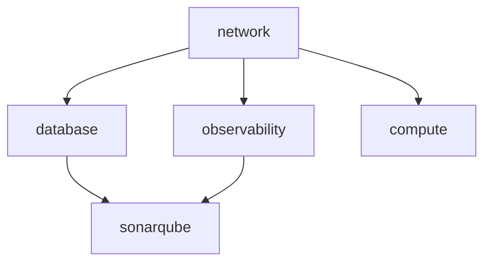
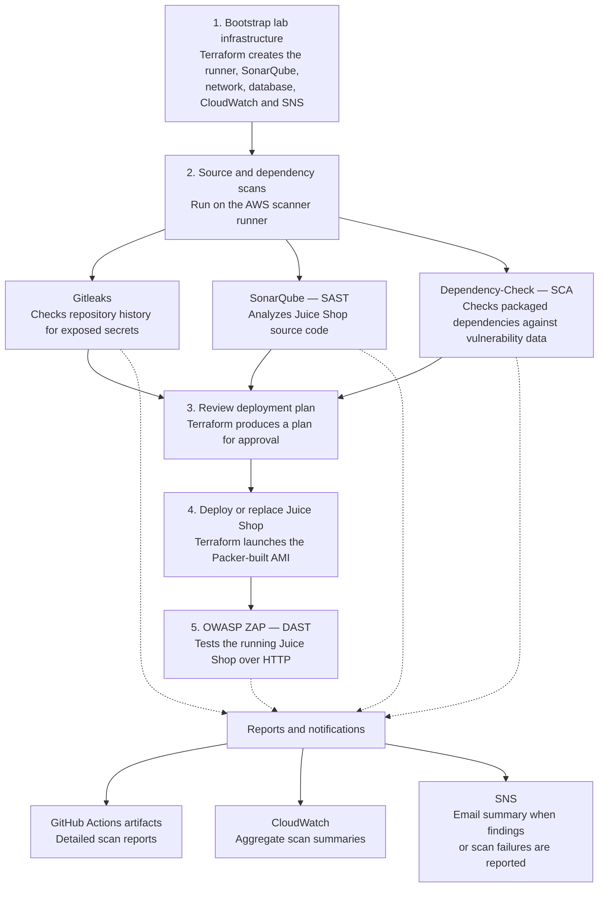

# Project 3 — Chronological command and configuration history

> Repository copy: AWS account/resource identifiers, internal host addresses, database endpoints and personal email addresses have been replaced with placeholders. I obtain their real values using the lookup commands shown before running the dependent command. These placeholders are not literal working AWS IDs.

I preserved the command blocks from the supplied conversation, including initial versions, diagnostics, file contents and failed attempts. This is the supporting record for [my walkthrough](walkthrough.md), not a single executable script. Repeated identical blocks appear once. Historical IDs and obsolete commands must be reviewed before reuse. Secret values are redacted; public signing-key fingerprints remain. Tool-call metadata and image encodings are excluded.


## WSL, authentication and software installation


<a id="command-54"></a>

### Command 54 — source line 2374


```powershell
aws configure list
aws sts get-caller-identity
```


<a id="command-55"></a>

### Command 55 — source line 2385


```bash
cd ~/projects
mkdir project-3-secure-cicd-pipeline
cd project-3-secure-cicd-pipeline
```


<a id="command-56"></a>

### Command 56 — source line 2393


```bash
mkdir -p ~/projects
cd ~/projects
mkdir project-3-secure-cicd-pipeline
cd project-3-secure-cicd-pipeline
```


<a id="command-354"></a>
<a id="command-57"></a>

### Command 57 — source line 2402


```bash
aws sts get-caller-identity
```


<a id="command-58"></a>

### Command 58 — source line 2412


```bash
history | grep -Ei 'recover|password|mds-devsecops-lab'
```


<a id="command-59"></a>

### Command 59 — source line 2418


```bash
python3 path/to/script.py --help
```


<a id="command-60"></a>

### Command 60 — source line 2474


```bash
aws --version
aws login --profile root-recovery
aws sts get-caller-identity --profile root-recovery --query Arn --output text
```


<a id="command-63"></a>
<a id="command-61"></a>

### Command 61 — source line 2528


```bash
aws sts get-caller-identity --profile root-recovery
```


<a id="command-62"></a>

### Command 62 — source line 2538


```bash
aws sts get-caller-identity --profile root-recovery --query Arn --output text
```


<a id="command-64"></a>

### Command 64 — source line 2562


```bash
aws --version
packer version
aws configure get region --profile root-recovery
```


<a id="command-65"></a>

### Command 65 — source line 2570


```bash
aws ec2 describe-regions --profile root-recovery --region us-east-1
```


<a id="command-66"></a>

### Command 66 — source line 2582


```bash
aws configure list-profiles
```


<a id="command-67"></a>

### Command 67 — source line 2588


```bash
aws sts get-caller-identity --profile <your-iam-user-profile>
```


<a id="command-68"></a>

### Command 68 — source line 2598


```bash
packer version
aws sts get-caller-identity
aws configure get region
```


<a id="command-69"></a>

### Command 69 — source line 2612


```bash
export AWS_PROFILE=mds-devsecops-lab
export AWS_REGION=us-east-1
export AWS_DEFAULT_REGION=us-east-1

aws sts get-caller-identity
packer version
```


<a id="command-70"></a>

### Command 70 — source line 2629


```bash
packer version
```


<a id="command-71"></a>

### Command 71 — source line 2648


```bash
sudo apt-get update
sudo apt-get install -y wget gpg lsb-release

wget -O- https://apt.releases.hashicorp.com/gpg \
  | sudo gpg --dearmor -o /usr/share/keyrings/hashicorp-archive-keyring.gpg

echo "deb [arch=$(dpkg --print-architecture) signed-by=/usr/share/keyrings/hashicorp-archive-keyring.gpg] https://apt.releases.hashicorp.com $(grep -oP '(?<=UBUNTU_CODENAME=).*' /etc/os-release || lsb_release -cs) main" \
  | sudo tee /etc/apt/sources.list.d/hashicorp.list

sudo apt-get update
sudo apt-get install -y packer
```


<a id="command-72"></a>

### Command 72 — source line 2664


```bash
packer version
aws sts get-caller-identity
```


<a id="command-73"></a>

### Command 73 — source line 2702


```bash
curl "https://s3.amazonaws.com/session-manager-downloads/plugin/latest/ubuntu_64bit/session-manager-plugin.deb" \
  -o session-manager-plugin.deb

sudo dpkg -i session-manager-plugin.deb
session-manager-plugin --version
```


<a id="command-74"></a>

### Command 74 — source line 2723


```bash
aws iam list-instance-profiles \
  --profile mds-devsecops-lab \
  --query 'InstanceProfiles[].{Profile:InstanceProfileName,Role:Roles[0].RoleName}' \
  --output table
```


<a id="command-75"></a>

### Command 75 — source line 2740


```bash
aws iam get-user --profile mds-devsecops-lab
```


## Builder IAM and GitHub checkout


<a id="command-85"></a>

### Command 85 — source line 2860


```bash
set -euo pipefail
umask 077

profile="mds-devsecops-lab"
role="project-3-packer-builder-role"
instance_profile="project-3-packer-builder-profile"
trust_file="$(mktemp)"
trap 'rm -f "$trust_file"' EXIT

aws sts get-caller-identity --profile "$profile" \
  --query Arn --output text

cat > "$trust_file" <<'JSON'
{
  "Version": "2012-10-17",
  "Statement": [
    {
      "Effect": "Allow",
      "Principal": {"Service": "ec2.amazonaws.com"},
      "Action": "sts:AssumeRole"
    }
  ]
}
JSON

aws iam create-role \
  --role-name "$role" \
  --assume-role-policy-document "file://$trust_file" \
  --description "SSM access for temporary Project 3 Packer builders" \
  --profile "$profile"

aws iam attach-role-policy \
  --role-name "$role" \
  --policy-arn arn:aws:iam::aws:policy/AmazonSSMManagedInstanceCore \
  --profile "$profile"

aws iam create-instance-profile \
  --instance-profile-name "$instance_profile" \
  --profile "$profile"

aws iam add-role-to-instance-profile \
  --instance-profile-name "$instance_profile" \
  --role-name "$role" \
  --profile "$profile"

aws iam get-instance-profile \
  --instance-profile-name "$instance_profile" \
  --profile "$profile" \
  --query 'InstanceProfile.Roles[].RoleName' \
  --output text
```


<a id="command-93"></a>

### Command 93 — source line 2998


```bash
aws iam list-attached-role-policies \
  --role-name project-3-packer-builder-role \
  --profile mds-devsecops-lab \
  --output table
```


<a id="command-94"></a>

### Command 94 — source line 3027


```bash
DEFAULT_VPC_ID=$(aws ec2 describe-vpcs \
  --region us-east-1 \
  --profile mds-devsecops-lab \
  --filters Name=isDefault,Values=true \
  --query 'Vpcs[0].VpcId' \
  --output text)

printf 'Default VPC: %s\n' "$DEFAULT_VPC_ID"

if [ "$DEFAULT_VPC_ID" != "None" ]; then
  aws ec2 describe-subnets \
    --region us-east-1 \
    --profile mds-devsecops-lab \
    --filters "Name=vpc-id,Values=$DEFAULT_VPC_ID" \
    --query 'Subnets[].{Subnet:SubnetId,AZ:AvailabilityZone,AutoPublicIP:MapPublicIpOnLaunch}' \
    --output table
fi
```


<a id="command-95"></a>

### Command 95 — source line 3058


```bash
aws ec2 describe-route-tables \
  --region us-east-1 \
  --profile mds-devsecops-lab \
  --filters Name=vpc-id,Values=vpc-REPLACE_WITH_YOUR_ID \
  --query 'RouteTables[].{RouteTable:RouteTableId,Main:Associations[?Main==`true`]|[0].Main,Subnets:Associations[].SubnetId,Routes:Routes[].{Destination:DestinationCidrBlock,Gateway:GatewayId,State:State}}' \
  --output json
```


<a id="command-96"></a>

### Command 96 — source line 3092


```bash
cd ~/projects/project-3-secure-cicd-pipeline
git status --short --branch
git remote -v
```


<a id="command-99"></a>
<a id="command-106"></a>
<a id="command-97"></a>

### Command 97 — source line 3109


```bash
cd ~/projects
git clone https://github.com/DelaneKay/project-3-secure-cicd-pipeline.git
cd project-3-secure-cicd-pipeline
git status --short --branch
```


<a id="command-100"></a>
<a id="command-104"></a>
<a id="command-98"></a>

### Command 98 — source line 3122


```bash
gh auth login
```


<a id="command-101"></a>

### Command 101 — source line 3193


```bash
curl -I --connect-timeout 10 https://api.github.com/
curl -I --connect-timeout 10 https://github.com/
```


<a id="command-102"></a>

### Command 102 — source line 3209


```powershell
wsl --shutdown
```


<a id="command-103"></a>

### Command 103 — source line 3215


```bash
curl -I --connect-timeout 10 https://api.github.com/
```


<a id="command-105"></a>

### Command 105 — source line 3236


```bash
gh auth status
```


<a id="command-107"></a>

### Command 107 — source line 3264


```bash
cd ~/projects
git clone https://github.com/DelaneKay/project-3-secure-cicd-pipeline.git
```


<a id="command-108"></a>

### Command 108 — source line 3278


```bash
cd ~/projects/project-3-secure-cicd-pipeline
ls -la
git status --short --branch
```


<a id="command-109"></a>

### Command 109 — source line 3293


```bash
mkdir -p ~/Downloads
mv ~/projects/project-3-secure-cicd-pipeline/session-manager-plugin.deb ~/Downloads/

cd ~/projects
git clone https://github.com/DelaneKay/project-3-secure-cicd-pipeline.git
```


<a id="command-486"></a>
<a id="command-110"></a>

### Command 110 — source line 3303


```bash
cd ~/projects/project-3-secure-cicd-pipeline
git status --short --branch
```


<a id="command-111"></a>

### Command 111 — source line 3338


```bash
cd ~/projects/project-3-secure-cicd-pipeline
ls -la
find . -maxdepth 2 -type f -not -path './.git/*' | sort
```


<a id="command-112"></a>

### Command 112 — source line 3353


```bash
git status --short --branch
cat docs/packer-builder-iam-bootstrap.md
```


<a id="command-115"></a>

### Command 115 — source line 3478


```bash
aws sts get-caller-identity \
  --profile mds-devsecops-lab \
  --query Arn --output text

aws iam get-instance-profile \
  --instance-profile-name project-3-packer-builder-profile \
  --profile mds-devsecops-lab \
  --region us-east-1 \
  --query 'InstanceProfile.Roles[].RoleName' \
  --output text

packer version
session-manager-plugin --version
```


## Ubuntu and Juice Shop Packer build


<a id="command-116"></a>

### Command 116 — source line 3514


```bash
aws ssm get-parameter \
  --name /aws/service/ami-amazon-linux-latest/al2023-ami-kernel-default-x86_64 \
  --query 'Parameter.Value' \
  --output text \
  --profile mds-devsecops-lab \
  --region us-east-1
```


<a id="command-117"></a>

### Command 117 — source line 3544


```bash
aws ssm get-parameter \
  --name /aws/service/canonical/ubuntu/server/24.04/stable/current/amd64/hvm/ebs-gp3/ami-id \
  --query 'Parameter.Value' \
  --output text \
  --profile mds-devsecops-lab \
  --region us-east-1
```


<a id="command-118"></a>

### Command 118 — source line 3572


```bash
aws ec2 describe-images \
  --image-ids ami-REPLACE_WITH_YOUR_ID \
  --query 'Images[0].[Name,Architecture,OwnerId,State]' \
  --output table \
  --profile mds-devsecops-lab \
  --region us-east-1
```


<a id="command-119"></a>

### Command 119 — source line 3592


```bash
cd ~/projects/project-3-secure-cicd-pipeline
mkdir -p packer/juice-shop/scripts
```


<a id="command-120"></a>

### Command 120 — source line 3599


```bash
find packer -maxdepth 3 -type d | sort
```


<a id="command-121"></a>

### Command 121 — source line 3612


```bash
aws ec2 describe-security-groups \
  --filters Name=vpc-id,Values=vpc-REPLACE_WITH_YOUR_ID Name=group-name,Values=default \
  --query 'SecurityGroups[0].{GroupId:GroupId,Ingress:IpPermissions,Egress:IpPermissionsEgress}' \
  --output json \
  --profile mds-devsecops-lab \
  --region us-east-1
```


<a id="command-122"></a>

### Command 122 — source line 3627


```bash
cd ~/projects/project-3-secure-cicd-pipeline

find packer -maxdepth 3 -type d | sort

aws ec2 describe-security-groups \
  --filters Name=vpc-id,Values=vpc-REPLACE_WITH_YOUR_ID Name=group-name,Values=default \
  --query 'SecurityGroups[0].{GroupId:GroupId,Ingress:IpPermissions,Egress:IpPermissionsEgress}' \
  --output json \
  --profile mds-devsecops-lab \
  --region us-east-1
```


<a id="command-123"></a>

### Command 123 — source line 3657


```bash
aws ec2 describe-security-groups \
  --filters Name=vpc-id,Values=vpc-REPLACE_WITH_YOUR_ID Name=group-name,Values=default \
  --query 'SecurityGroups[0].GroupId' \
  --output text \
  --profile mds-devsecops-lab \
  --region us-east-1
```


<a id="command-124"></a>

### Command 124 — source line 3725


```bash
cat > packer/juice-shop/juice-shop.pkr.hcl <<'EOF'
packer {
  required_plugins {
    amazon = {
      source  = "github.com/hashicorp/amazon"
      version = ">= 1.8.3, < 1.9.0"
    }
  }
}

variable "aws_region" {
  type    = string
  default = "us-east-1"
}

variable "source_ami_id" {
  type = string
}

variable "subnet_id" {
  type = string
}

variable "security_group_id" {
  type = string
}

variable "builder_instance_profile" {
  type    = string
  default = "project-3-packer-builder-profile"
}

variable "builder_instance_type" {
  type    = string
  default = "t3.small"
}

source "amazon-ebs" "juice_shop" {
  region                      = var.aws_region
  source_ami                  = var.source_ami_id
  instance_type               = var.builder_instance_type
  subnet_id                   = var.subnet_id
  security_group_id           = var.security_group_id
  associate_public_ip_address = true

  iam_instance_profile = var.builder_instance_profile
  communicator         = "ssh"
  ssh_interface        = "session_manager"
  ssh_username         = "ubuntu"
  ssh_timeout          = "30m"

  ami_name        = "project-3-juice-shop-ubuntu-24-04-{{timestamp}}"
  ami_description = "Hardened Ubuntu 24.04 AMI with OWASP Juice Shop for Project 3"

  metadata_options {
    http_endpoint = "enabled"
    http_tokens   = "required"
  }

  run_tags = {
    Project = "project-3-secure-cicd-pipeline"
    Purpose = "temporary-packer-builder"
  }

  tags = {
    Project = "project-3-secure-cicd-pipeline"
    Image   = "juice-shop"
    OS      = "ubuntu-24.04"
  }
}

build {
  name    = "juice-shop-ami"
  sources = ["source.amazon-ebs.juice_shop"]

  provisioner "shell" {
    script          = "${path.root}/scripts/install-juice-shop.sh"
    execute_command = "sudo -E bash '{{ .Path }}'"
  }
}
EOF
```


<a id="command-126"></a>
<a id="command-125"></a>

### Command 125 — source line 3811


```bash
packer init packer/juice-shop
```


<a id="command-127"></a>

### Command 127 — source line 3857


```bash
cat > packer/juice-shop/scripts/install-juice-shop.sh <<'EOF'
#!/usr/bin/env bash
set -euo pipefail

export DEBIAN_FRONTEND=noninteractive

apt-get update
apt-get -y full-upgrade
apt-get -y install ca-certificates curl xz-utils

work_dir="$(mktemp -d)"
trap 'rm -rf "$work_dir"' EXIT

# Install a pinned Node.js 22 release and verify it against Node.js checksums.
node_version="22.23.4"
node_archive="node-v${node_version}-linux-x64.tar.xz"
node_url="https://nodejs.org/dist/v${node_version}"

curl -fsSLo "$work_dir/$node_archive" "$node_url/$node_archive"
curl -fsSLo "$work_dir/SHASUMS256.txt" "$node_url/SHASUMS256.txt"
grep -F "  $node_archive" "$work_dir/SHASUMS256.txt" > "$work_dir/node.sha256"
(
  cd "$work_dir"
  sha256sum --check --strict node.sha256
)

install -d -m 0755 "/opt/node-v${node_version}"
tar -xJf "$work_dir/$node_archive" \
  --strip-components=1 \
  -C "/opt/node-v${node_version}"

# Download and verify the pinned OWASP Juice Shop release.
juice_version="20.3.0"
juice_archive="juice-shop-${juice_version}_node22_linux_x64.tgz"
juice_sha256="6148dcce8fe7d990a86bf8457a0e9a07821c127d498c76da1a3bc7dba12a77e5"
juice_url="https://github.com/juice-shop/juice-shop/releases/download/v${juice_version}/${juice_archive}"

curl -fsSLo "$work_dir/$juice_archive" "$juice_url"
printf '%s  %s\n' "$juice_sha256" "$work_dir/$juice_archive" \
  | sha256sum --check --strict

mkdir -p "$work_dir/juice-unpacked"
tar -xzf "$work_dir/$juice_archive" -C "$work_dir/juice-unpacked"

package_json="$(find "$work_dir/juice-unpacked" -maxdepth 3 \
  -type f -name package.json -print -quit)"
if [[ -z "$package_json" ]]; then
  echo "Could not find Juice Shop package.json in the release archive." >&2
  exit 1
fi

app_source="$(dirname "$package_json")"
install -d -m 0755 /opt/juice-shop
cp -a "$app_source/." /opt/juice-shop/

if ! id juiceshop >/dev/null 2>&1; then
  useradd --system \
    --home-dir /opt/juice-shop \
    --shell /usr/sbin/nologin \
    --user-group juiceshop
fi

chown -R juiceshop:juiceshop /opt/juice-shop
install -d -o juiceshop -g juiceshop -m 0750 /var/log/juice-shop
touch /var/log/juice-shop/app.log
chown juiceshop:juiceshop /var/log/juice-shop/app.log
chmod 0640 /var/log/juice-shop/app.log

# Run the intentionally vulnerable application as a dedicated non-root user.
cat > /etc/systemd/system/juice-shop.service <<'UNIT'
[Unit]
Description=OWASP Juice Shop
After=network-online.target
Wants=network-online.target

[Service]
Type=simple
User=juiceshop
Group=juiceshop
WorkingDirectory=/opt/juice-shop
Environment=PATH=/opt/node-v22.23.4/bin:/usr/local/sbin:/usr/local/bin:/usr/sbin:/usr/bin:/sbin:/bin
Environment=PORT=3000
ExecStart=/opt/node-v22.23.4/bin/npm start
Restart=on-failure
RestartSec=5
NoNewPrivileges=true
PrivateTmp=true
ProtectSystem=full
ProtectHome=true
StandardOutput=append:/var/log/juice-shop/app.log
StandardError=append:/var/log/juice-shop/app.log

[Install]
WantedBy=multi-user.target
UNIT

systemctl daemon-reload
systemctl enable juice-shop.service

# Keep SSM available after launch; the Ubuntu AWS AMI includes its agent.
if systemctl cat amazon-ssm-agent.service >/dev/null 2>&1; then
  systemctl enable amazon-ssm-agent.service
elif command -v snap >/dev/null 2>&1 \
  && snap list amazon-ssm-agent >/dev/null 2>&1; then
  snap enable amazon-ssm-agent
else
  echo "SSM Agent was not found on the Ubuntu base image." >&2
  exit 1
fi

# Install and configure the CloudWatch Agent. Terraform will create these log groups.
curl -fsSLo "$work_dir/amazon-cloudwatch-agent.deb" \
  https://amazoncloudwatch-agent.s3.amazonaws.com/ubuntu/amd64/latest/amazon-cloudwatch-agent.deb
dpkg -i "$work_dir/amazon-cloudwatch-agent.deb"

cat > /opt/aws/amazon-cloudwatch-agent/etc/amazon-cloudwatch-agent.json <<'CWCONFIG'
{
  "agent": {
    "run_as_user": "root",
    "metrics_collection_interval": 60
  },
  "logs": {
    "logs_collected": {
      "files": {
        "collect_list": [
          {
            "file_path": "/var/log/syslog",
            "log_group_name": "/project-3/juice-shop/syslog",
            "log_stream_name": "{instance_id}"
          },
          {
            "file_path": "/var/log/auth.log",
            "log_group_name": "/project-3/juice-shop/auth",
            "log_stream_name": "{instance_id}"
          },
          {
            "file_path": "/var/log/juice-shop/app.log",
            "log_group_name": "/project-3/juice-shop/app",
            "log_stream_name": "{instance_id}"
          }
        ]
      }
    }
  },
  "metrics": {
    "namespace": "Project3/JuiceShop",
    "metrics_collected": {
      "mem": {
        "measurement": ["mem_used_percent"],
        "metrics_collection_interval": 60
      },
      "disk": {
        "measurement": ["used_percent"],
        "resources": ["/"],
        "metrics_collection_interval": 60
      }
    }
  }
}
CWCONFIG

chmod 0640 /opt/aws/amazon-cloudwatch-agent/etc/amazon-cloudwatch-agent.json
systemctl enable amazon-cloudwatch-agent.service

# SSH is needed only during Packer's SSM-tunneled build; do not start it on deployed hosts.
systemctl disable ssh.service 2>/dev/null || true
systemctl disable ssh.socket 2>/dev/null || true

apt-get clean
rm -rf /var/lib/apt/lists/*
EOF
```


<a id="command-128"></a>

### Command 128 — source line 4039


```bash
ufw default deny incoming
ufw default allow outgoing
ufw allow 3000/tcp comment 'Juice Shop; AWS security group restricts sources'
ufw --force enable
```


<a id="command-129"></a>

### Command 129 — source line 4054


```bash
cat > packer/juice-shop/scripts/install-juice-shop.sh <<'EOF'
#!/usr/bin/env bash
set -euo pipefail

export DEBIAN_FRONTEND=noninteractive

apt-get update
apt-get -y full-upgrade
apt-get -y install ca-certificates curl xz-utils ufw

work_dir="$(mktemp -d)"
trap 'rm -rf "$work_dir"' EXIT

# Install pinned Node.js 22 and verify it against Node.js's published checksums.
node_version="22.23.4"
node_archive="node-v${node_version}-linux-x64.tar.xz"
node_url="https://nodejs.org/dist/v${node_version}"

curl -fsSLo "$work_dir/$node_archive" "$node_url/$node_archive"
curl -fsSLo "$work_dir/SHASUMS256.txt" "$node_url/SHASUMS256.txt"
grep -F "  $node_archive" "$work_dir/SHASUMS256.txt" > "$work_dir/node.sha256"

(
  cd "$work_dir"
  sha256sum --check --strict node.sha256
)

install -d -m 0755 "/opt/node-v${node_version}"
tar -xJf "$work_dir/$node_archive" \
  --strip-components=1 \
  -C "/opt/node-v${node_version}"

# Download and verify the pinned OWASP Juice Shop release.
juice_version="20.3.0"
juice_archive="juice-shop-${juice_version}_node22_linux_x64.tgz"
juice_sha256="6148dcce8fe7d990a86bf8457a0e9a07821c127d498c76da1a3bc7dba12a77e5"
juice_url="https://github.com/juice-shop/juice-shop/releases/download/v${juice_version}/${juice_archive}"

curl -fsSLo "$work_dir/$juice_archive" "$juice_url"
printf '%s  %s\n' "$juice_sha256" "$work_dir/$juice_archive" \
  | sha256sum --check --strict

mkdir -p "$work_dir/juice-unpacked"
tar -xzf "$work_dir/$juice_archive" -C "$work_dir/juice-unpacked"

package_json="$(find "$work_dir/juice-unpacked" -maxdepth 3 \
  -type f -name package.json -print -quit)"

if [[ -z "$package_json" ]]; then
  echo "Could not find Juice Shop package.json in the release archive." >&2
  exit 1
fi

app_source="$(dirname "$package_json")"
install -d -m 0755 /opt/juice-shop
cp -a "$app_source/." /opt/juice-shop/

if ! id juiceshop >/dev/null 2>&1; then
  useradd --system \
    --home-dir /opt/juice-shop \
    --shell /usr/sbin/nologin \
    --user-group juiceshop
fi

chown -R juiceshop:juiceshop /opt/juice-shop

install -d -o juiceshop -g juiceshop -m 0750 /var/log/juice-shop
touch /var/log/juice-shop/app.log
chown juiceshop:juiceshop /var/log/juice-shop/app.log
chmod 0640 /var/log/juice-shop/app.log

# Run the intentionally vulnerable application as a dedicated non-root user.
cat > /etc/systemd/system/juice-shop.service <<'UNIT'
[Unit]
Description=OWASP Juice Shop
After=network-online.target
Wants=network-online.target

[Service]
Type=simple
User=juiceshop
Group=juiceshop
WorkingDirectory=/opt/juice-shop
Environment=PATH=/opt/node-v22.23.4/bin:/usr/local/sbin:/usr/local/bin:/usr/sbin:/usr/bin:/sbin:/bin
Environment=PORT=3000
ExecStart=/opt/node-v22.23.4/bin/npm start
Restart=on-failure
RestartSec=5
NoNewPrivileges=true
PrivateTmp=true
ProtectSystem=full
ProtectHome=true
StandardOutput=append:/var/log/juice-shop/app.log
StandardError=append:/var/log/juice-shop/app.log

[Install]
WantedBy=multi-user.target
UNIT

systemctl daemon-reload
systemctl enable juice-shop.service

# Keep SSM enabled for administration after the instance launches.
if systemctl cat amazon-ssm-agent.service >/dev/null 2>&1; then
  systemctl enable amazon-ssm-agent.service
elif command -v snap >/dev/null 2>&1 \
  && snap list amazon-ssm-agent >/dev/null 2>&1; then
  snap enable amazon-ssm-agent
else
  echo "SSM Agent was not found on the Ubuntu base image." >&2
  exit 1
fi

# Install and configure CloudWatch Agent.
# Terraform will create these log groups before deploying the instance.
curl -fsSLo "$work_dir/amazon-cloudwatch-agent.deb" \
  https://amazoncloudwatch-agent.s3.amazonaws.com/ubuntu/amd64/latest/amazon-cloudwatch-agent.deb
dpkg -i "$work_dir/amazon-cloudwatch-agent.deb"

cat > /opt/aws/amazon-cloudwatch-agent/etc/amazon-cloudwatch-agent.json <<'CWCONFIG'
{
  "agent": {
    "run_as_user": "root",
    "metrics_collection_interval": 60
  },
  "logs": {
    "logs_collected": {
      "files": {
        "collect_list": [
          {
            "file_path": "/var/log/syslog",
            "log_group_name": "/project-3/juice-shop/syslog",
            "log_stream_name": "{instance_id}"
          },
          {
            "file_path": "/var/log/auth.log",
            "log_group_name": "/project-3/juice-shop/auth",
            "log_stream_name": "{instance_id}"
          },
          {
            "file_path": "/var/log/juice-shop/app.log",
            "log_group_name": "/project-3/juice-shop/app",
            "log_stream_name": "{instance_id}"
          }
        ]
      }
    }
  },
  "metrics": {
    "namespace": "Project3/JuiceShop",
    "metrics_collected": {
      "mem": {
        "measurement": ["mem_used_percent"],
        "metrics_collection_interval": 60
      },
      "disk": {
        "measurement": ["used_percent"],
        "resources": ["/"],
        "metrics_collection_interval": 60
      }
    }
  }
}
CWCONFIG

chmod 0640 /opt/aws/amazon-cloudwatch-agent/etc/amazon-cloudwatch-agent.json
systemctl enable amazon-cloudwatch-agent.service

# SSH is used only by Packer's SSH communicator through its SSM tunnel.
# Do not start SSH on the deployed Juice Shop host.
systemctl disable ssh.service 2>/dev/null || true
systemctl disable ssh.socket 2>/dev/null || true

# Host firewall: allow local loopback and the app port only.
# AWS security groups remain responsible for restricting port 3000 sources.
ufw default deny incoming
ufw default allow outgoing
ufw allow in on lo
ufw allow 3000/tcp comment 'Juice Shop; source access restricted by AWS security group'
ufw --force enable

apt-get clean
rm -rf /var/lib/apt/lists/*
EOF
```


<a id="command-130"></a>

### Command 130 — source line 4251


```bash
aws ec2 create-security-group \
  --group-name project-3-packer-builder \
  --description "Temporary no-ingress security group for SSM-connected Packer builds" \
  --vpc-id vpc-REPLACE_WITH_YOUR_ID \
  --tag-specifications 'ResourceType=security-group,Tags=[{Key=Project,Value=project-3-secure-cicd-pipeline},{Key=Purpose,Value=packer-builder}]' \
  --query GroupId \
  --output text \
  --profile mds-devsecops-lab \
  --region us-east-1
```


<a id="command-131"></a>

### Command 131 — source line 4265


```bash
grep -q 'ssh_clear_authorized_keys' packer/juice-shop/juice-shop.pkr.hcl ||
  sed -i '/ssh_timeout[[:space:]]*=/a\  ssh_clear_authorized_keys = true' \
    packer/juice-shop/juice-shop.pkr.hcl
```


<a id="command-132"></a>

### Command 132 — source line 4308


```bash
set -euo pipefail

PACKER_SG_ID="$(aws ec2 create-security-group \
  --group-name project-3-packer-builder \
  --description "Temporary no-ingress security group for SSM-connected Packer builds" \
  --vpc-id vpc-REPLACE_WITH_YOUR_ID \
  --tag-specifications 'ResourceType=security-group,Tags=[{Key=Project,Value=project-3-secure-cicd-pipeline},{Key=Purpose,Value=packer-builder}]' \
  --query GroupId \
  --output text \
  --profile mds-devsecops-lab \
  --region us-east-1)"

printf 'Created Packer builder security group: %s\n' "$PACKER_SG_ID"

aws ec2 revoke-security-group-egress \
  --group-id "$PACKER_SG_ID" \
  --ip-permissions '[{"IpProtocol":"-1","IpRanges":[{"CidrIp":"0.0.0.0/0"}]}]' \
  --profile mds-devsecops-lab \
  --region us-east-1

aws ec2 authorize-security-group-egress \
  --group-id "$PACKER_SG_ID" \
  --ip-permissions '[{"IpProtocol":"tcp","FromPort":80,"ToPort":80,"IpRanges":[{"CidrIp":"0.0.0.0/0","Description":"HTTP package mirrors during Packer build"}]},{"IpProtocol":"tcp","FromPort":443,"ToPort":443,"IpRanges":[{"CidrIp":"0.0.0.0/0","Description":"HTTPS for SSM and build downloads"}]}]' \
  --profile mds-devsecops-lab \
  --region us-east-1

aws ec2 describe-security-groups \
  --group-ids "$PACKER_SG_ID" \
  --query 'SecurityGroups[0].{GroupId:GroupId,Ingress:IpPermissions,Egress:IpPermissionsEgress}' \
  --output json \
  --profile mds-devsecops-lab \
  --region us-east-1
```


<a id="command-133"></a>

### Command 133 — source line 4349


```bash
printf 'Packer security group: %s\n' "$PACKER_SG_ID"
```


<a id="command-134"></a>

### Command 134 — source line 4355


```bash
aws ec2 describe-security-groups \
  --filters Name=vpc-id,Values=vpc-REPLACE_WITH_YOUR_ID Name=group-name,Values=project-3-packer-builder \
  --query 'SecurityGroups[].{GroupId:GroupId,Ingress:IpPermissions,Egress:IpPermissionsEgress}' \
  --output json \
  --profile mds-devsecops-lab \
  --region us-east-1
```


<a id="command-135"></a>

### Command 135 — source line 4412


```bash
cd ~/projects/project-3-secure-cicd-pipeline

if ! grep -q 'ssh_clear_authorized_keys' packer/juice-shop/juice-shop.pkr.hcl; then
  sed -i '/ssh_timeout[[:space:]]*=/a\  ssh_clear_authorized_keys = true' \
    packer/juice-shop/juice-shop.pkr.hcl
fi

packer fmt packer/juice-shop

packer validate \
  -var 'source_ami_id=ami-REPLACE_WITH_YOUR_ID' \
  -var 'subnet_id=subnet-REPLACE_WITH_YOUR_ID' \
  -var 'security_group_id=sg-REPLACE_WITH_YOUR_ID' \
  packer/juice-shop
```


<a id="command-139"></a>
<a id="command-136"></a>

### Command 136 — source line 4437


```bash
cd ~/projects/project-3-secure-cicd-pipeline

AWS_PROFILE=mds-devsecops-lab AWS_REGION=us-east-1 \
packer build \
  -var 'source_ami_id=ami-REPLACE_WITH_YOUR_ID' \
  -var 'subnet_id=subnet-REPLACE_WITH_YOUR_ID' \
  -var 'security_group_id=sg-REPLACE_WITH_YOUR_ID' \
  packer/juice-shop
```


<a id="command-137"></a>

### Command 137 — source line 4459


```bash
exit
```


<a id="command-185"></a>
<a id="command-138"></a>

### Command 138 — source line 4465


```bash
whoami
aws sts get-caller-identity \
  --profile mds-devsecops-lab \
  --region us-east-1 \
  --query Arn \
  --output text
```


<a id="command-140"></a>

### Command 140 — source line 4513


```bash
aws configure set credential_process \
  'aws configure export-credentials --profile mds-devsecops-lab --format process' \
  --profile mds-devsecops-lab-packer

aws configure set region us-east-1 \
  --profile mds-devsecops-lab-packer
```


<a id="command-141"></a>

### Command 141 — source line 4524


```bash
aws sts get-caller-identity \
  --profile mds-devsecops-lab-packer \
  --region us-east-1 \
  --query Arn \
  --output text
```


## Role-based Packer credentials


<a id="command-201"></a>
<a id="command-233"></a>
<a id="command-181"></a>

### Command 181 — source line 4854


```bash
cd ~/projects/project-3-secure-cicd-pipeline
git pull --ff-only origin master
```


<a id="command-182"></a>

### Command 182 — source line 4872


```bash
aws sts get-caller-identity \
  --profile mds-devsecops-lab \
  --region us-east-1 \
  --query '{Account:Account,Arn:Arn}' \
  --output json
```


<a id="command-183"></a>

### Command 183 — source line 4888


```bash
set -euo pipefail
umask 077

profile="mds-devsecops-lab"
user_name="mds-devsecops-lab"
operator_role="project-3-packer-operator-role"
trust_file="$(mktemp)"
assume_policy_file="$(mktemp)"
trap 'rm -f "$trust_file" "$assume_policy_file"' EXIT

account_id="$(aws sts get-caller-identity \
  --profile "$profile" \
  --region us-east-1 \
  --query Account --output text)"
caller_arn="$(aws sts get-caller-identity \
  --profile "$profile" \
  --region us-east-1 \
  --query Arn --output text)"

if [[ "$caller_arn" != "arn:aws:iam::${account_id}:user/${user_name}" ]]; then
  echo "Unexpected AWS identity: $caller_arn"
  exit 1
fi

cat > "$trust_file" <<JSON
{
  "Version": "2012-10-17",
  "Statement": [
    {
      "Effect": "Allow",
      "Principal": {
        "AWS": "arn:aws:iam::${account_id}:user/${user_name}"
      },
      "Action": "sts:AssumeRole"
    }
  ]
}
JSON

cat > "$assume_policy_file" <<JSON
{
  "Version": "2012-10-17",
  "Statement": [
    {
      "Effect": "Allow",
      "Action": "sts:AssumeRole",
      "Resource": "arn:aws:iam::${account_id}:role/${operator_role}"
    }
  ]
}
JSON

aws iam create-role \
  --role-name "$operator_role" \
  --assume-role-policy-document "file://$trust_file" \
  --description "Packer operator role for Project 3 AMI builds" \
  --max-session-duration 3600 \
  --profile "$profile"

aws iam put-user-policy \
  --user-name "$user_name" \
  --policy-name project-3-assume-packer-operator \
  --policy-document "file://$assume_policy_file" \
  --profile "$profile"

aws iam get-role \
  --role-name "$operator_role" \
  --profile "$profile" \
  --query 'Role.Arn' \
  --output text
```


<a id="command-184"></a>

### Command 184 — source line 4969


```bash
set -euo pipefail
umask 077

profile="mds-devsecops-lab"
operator_role="project-3-packer-operator-role"
builder_role="project-3-packer-builder-role"
builder_profile="project-3-packer-builder-profile"
policy_name="project-3-packer-operator-policy"
policy_file="$(mktemp)"
trap 'rm -f "$policy_file"' EXIT

account_id="$(aws sts get-caller-identity \
  --profile "$profile" \
  --region us-east-1 \
  --query Account --output text)"

cat > "$policy_file" <<JSON
{
  "Version": "2012-10-17",
  "Statement": [
    {
      "Sid": "PackerEc2ImageBuildInUsEast1",
      "Effect": "Allow",
      "Action": [
        "ec2:AttachVolume",
        "ec2:CopyImage",
        "ec2:CreateImage",
        "ec2:CreateKeyPair",
        "ec2:CreateSnapshot",
        "ec2:CreateTags",
        "ec2:CreateVolume",
        "ec2:DeleteKeyPair",
        "ec2:DeleteSnapshot",
        "ec2:DeleteVolume",
        "ec2:DeregisterImage",
        "ec2:DescribeImageAttribute",
        "ec2:DescribeImages",
        "ec2:DescribeInstances",
        "ec2:DescribeInstanceStatus",
        "ec2:DescribeRegions",
        "ec2:DescribeSecurityGroups",
        "ec2:DescribeSnapshots",
        "ec2:DescribeSubnets",
        "ec2:DescribeTags",
        "ec2:DescribeVolumes",
        "ec2:DetachVolume",
        "ec2:ModifyImageAttribute",
        "ec2:ModifyInstanceAttribute",
        "ec2:RegisterImage",
        "ec2:RunInstances",
        "ec2:StopInstances",
        "ec2:TerminateInstances"
      ],
      "Resource": "*",
      "Condition": {
        "StringEquals": {
          "aws:RequestedRegion": "us-east-1"
        }
      }
    },
    {
      "Sid": "PackerSsmTunnelInUsEast1",
      "Effect": "Allow",
      "Action": [
        "ssm:StartSession",
        "ssm:TerminateSession",
        "ssm:ResumeSession"
      ],
      "Resource": "*",
      "Condition": {
        "StringEquals": {
          "aws:RequestedRegion": "us-east-1"
        }
      }
    },
    {
      "Sid": "InspectOnlyPackerBuilderRole",
      "Effect": "Allow",
      "Action": [
        "iam:GetInstanceProfile",
        "iam:GetRole"
      ],
      "Resource": [
        "arn:aws:iam::\${account_id}:instance-profile/\${builder_profile}",
        "arn:aws:iam::\${account_id}:role/\${builder_role}"
      ]
    },
    {
      "Sid": "PassOnlyPackerBuilderRoleToEc2",
      "Effect": "Allow",
      "Action": "iam:PassRole",
      "Resource": "arn:aws:iam::\${account_id}:role/\${builder_role}",
      "Condition": {
        "StringEquals": {
          "iam:PassedToService": "ec2.amazonaws.com"
        }
      }
    }
  ]
}
JSON

aws iam put-role-policy \
  --role-name "$operator_role" \
  --policy-name "$policy_name" \
  --policy-document "file://$policy_file" \
  --profile "$profile"

aws iam get-role-policy \
  --role-name "$operator_role" \
  --policy-name "$policy_name" \
  --profile "$profile" \
  --query '[RoleName,PolicyName]' \
  --output text
```


<a id="command-186"></a>

### Command 186 — source line 5139


```bash
set -euo pipefail
umask 077

profile="mds-devsecops-lab"
operator_role="project-3-packer-operator-role"
builder_role="project-3-packer-builder-role"
builder_profile="project-3-packer-builder-profile"
policy_name="project-3-packer-operator-policy"
policy_file="$(mktemp)"
trap 'rm -f "$policy_file"' EXIT

account_id="$(aws sts get-caller-identity \
  --profile "$profile" \
  --region us-east-1 \
  --query Account \
  --output text)"

cat > "$policy_file" <<JSON
{
  "Version": "2012-10-17",
  "Statement": [
    {
      "Sid": "PackerEc2ImageBuildInUsEast1",
      "Effect": "Allow",
      "Action": [
        "ec2:AttachVolume",
        "ec2:CopyImage",
        "ec2:CreateImage",
        "ec2:CreateKeyPair",
        "ec2:CreateSnapshot",
        "ec2:CreateTags",
        "ec2:CreateVolume",
        "ec2:DeleteKeyPair",
        "ec2:DeleteSnapshot",
        "ec2:DeleteVolume",
        "ec2:DeregisterImage",
        "ec2:DescribeImageAttribute",
        "ec2:DescribeImages",
        "ec2:DescribeInstances",
        "ec2:DescribeInstanceStatus",
        "ec2:DescribeRegions",
        "ec2:DescribeSecurityGroups",
        "ec2:DescribeSubnets",
        "ec2:DescribeSnapshots",
        "ec2:DescribeTags",
        "ec2:DescribeVolumes",
        "ec2:DetachVolume",
        "ec2:ModifyImageAttribute",
        "ec2:ModifyInstanceAttribute",
        "ec2:RegisterImage",
        "ec2:RunInstances",
        "ec2:StopInstances",
        "ec2:TerminateInstances"
      ],
      "Resource": "*",
      "Condition": {
        "StringEquals": {
          "aws:RequestedRegion": "us-east-1"
        }
      }
    },
    {
      "Sid": "PackerSsmTunnelInUsEast1",
      "Effect": "Allow",
      "Action": [
        "ssm:StartSession",
        "ssm:TerminateSession",
        "ssm:ResumeSession"
      ],
      "Resource": "*",
      "Condition": {
        "StringEquals": {
          "aws:RequestedRegion": "us-east-1"
        }
      }
    },
    {
      "Sid": "InspectOnlyPackerBuilderRole",
      "Effect": "Allow",
      "Action": [
        "iam:GetInstanceProfile",
        "iam:GetRole"
      ],
      "Resource": [
        "arn:aws:iam::\${account_id}:instance-profile/\${builder_profile}",
        "arn:aws:iam::\${account_id}:role/\${builder_role}"
      ]
    },
    {
      "Sid": "PassOnlyPackerBuilderRoleToEc2",
      "Effect": "Allow",
      "Action": "iam:PassRole",
      "Resource": "arn:aws:iam::\${account_id}:role/\${builder_role}",
      "Condition": {
        "StringEquals": {
          "iam:PassedToService": "ec2.amazonaws.com"
        }
      }
    }
  ]
}
JSON

python3 -m json.tool "$policy_file" >/dev/null
```


<a id="command-187"></a>

### Command 187 — source line 5252


```bash
aws sts get-caller-identity \
  --profile mds-devsecops-lab \
  --region us-east-1 \
  --query Account \
  --output text
```


<a id="command-188"></a>

### Command 188 — source line 5270


```bash
set -euo pipefail
umask 077

policy_file="$(mktemp)"
trap 'rm -f "$policy_file"' EXIT

cat > "$policy_file" <<'JSON'
{
  "Version": "2012-10-17",
  "Statement": [
    {
      "Sid": "PackerEc2ImageBuildInUsEast1",
      "Effect": "Allow",
      "Action": [
        "ec2:AttachVolume",
        "ec2:CopyImage",
        "ec2:CreateImage",
        "ec2:CreateKeyPair",
        "ec2:CreateSnapshot",
        "ec2:CreateTags",
        "ec2:CreateVolume",
        "ec2:DeleteKeyPair",
        "ec2:DeleteSnapshot",
        "ec2:DeleteVolume",
        "ec2:DeregisterImage",
        "ec2:DescribeImageAttribute",
        "ec2:DescribeImages",
        "ec2:DescribeInstances",
        "ec2:DescribeInstanceStatus",
        "ec2:DescribeRegions",
        "ec2:DescribeSecurityGroups",
        "ec2:DescribeSubnets",
        "ec2:DescribeSnapshots",
        "ec2:DescribeTags",
        "ec2:DescribeVolumes",
        "ec2:DetachVolume",
        "ec2:ModifyImageAttribute",
        "ec2:ModifyInstanceAttribute",
        "ec2:RegisterImage",
        "ec2:RunInstances",
        "ec2:StopInstances",
        "ec2:TerminateInstances"
      ],
      "Resource": "*",
      "Condition": {
        "StringEquals": {
          "aws:RequestedRegion": "us-east-1"
        }
      }
    },
    {
      "Sid": "PackerSsmTunnelInUsEast1",
      "Effect": "Allow",
      "Action": [
        "ssm:StartSession",
        "ssm:TerminateSession",
        "ssm:ResumeSession"
      ],
      "Resource": "*",
      "Condition": {
        "StringEquals": {
          "aws:RequestedRegion": "us-east-1"
        }
      }
    },
    {
      "Sid": "InspectOnlyPackerBuilderRole",
      "Effect": "Allow",
      "Action": [
        "iam:GetInstanceProfile",
        "iam:GetRole"
      ],
      "Resource": [
        "arn:aws:iam::YOUR_ACCOUNT_ID:instance-profile/project-3-packer-builder-profile",
        "arn:aws:iam::YOUR_ACCOUNT_ID:role/project-3-packer-builder-role"
      ]
    },
    {
      "Sid": "PassOnlyPackerBuilderRoleToEc2",
      "Effect": "Allow",
      "Action": "iam:PassRole",
      "Resource": "arn:aws:iam::YOUR_ACCOUNT_ID:role/project-3-packer-builder-role",
      "Condition": {
        "StringEquals": {
          "iam:PassedToService": "ec2.amazonaws.com"
        }
      }
    }
  ]
}
JSON

python3 -m json.tool "$policy_file" >/dev/null

aws iam put-role-policy \
  --role-name project-3-packer-operator-role \
  --policy-name project-3-packer-operator-policy \
  --policy-document "file://$policy_file" \
  --profile mds-devsecops-lab

aws iam get-role-policy \
  --role-name project-3-packer-operator-role \
  --policy-name project-3-packer-operator-policy \
  --profile mds-devsecops-lab \
  --query '[RoleName,PolicyName]' \
  --output text
```


<a id="command-189"></a>

### Command 189 — source line 5381


```text
project-3-packer-operator-role    project-3-packer-operator-policy
```


<a id="command-190"></a>

### Command 190 — source line 5405


```bash
set -euo pipefail

aws configure set credential_process \
  'aws configure export-credentials --profile mds-devsecops-lab --format process' \
  --profile mds-devsecops-lab-packer-source

aws configure set region us-east-1 \
  --profile mds-devsecops-lab-packer-source

aws configure set role_arn \
  arn:aws:iam::YOUR_ACCOUNT_ID:role/project-3-packer-operator-role \
  --profile project-3-packer

aws configure set source_profile mds-devsecops-lab-packer-source \
  --profile project-3-packer

aws configure set role_session_name project-3-packer-build \
  --profile project-3-packer

aws configure set region us-east-1 \
  --profile project-3-packer

aws sts get-caller-identity \
  --profile project-3-packer \
  --region us-east-1 \
  --query Arn \
  --output text
```


<a id="command-191"></a>

### Command 191 — source line 5437


```text
assumed-role/project-3-packer-operator-role/project-3-packer-build
```


<a id="command-196"></a>
<a id="command-192"></a>

### Command 192 — source line 5452


```bash
cd ~/projects/project-3-secure-cicd-pipeline

AWS_PROFILE=project-3-packer AWS_REGION=us-east-1 packer build \
  -var 'source_ami_id=ami-REPLACE_WITH_YOUR_ID' \
  -var 'subnet_id=subnet-REPLACE_WITH_YOUR_ID' \
  -var 'security_group_id=sg-REPLACE_WITH_YOUR_ID' \
  packer/juice-shop
```


<a id="command-193"></a>

### Command 193 — source line 5484


```bash
cd ~/projects/project-3-secure-cicd-pipeline
grep -n -C 3 'ssm-agent' packer/juice-shop/scripts/install-juice-shop.sh
```


<a id="command-194"></a>

### Command 194 — source line 5491


```bash
snap start amazon-ssm-agent
```


<a id="command-195"></a>

### Command 195 — source line 5514


```bash
sed -i 's/^[[:space:]]*snap enable amazon-ssm-agent$/  snap start amazon-ssm-agent/' \
  packer/juice-shop/scripts/install-juice-shop.sh

sed -n '100,112p' packer/juice-shop/scripts/install-juice-shop.sh
```


<a id="command-202"></a>

### Command 202 — source line 5632


```bash
aws ec2 describe-images \
  --image-ids ami-REPLACE_WITH_YOUR_ID \
  --profile mds-devsecops-lab \
  --region us-east-1 \
  --query 'Images[0].[ImageId,State,Name]' \
  --output table
```


## SonarQube and runner images


<a id="command-212"></a>

### Command 212 — source line 5741


```bash
cd ~/projects/project-3-secure-cicd-pipeline
mkdir -p packer/sonarqube/scripts
```


<a id="command-213"></a>

### Command 213 — source line 5781


```bash
cd ~/projects/project-3-secure-cicd-pipeline

cat > packer/sonarqube/version.env <<'EOF'
SONARQUBE_VERSION=26.10.0.133078
JAVA_PACKAGE=openjdk-21-jdk
EOF
```


<a id="command-214"></a>

### Command 214 — source line 5798


```bash
nano packer/sonarqube/scripts/install-sonarqube.sh
```


<a id="command-215"></a>

### Command 215 — source line 5813


```bash
#!/usr/bin/env bash
set -euo pipefail

SONARQUBE_VERSION="${SONARQUBE_VERSION:-26.10.0.133078}"
JAVA_PACKAGE="${JAVA_PACKAGE:-openjdk-21-jdk}"
SONARQUBE_URL="https://binaries.sonarsource.com/Distribution/sonarqube/sonarqube-${SONARQUBE_VERSION}.zip"
WORK_DIR="$(mktemp -d)"
SONARQUBE_JAR=""

cleanup() {
  rm -rf "$WORK_DIR"
}
trap cleanup EXIT

export DEBIAN_FRONTEND=noninteractive

apt-get update
apt-get full-upgrade -y
apt-get install -y \
  ca-certificates \
  curl \
  unzip \
  "$JAVA_PACKAGE"

java -version

curl --fail --silent --show-error --location \
  --retry 3 \
  --output "$WORK_DIR/sonarqube.zip" \
  "$SONARQUBE_URL"

checksum_text="$(curl --fail --silent --show-error --location \
  "${SONARQUBE_URL}.sha256")"
expected_checksum="$(printf '%s\n' "$checksum_text" \
  | grep -Eo '[[:xdigit:]]{64}' \
  | head -n 1)"

if [[ ! "$expected_checksum" =~ ^[[:xdigit:]]{64}$ ]]; then
  echo "Could not read the SonarQube SHA-256 checksum." >&2
  exit 1
fi

printf '%s  %s\n' "$expected_checksum" "$WORK_DIR/sonarqube.zip" \
  | sha256sum --check

groupadd --system sonarqube 2>/dev/null || true
useradd \
  --system \
  --gid sonarqube \
  --home-dir /opt/sonarqube \
  --create-home \
  --shell /usr/sbin/nologin \
  sonarqube 2>/dev/null || true

unzip -q "$WORK_DIR/sonarqube.zip" -d /opt
SONARQUBE_HOME="/opt/sonarqube-${SONARQUBE_VERSION}"
ln -sfn "$SONARQUBE_HOME" /opt/sonarqube
chown -R sonarqube:sonarqube "$SONARQUBE_HOME"

SONARQUBE_JAR="$(find "$SONARQUBE_HOME/lib" \
  -maxdepth 1 \
  -type f \
  -name 'sonar-application-*.jar' \
  -print -quit)"

if [[ -z "$SONARQUBE_JAR" ]]; then
  echo "SonarQube application JAR was not found." >&2
  exit 1
fi

cat > /etc/sysctl.d/99-sonarqube.conf <<'EOF'
vm.max_map_count=524288
fs.file-max=131072
EOF

sysctl --system

cat > /etc/systemd/system/sonarqube.service <<EOF
[Unit]
Description=SonarQube Community Build
After=network-online.target
Wants=network-online.target

[Service]
Type=simple
User=sonarqube
Group=sonarqube
WorkingDirectory=/opt/sonarqube
ExecStart=/usr/bin/java -Xms32m -Xmx32m -Djava.net.preferIPv4Stack=true -jar ${SONARQUBE_JAR}
SuccessExitStatus=143
Restart=on-failure
RestartSec=10
TimeoutStartSec=300
LimitNOFILE=131072
LimitNPROC=8192
UMask=0027
PrivateTmp=true

[Install]
WantedBy=multi-user.target
EOF

systemctl daemon-reload

echo "SonarQube ${SONARQUBE_VERSION} installed. Service is not enabled until RDS configuration is supplied at launch."
```


<a id="command-216"></a>

### Command 216 — source line 5929


```bash
cd ~/projects/project-3-secure-cicd-pipeline
sed -n '1,240p' packer/juice-shop/juice-shop.pkr.hcl
```


<a id="command-217"></a>

### Command 217 — source line 5940


```bash
cd ~/projects/project-3-secure-cicd-pipeline
pwd
ls -la packer/juice-shop
```


<a id="command-218"></a>

### Command 218 — source line 5953


```bash
cat packer/juice-shop/juice-shop.pkr.hcl
```


<a id="command-219"></a>

### Command 219 — source line 5963


```bash
grep -n . packer/juice-shop/juice-shop.pkr.hcl
```


<a id="command-220"></a>

### Command 220 — source line 6053


```bash
cd ~/projects/project-3-secure-cicd-pipeline

cat > packer/sonarqube/sonarqube.pkr.hcl <<'EOF'
packer {
  required_plugins {
    amazon = {
      source  = "github.com/hashicorp/amazon"
      version = ">= 1.8.3, < 1.9.0"
    }
  }
}

variable "aws_region" {
  type    = string
  default = "us-east-1"
}

variable "source_ami_id" {
  type = string
}

variable "subnet_id" {
  type = string
}

variable "security_group_id" {
  type = string
}

variable "builder_instance_profile" {
  type    = string
  default = "project-3-packer-builder-profile"
}

variable "builder_instance_type" {
  type    = string
  default = "t3.small"
}

variable "sonarqube_version" {
  type = string
}

variable "java_package" {
  type = string
}

source "amazon-ebs" "sonarqube" {
  region                      = var.aws_region
  source_ami                  = var.source_ami_id
  instance_type               = var.builder_instance_type
  subnet_id                   = var.subnet_id
  security_group_id           = var.security_group_id
  associate_public_ip_address = true

  iam_instance_profile      = var.builder_instance_profile
  communicator              = "ssh"
  ssh_interface             = "session_manager"
  ssh_username              = "ubuntu"
  ssh_timeout               = "30m"
  ssh_clear_authorized_keys = true

  ami_name        = "project-3-sonarqube-ubuntu-24-04-{{timestamp}}"
  ami_description = "Hardened Ubuntu 24.04 AMI with SonarQube Community Build for Project 3"

  metadata_options {
    http_endpoint = "enabled"
    http_tokens   = "required"
  }

  launch_block_device_mappings {
    device_name           = "/dev/sda1"
    volume_size           = 30
    volume_type           = "gp3"
    delete_on_termination = true
  }

  run_tags = {
    Project = "project-3-secure-cicd-pipeline"
    Purpose = "temporary-packer-builder"
  }

  tags = {
    Project = "project-3-secure-cicd-pipeline"
    Image   = "sonarqube"
    OS      = "ubuntu-24.04"
  }
}

build {
  name    = "sonarqube-ami"
  sources = ["source.amazon-ebs.sonarqube"]

  provisioner "shell" {
    script = "${path.root}/scripts/install-sonarqube.sh"

    environment_vars = [
      "SONARQUBE_VERSION=${var.sonarqube_version}",
      "JAVA_PACKAGE=${var.java_package}",
    ]

    execute_command = "sudo -E env {{ .Vars }} bash '{{ .Path }}'"
  }
}
EOF
```


<a id="command-221"></a>

### Command 221 — source line 6169


```bash
ls -lh packer/sonarqube/sonarqube.pkr.hcl
```


<a id="command-222"></a>

### Command 222 — source line 6184


```bash
sed -i '/--home-dir \/opt\/sonarqube/s|/opt/sonarqube|/var/lib/sonarqube|' \
  packer/sonarqube/scripts/install-sonarqube.sh

grep -n -A6 'useradd' packer/sonarqube/scripts/install-sonarqube.sh
```


<a id="command-223"></a>

### Command 223 — source line 6198


```bash
cd ~/projects/project-3-secure-cicd-pipeline
packer fmt packer/sonarqube
packer init packer/sonarqube

set -a
source packer/sonarqube/version.env
set +a

packer validate \
  -var 'source_ami_id=ami-REPLACE_WITH_YOUR_ID' \
  -var 'subnet_id=subnet-REPLACE_WITH_YOUR_ID' \
  -var 'security_group_id=sg-REPLACE_WITH_YOUR_ID' \
  -var "sonarqube_version=${SONARQUBE_VERSION}" \
  -var "java_package=${JAVA_PACKAGE}" \
  packer/sonarqube
```


<a id="command-224"></a>

### Command 224 — source line 6233


```bash
cd ~/projects/project-3-secure-cicd-pipeline

cat > packer/sonarqube/scripts/install-cloudwatch-agent.sh <<'EOF'
#!/usr/bin/env bash
set -euo pipefail

WORK_DIR="$(mktemp -d)"
GNUPGHOME="$WORK_DIR/gnupg"
AGENT_URL="https://amazoncloudwatch-agent.s3.amazonaws.com/ubuntu/amd64/latest/amazon-cloudwatch-agent.deb"

cleanup() {
  rm -rf "$WORK_DIR"
}
trap cleanup EXIT

mkdir -m 700 -p "$GNUPGHOME"

curl --fail --silent --show-error --location --retry 3 \
  --output "$WORK_DIR/amazon-cloudwatch-agent.gpg" \
  https://amazoncloudwatch-agent.s3.amazonaws.com/assets/amazon-cloudwatch-agent.gpg

gpg --batch --homedir "$GNUPGHOME" \
  --import "$WORK_DIR/amazon-cloudwatch-agent.gpg" >/dev/null

fingerprint="$(gpg --batch --homedir "$GNUPGHOME" --with-colons --fingerprint \
  | awk -F: '$1 == "fpr" {print $10; exit}')"

if [[ "$fingerprint" != "937616F3450B7D806CBD9725D58167303B789C72" ]]; then
  echo "CloudWatch Agent signing-key fingerprint did not match." >&2
  exit 1
fi

curl --fail --silent --show-error --location --retry 3 \
  --output "$WORK_DIR/amazon-cloudwatch-agent.deb" \
  "$AGENT_URL"

curl --fail --silent --show-error --location --retry 3 \
  --output "$WORK_DIR/amazon-cloudwatch-agent.deb.sig" \
  "${AGENT_URL}.sig"

gpg --batch --homedir "$GNUPGHOME" \
  --verify "$WORK_DIR/amazon-cloudwatch-agent.deb.sig" \
  "$WORK_DIR/amazon-cloudwatch-agent.deb"

dpkg -i "$WORK_DIR/amazon-cloudwatch-agent.deb"

install -d -m 0755 /opt/aws/amazon-cloudwatch-agent/etc

cat > /opt/aws/amazon-cloudwatch-agent/etc/amazon-cloudwatch-agent.json <<'JSON'
{
  "agent": {
    "metrics_collection_interval": 60
  },
  "logs": {
    "logs_collected": {
      "files": {
        "collect_list": [
          {
            "file_path": "/opt/sonarqube/logs/sonar.log",
            "log_group_name": "/project-3/sonarqube",
            "log_stream_name": "{instance_id}/sonar.log",
            "timezone": "UTC"
          },
          {
            "file_path": "/opt/sonarqube/logs/web.log",
            "log_group_name": "/project-3/sonarqube",
            "log_stream_name": "{instance_id}/web.log",
            "timezone": "UTC"
          },
          {
            "file_path": "/opt/sonarqube/logs/ce.log",
            "log_group_name": "/project-3/sonarqube",
            "log_stream_name": "{instance_id}/ce.log",
            "timezone": "UTC"
          },
          {
            "file_path": "/opt/sonarqube/logs/es.log",
            "log_group_name": "/project-3/sonarqube",
            "log_stream_name": "{instance_id}/es.log",
            "timezone": "UTC"
          }
        ]
      }
    }
  },
  "metrics": {
    "namespace": "Project3/SonarQube",
    "metrics_collected": {
      "mem": {
        "measurement": ["mem_used_percent"]
      },
      "disk": {
        "measurement": ["used_percent"],
        "resources": ["/"]
      }
    }
  }
}
JSON

chmod 0644 /opt/aws/amazon-cloudwatch-agent/etc/amazon-cloudwatch-agent.json
EOF
```


<a id="command-225"></a>

### Command 225 — source line 6346


```bash
ls -lh packer/sonarqube/scripts/install-cloudwatch-agent.sh
```


<a id="command-226"></a>

### Command 226 — source line 6357


```bash
cd ~/projects/project-3-secure-cicd-pipeline

python3 - <<'PY'
from pathlib import Path

path = Path("packer/sonarqube/sonarqube.pkr.hcl")
text = path.read_text()

if "install-cloudwatch-agent.sh" in text:
    raise SystemExit("CloudWatch provisioner is already present.")

insert_at = text.rfind("\n}")
if insert_at < 0:
    raise SystemExit("Could not find the end of the Packer build block.")

block = """
  provisioner "shell" {
    script          = "${path.root}/scripts/install-cloudwatch-agent.sh"
    execute_command = "sudo -E bash '{{ .Path }}'"
  }
"""

path.write_text(text[:insert_at] + block + text[insert_at:])
PY

packer fmt packer/sonarqube
grep -n -A5 'install-cloudwatch-agent.sh' packer/sonarqube/sonarqube.pkr.hcl
```


<a id="command-227"></a>

### Command 227 — source line 6396


```bash
cd ~/projects/project-3-secure-cicd-pipeline

set -a
source packer/sonarqube/version.env
set +a

packer validate \
  -var 'source_ami_id=ami-REPLACE_WITH_YOUR_ID' \
  -var 'subnet_id=subnet-REPLACE_WITH_YOUR_ID' \
  -var 'security_group_id=sg-REPLACE_WITH_YOUR_ID' \
  -var "sonarqube_version=${SONARQUBE_VERSION}" \
  -var "java_package=${JAVA_PACKAGE}" \
  packer/sonarqube
```


<a id="command-228"></a>

### Command 228 — source line 6418


```bash
cd ~/projects/project-3-secure-cicd-pipeline

set -a
source packer/sonarqube/version.env
set +a

AWS_PROFILE=project-3-packer AWS_REGION=us-east-1 packer build \
  -var 'source_ami_id=ami-REPLACE_WITH_YOUR_ID' \
  -var 'subnet_id=subnet-REPLACE_WITH_YOUR_ID' \
  -var 'security_group_id=sg-REPLACE_WITH_YOUR_ID' \
  -var "sonarqube_version=${SONARQUBE_VERSION}" \
  -var "java_package=${JAVA_PACKAGE}" \
  packer/sonarqube
```


<a id="command-234"></a>

### Command 234 — source line 6517


```bash
cd ~/projects/project-3-secure-cicd-pipeline
mkdir -p packer/github-runner/scripts
```


<a id="command-235"></a>

### Command 235 — source line 6566


```bash
cd ~/projects/project-3-secure-cicd-pipeline

cat > packer/github-runner/versions.env <<'EOF'
GITHUB_RUNNER_VERSION=2.338.2
GITLEAKS_VERSION=8.30.0
SONAR_SCANNER_VERSION=8.1.0.6389
DEPENDENCY_CHECK_VERSION=13.0.0
ZAP_VERSION=2.17.0
TERRAFORM_VERSION=1.16.2
AWS_CLI_VERSION=2.39.1
JAVA_PACKAGE=openjdk-21-jdk
EOF
```


<a id="command-236"></a>

### Command 236 — source line 6589


```bash
cat packer/github-runner/versions.env
```


<a id="command-238"></a>
<a id="command-241"></a>
<a id="command-256"></a>
<a id="command-237"></a>

### Command 237 — source line 6602


```bash
nano packer/github-runner/scripts/install-runner.sh
```


<a id="command-239"></a>

### Command 239 — source line 6628


```bash
#!/usr/bin/env bash
set -Eeuo pipefail
umask 027

# Packer passes these pinned versions from versions.env.
: "${GITHUB_RUNNER_VERSION:?GITHUB_RUNNER_VERSION is required}"
: "${GITLEAKS_VERSION:?GITLEAKS_VERSION is required}"
: "${SONAR_SCANNER_VERSION:?SONAR_SCANNER_VERSION is required}"
: "${DEPENDENCY_CHECK_VERSION:?DEPENDENCY_CHECK_VERSION is required}"
: "${ZAP_VERSION:?ZAP_VERSION is required}"
: "${TERRAFORM_VERSION:?TERRAFORM_VERSION is required}"
: "${AWS_CLI_VERSION:?AWS_CLI_VERSION is required}"
: "${JAVA_PACKAGE:?JAVA_PACKAGE is required}"

export DEBIAN_FRONTEND=noninteractive

apt-get update
apt-get install -y --no-install-recommends \
  ca-certificates \
  curl \
  unzip \
  tar \
  gzip \
  jq \
  git \
  gnupg \
  dirmngr \
  wget \
  software-properties-common \
  "${JAVA_PACKAGE}" \
  libicu74 \
  libkrb5-3 \
  zlib1g \
  libssl3 \
  libcurl4 \
  liblttng-ust1 \
  libunwind8 \
  libnuma1 \
  libsecret-1-0 \
  libgtk-3-0 \
  libdbus-glib-1-2 \
  libx11-xcb1 \
  libasound2t64 \
  fonts-liberation

install -d -m 0755 /opt/project-3/tools /opt/actions-runner
install -d -m 0755 /usr/local/bin

# Create a dedicated, non-root account. Do not register the runner in the image.
if ! id actions-runner >/dev/null 2>&1; then
  useradd --system --create-home --home-dir /home/actions-runner \
    --shell /usr/sbin/nologin actions-runner
fi
chown -R actions-runner:actions-runner /home/actions-runner /opt/actions-runner

workdir="$(mktemp -d)"
trap 'rm -rf "$workdir"' EXIT
cd "$workdir"

# GitHub Actions runner.
runner_archive="actions-runner-linux-x64-${GITHUB_RUNNER_VERSION}.tar.gz"
curl --fail --location --retry 3 \
  "https://github.com/actions/runner/releases/download/v${GITHUB_RUNNER_VERSION}/${runner_archive}" \
  --output "$runner_archive"
tar -xzf "$runner_archive" -C /opt/actions-runner
/opt/actions-runner/bin/installdependencies.sh
chown -R actions-runner:actions-runner /opt/actions-runner

# Gitleaks.
gitleaks_archive="gitleaks_${GITLEAKS_VERSION}_linux_x64.tar.gz"
curl --fail --location --retry 3 \
  "https://github.com/gitleaks/gitleaks/releases/download/v${GITLEAKS_VERSION}/${gitleaks_archive}" \
  --output "$gitleaks_archive"
tar -xzf "$gitleaks_archive" gitleaks
install -o root -g root -m 0755 gitleaks /usr/local/bin/gitleaks

# SonarScanner CLI.
sonar_zip="sonar-scanner-cli-${SONAR_SCANNER_VERSION}-linux-x64.zip"
curl --fail --location --retry 3 \
  "https://binaries.sonarsource.com/Distribution/sonar-scanner-cli/${sonar_zip}" \
  --output "$sonar_zip"
unzip -q "$sonar_zip" -d /opt/project-3/tools
ln -sfn "/opt/project-3/tools/sonar-scanner-${SONAR_SCANNER_VERSION}-linux-x64/bin/sonar-scanner" \
  /usr/local/bin/sonar-scanner

# OWASP Dependency-Check.
dependency_check_zip="dependency-check-${DEPENDENCY_CHECK_VERSION}-release.zip"
curl --fail --location --retry 3 \
  "https://github.com/dependency-check/DependencyCheck/releases/download/v${DEPENDENCY_CHECK_VERSION}/${dependency_check_zip}" \
  --output "$dependency_check_zip"
unzip -q "$dependency_check_zip" -d /opt/project-3/tools
ln -sfn /opt/project-3/tools/dependency-check/bin/dependency-check.sh \
  /usr/local/bin/dependency-check

# OWASP ZAP command-line package.
zap_archive="ZAP_${ZAP_VERSION}_Linux.tar.gz"
curl --fail --location --retry 3 \
  "https://github.com/zaproxy/zaproxy/releases/download/v${ZAP_VERSION}/${zap_archive}" \
  --output "$zap_archive"
tar -xzf "$zap_archive" -C /opt/project-3/tools
ln -sfn /opt/project-3/tools/ZAP_${ZAP_VERSION}/zap.sh /usr/local/bin/zap.sh

# Terraform.
terraform_zip="terraform_${TERRAFORM_VERSION}_linux_amd64.zip"
curl --fail --location --retry 3 \
  "https://releases.hashicorp.com/terraform/${TERRAFORM_VERSION}/${terraform_zip}" \
  --output "$terraform_zip"
unzip -q "$terraform_zip" -d "$workdir/terraform"
install -o root -g root -m 0755 "$workdir/terraform/terraform" /usr/local/bin/terraform

# AWS CLI v2. Verify its detached signature using AWS's published signing key.
awscli_zip="awscli-exe-linux-x86_64-${AWS_CLI_VERSION}.zip"
curl --fail --location --retry 3 \
  "https://awscli.amazonaws.com/${awscli_zip}" --output "$awscli_zip"
curl --fail --location --retry 3 \
  "https://awscli.amazonaws.com/${awscli_zip}.sig" --output "${awscli_zip}.sig"

curl --fail --location --retry 3 \
  https://raw.githubusercontent.com/aws/aws-cli/v2/KEYS \
  --output aws-cli-keys
gpg --import aws-cli-keys
gpg --verify "${awscli_zip}.sig" "$awscli_zip"
unzip -q "$awscli_zip" -d "$workdir"
"$workdir/aws/install" --update

# Keep installed tool trees readable but not writable by the runner account.
chown -R root:root /opt/project-3/tools
chmod -R go-w /opt/project-3/tools
chown -R actions-runner:actions-runner /home/actions-runner /opt/actions-runner

# Remove package metadata and temporary build artifacts.
apt-get clean
rm -rf /var/lib/apt/lists/*

echo "Runner tools installed. GitHub registration is intentionally deferred until instance launch."
```


<a id="command-240"></a>

### Command 240 — source line 6783


```bash
sed -n '1,220p' packer/github-runner/scripts/install-runner.sh
```


<a id="command-242"></a>

### Command 242 — source line 6840


```bash
#!/usr/bin/env bash
set -Eeuo pipefail
umask 027

: "${GITHUB_RUNNER_VERSION:?GITHUB_RUNNER_VERSION is required}"
: "${GITLEAKS_VERSION:?GITLEAKS_VERSION is required}"
: "${SONAR_SCANNER_VERSION:?SONAR_SCANNER_VERSION is required}"
: "${DEPENDENCY_CHECK_VERSION:?DEPENDENCY_CHECK_VERSION is required}"
: "${ZAP_VERSION:?ZAP_VERSION is required}"
: "${TERRAFORM_VERSION:?TERRAFORM_VERSION is required}"
: "${AWS_CLI_VERSION:?AWS_CLI_VERSION is required}"
: "${JAVA_PACKAGE:?JAVA_PACKAGE is required}"

export DEBIAN_FRONTEND=noninteractive

apt-get update
apt-get upgrade -y
apt-get install -y --no-install-recommends \
  ca-certificates curl unzip tar gzip jq git gnupg dirmngr wget \
  "${JAVA_PACKAGE}" \
  libicu74 libkrb5-3 zlib1g libssl3 libcurl4 liblttng-ust1 \
  libunwind8 libnuma1 libsecret-1-0 libgtk-3-0 libdbus-glib-1-2 \
  libx11-xcb1 libasound2t64 fonts-liberation ufw snapd

install -d -m 0755 /opt/project-3/tools /opt/actions-runner /usr/local/bin

if ! id actions-runner >/dev/null 2>&1; then
  useradd --system --create-home --home-dir /home/actions-runner \
    --shell /usr/sbin/nologin actions-runner
fi
chown -R actions-runner:actions-runner /home/actions-runner /opt/actions-runner

workdir="$(mktemp -d)"
gpg_home="$(mktemp -d)"
chmod 0700 "$gpg_home"
export GNUPGHOME="$gpg_home"
cleanup() {
  rm -rf "$workdir" "$gpg_home"
}
trap cleanup EXIT
cd "$workdir"

download() {
  curl --fail --location --retry 3 --silent --show-error "$1" --output "$2"
}

import_and_check_key() {
  local key_id="$1"
  local expected_fingerprint="$2"
  local actual_fingerprint

  gpg --batch --keyserver hkps://keyserver.ubuntu.com --recv-keys "$key_id"
  actual_fingerprint="$(
    gpg --batch --with-colons --fingerprint "$key_id" |
      awk -F: '$1 == "fpr" { print $10; exit }'
  )"

  if [[ "$actual_fingerprint" != "$expected_fingerprint" ]]; then
    echo "Unexpected signing-key fingerprint for $key_id" >&2
    exit 1
  fi
}

verify_sha256() {
  local expected="$1"
  local file="$2"
  printf '%s  %s\n' "$expected" "$file" | sha256sum --check --status
}

# Ensure the Ubuntu 24.04 SSM Agent is installed and running.
if ! snap list amazon-ssm-agent >/dev/null 2>&1; then
  snap install amazon-ssm-agent --classic
fi
snap start amazon-ssm-agent

# GitHub Actions runner. Verify against the digest published in GitHub's
# release API; fail if GitHub does not provide a SHA-256 digest.
runner_archive="actions-runner-linux-x64-${GITHUB_RUNNER_VERSION}.tar.gz"
runner_api="https://api.github.com/repos/actions/runner/releases/tags/v${GITHUB_RUNNER_VERSION}"
runner_digest="$(
  curl --fail --location --retry 3 --silent --show-error "$runner_api" |
    jq -r --arg name "$runner_archive" \
      '.assets[] | select(.name == $name) | .digest // empty'
)"
runner_digest="${runner_digest#sha256:}"
if [[ ! "$runner_digest" =~ ^[[:xdigit:]]{64}$ ]]; then
  echo "GitHub release did not provide a valid SHA-256 digest for $runner_archive" >&2
  exit 1
fi
download \
  "https://github.com/actions/runner/releases/download/v${GITHUB_RUNNER_VERSION}/${runner_archive}" \
  "$runner_archive"
verify_sha256 "$runner_digest" "$runner_archive"
tar -xzf "$runner_archive" -C /opt/actions-runner
/opt/actions-runner/bin/installdependencies.sh
chown -R actions-runner:actions-runner /opt/actions-runner

# Gitleaks. Verify the archive against the release's checksum manifest.
gitleaks_archive="gitleaks_${GITLEAKS_VERSION}_linux_x64.tar.gz"
gitleaks_checksums="gitleaks_${GITLEAKS_VERSION}_checksums.txt"
gitleaks_base="https://github.com/gitleaks/gitleaks/releases/download/v${GITLEAKS_VERSION}"
download "${gitleaks_base}/${gitleaks_archive}" "$gitleaks_archive"
download "${gitleaks_base}/${gitleaks_checksums}" "$gitleaks_checksums"
grep -E "[[:space:]]${gitleaks_archive//./\\.}$" "$gitleaks_checksums" > gitleaks-check.txt
test -s gitleaks-check.txt
sha256sum --check gitleaks-check.txt
tar -xzf "$gitleaks_archive" gitleaks
install -o root -g root -m 0755 gitleaks /usr/local/bin/gitleaks

# SonarScanner CLI. Verify its pinned SHA-256 from SonarSource's version file.
sonar_zip="sonar-scanner-cli-${SONAR_SCANNER_VERSION}-linux-x64.zip"
sonar_url="https://binaries.sonarsource.com/Distribution/sonar-scanner-cli/${sonar_zip}"
sonar_version_file="https://raw.githubusercontent.com/SonarSource/sonarqube-scan-action/master/sonar-scanner-version"
download "$sonar_url" "$sonar_zip"
sonar_expected="$(
  curl --fail --location --retry 3 --silent --show-error "$sonar_version_file" |
    sed -n "s/^sonar-scanner-sha-linux-x64=//p"
)"
if [[ ! "$sonar_expected" =~ ^[[:xdigit:]]{64}$ ]]; then
  echo "Could not obtain SonarScanner SHA-256 from SonarSource" >&2
  exit 1
fi
verify_sha256 "$sonar_expected" "$sonar_zip"
unzip -q "$sonar_zip" -d /opt/project-3/tools
ln -sfn \
  "/opt/project-3/tools/sonar-scanner-${SONAR_SCANNER_VERSION}-linux-x64/bin/sonar-scanner" \
  /usr/local/bin/sonar-scanner

# OWASP Dependency-Check. Verify its release signature.
dependency_check_zip="dependency-check-${DEPENDENCY_CHECK_VERSION}-release.zip"
dependency_check_url="https://github.com/dependency-check/DependencyCheck/releases/download/v${DEPENDENCY_CHECK_VERSION}"
download "${dependency_check_url}/${dependency_check_zip}" "$dependency_check_zip"
download "${dependency_check_url}/${dependency_check_zip}.asc" "${dependency_check_zip}.asc"
import_and_check_key \
  "259A55407DD6C00299E6607EFFDE55BE73A2D1ED" \
  "259A55407DD6C00299E6607EFFDE55BE73A2D1ED"
gpg --batch --verify "${dependency_check_zip}.asc" "$dependency_check_zip"
unzip -q "$dependency_check_zip" -d /opt/project-3/tools
ln -sfn /opt/project-3/tools/dependency-check/bin/dependency-check.sh \
  /usr/local/bin/dependency-check

# OWASP ZAP. Verify against the SHA-256 published with this release.
zap_archive="ZAP_${ZAP_VERSION}_Linux.tar.gz"
download \
  "https://github.com/zaproxy/zaproxy/releases/download/v${ZAP_VERSION}/${zap_archive}" \
  "$zap_archive"
if [[ "$ZAP_VERSION" == "2.17.0" ]]; then
  verify_sha256 \
    "efe799aaa3627db683b43f00c9c210aea0b75c00cc8f0a0f0434d12bb3ddde5a" \
    "$zap_archive"
else
  echo "Add and review the official SHA-256 for ZAP ${ZAP_VERSION} before building." >&2
  exit 1
fi
tar -xzf "$zap_archive" -C /opt/project-3/tools
ln -sfn "/opt/project-3/tools/ZAP_${ZAP_VERSION}/zap.sh" /usr/local/bin/zap.sh

# Terraform. Verify HashiCorp's signed checksum manifest and the archive.
terraform_zip="terraform_${TERRAFORM_VERSION}_linux_amd64.zip"
terraform_base="https://releases.hashicorp.com/terraform/${TERRAFORM_VERSION}"
download "${terraform_base}/${terraform_zip}" "$terraform_zip"
download \
  "${terraform_base}/terraform_${TERRAFORM_VERSION}_SHA256SUMS" \
  terraform_SHA256SUMS
download \
  "${terraform_base}/terraform_${TERRAFORM_VERSION}_SHA256SUMS.sig" \
  terraform_SHA256SUMS.sig
import_and_check_key \
  "72D7468F" \
  "C874011F0AB405110D02105534365D9472D7468F"
gpg --batch --verify terraform_SHA256SUMS.sig terraform_SHA256SUMS
grep -E "[[:space:]]${terraform_zip//./\\.}$" terraform_SHA256SUMS |
  sha256sum --check
unzip -q "$terraform_zip" -d "$workdir"
install -o root -g root -m 0755 "$workdir/terraform" /usr/local/bin/terraform

# AWS CLI v2. Verify AWS's detached signature and pinned signing-key fingerprint.
awscli_zip="awscli-exe-linux-x86_64-${AWS_CLI_VERSION}.zip"
download "https://awscli.amazonaws.com/${awscli_zip}" "$awscli_zip"
download "https://awscli.amazonaws.com/${awscli_zip}.sig" "${awscli_zip}.sig"
download https://awscli.amazonaws.com/v2/KEYS aws-cli-keys
gpg --batch --import aws-cli-keys
aws_key_fingerprint="$(
  gpg --batch --with-colons --fingerprint A6310ACC4672475C |
    awk -F: '$1 == "fpr" { print $10; exit }'
)"
if [[ "$aws_key_fingerprint" != "FB5DB77FD5C118B80511ADA8A6310ACC4672475C" ]]; then
  echo "Unexpected AWS CLI signing-key fingerprint" >&2
  exit 1
fi
gpg --batch --verify "${awscli_zip}.sig" "$awscli_zip"
unzip -q "$awscli_zip" -d "$workdir"
"$workdir/aws/install" --update

# CloudWatch Agent. Verify AWS's detached signature and key fingerprint.
cloudwatch_deb="amazon-cloudwatch-agent.deb"
download \
  https://amazoncloudwatch-agent.s3.amazonaws.com/ubuntu/amd64/latest/amazon-cloudwatch-agent.deb \
  "$cloudwatch_deb"
download \
  https://amazoncloudwatch-agent.s3.amazonaws.com/ubuntu/amd64/latest/amazon-cloudwatch-agent.deb.sig \
  "${cloudwatch_deb}.sig"
download \
  https://amazoncloudwatch-agent.s3.amazonaws.com/assets/amazon-cloudwatch-agent.gpg \
  amazon-cloudwatch-agent.gpg
gpg --batch --import amazon-cloudwatch-agent.gpg
cloudwatch_fingerprint="$(
  gpg --batch --with-colons --fingerprint 3B789C72 |
    awk -F: '$1 == "fpr" { print $10; exit }'
)"
if [[ "$cloudwatch_fingerprint" != "937616F3450B7D806CBD9725D58167303B789C72" ]]; then
  echo "Unexpected CloudWatch Agent signing-key fingerprint" >&2
  exit 1
fi
gpg --batch --verify "${cloudwatch_deb}.sig" "$cloudwatch_deb"
dpkg -i "$cloudwatch_deb"

# Bake CloudWatch log collection config. A systemd unit applies it after boot,
# when the deployed instance has its own IAM role and instance identity.
install -d -m 0755 /opt/aws/amazon-cloudwatch-agent/etc
cat > /opt/aws/amazon-cloudwatch-agent/etc/amazon-cloudwatch-agent.json <<'JSON'
{
  "agent": {
    "metrics_collection_interval": 60,
    "run_as_user": "root"
  },
  "logs": {
    "logs_collected": {
      "files": {
        "collect_list": [
          {
            "file_path": "/var/log/syslog",
            "log_group_name": "/project-3/github-runner",
            "log_stream_name": "{instance_id}/syslog",
            "retention_in_days": 14
          },
          {
            "file_path": "/var/log/auth.log",
            "log_group_name": "/project-3/github-runner",
            "log_stream_name": "{instance_id}/auth",
            "retention_in_days": 14
          },
          {
            "file_path": "/opt/actions-runner/_diag/Runner_*.log",
            "log_group_name": "/project-3/github-runner",
            "log_stream_name": "{instance_id}/runner",
            "retention_in_days": 14
          }
        ]
      }
    }
  }
}
JSON
chmod 0644 /opt/aws/amazon-cloudwatch-agent/etc/amazon-cloudwatch-agent.json

cat > /usr/local/sbin/project-3-start-cloudwatch-agent <<'SCRIPT'
#!/usr/bin/env bash
set -Eeuo pipefail
exec /opt/aws/amazon-cloudwatch-agent/bin/amazon-cloudwatch-agent-ctl \
  -a fetch-config -m ec2 \
  -c file:/opt/aws/amazon-cloudwatch-agent/etc/amazon-cloudwatch-agent.json \
  -s
SCRIPT
chmod 0755 /usr/local/sbin/project-3-start-cloudwatch-agent

cat > /etc/systemd/system/project-3-cloudwatch-agent.service <<'UNIT'
[Unit]
Description=Start CloudWatch Agent with the instance's runtime identity
Wants=network-online.target
After=network-online.target
[Service]
Type=oneshot
ExecStart=/usr/local/sbin/project-3-start-cloudwatch-agent
RemainAfterExit=yes
[Install]
WantedBy=multi-user.target
UNIT
systemctl enable project-3-cloudwatch-agent.service

# Host firewall: no unsolicited inbound connections; outbound HTTPS remains
# available for GitHub, SSM, CloudWatch, and scanner update services.
ufw --force default deny incoming
ufw --force default allow outgoing
ufw --force enable

# Keep tool installations root-owned and remove package cache.
chown -R root:root /opt/project-3/tools
chmod -R go-w /opt/project-3/tools
chown -R actions-runner:actions-runner /home/actions-runner /opt/actions-runner
apt-get clean
rm -rf /var/lib/apt/lists/*

echo "Runner tools, SSM Agent, and CloudWatch Agent setup completed. GitHub registration is deferred until instance launch."
```


<a id="command-243"></a>

### Command 243 — source line 7153


```bash
wc -l packer/github-runner/scripts/install-runner.sh
```


<a id="command-244"></a>

### Command 244 — source line 7168


```bash
grep -n -A12 -B2 'SonarScanner CLI' packer/github-runner/scripts/install-runner.sh
```


<a id="command-245"></a>

### Command 245 — source line 7181


```bash
nano +113 packer/github-runner/scripts/install-runner.sh
```


<a id="command-246"></a>

### Command 246 — source line 7187


```bash
sonar_expected="bb8f709f9cb73352f8d1260a3b3c506c0f41146754bc630762c126d795499d0b"
```


<a id="command-247"></a>

### Command 247 — source line 7197


```bash
#!/usr/bin/env bash
set -Eeuo pipefail
umask 027

: "${GITHUB_RUNNER_VERSION:?GITHUB_RUNNER_VERSION is required}"
: "${GITLEAKS_VERSION:?GITLEAKS_VERSION is required}"
: "${SONAR_SCANNER_VERSION:?SONAR_SCANNER_VERSION is required}"
: "${DEPENDENCY_CHECK_VERSION:?DEPENDENCY_CHECK_VERSION is required}"
: "${ZAP_VERSION:?ZAP_VERSION is required}"
: "${TERRAFORM_VERSION:?TERRAFORM_VERSION is required}"
: "${AWS_CLI_VERSION:?AWS_CLI_VERSION is required}"
: "${JAVA_PACKAGE:?JAVA_PACKAGE is required}"

export DEBIAN_FRONTEND=noninteractive

apt-get update
apt-get upgrade -y
apt-get install -y --no-install-recommends \
  ca-certificates curl unzip tar gzip jq git gnupg dirmngr wget \
  "${JAVA_PACKAGE}" \
  libicu74 libkrb5-3 zlib1g libssl3 libcurl4 liblttng-ust1 \
  libunwind8 libnuma1 libsecret-1-0 libgtk-3-0 libdbus-glib-1-2 \
  libx11-xcb1 libasound2t64 fonts-liberation ufw snapd

install -d -m 0755 /opt/project-3/tools /opt/actions-runner /usr/local/bin

if ! id actions-runner >/dev/null 2>&1; then
  useradd --system --create-home --home-dir /home/actions-runner \
    --shell /usr/sbin/nologin actions-runner
fi
chown -R actions-runner:actions-runner /home/actions-runner /opt/actions-runner

workdir="$(mktemp -d)"
gpg_home="$(mktemp -d)"
chmod 0700 "$gpg_home"
export GNUPGHOME="$gpg_home"

cleanup() {
  rm -rf "$workdir" "$gpg_home"
}
trap cleanup EXIT
cd "$workdir"

download() {
  curl --fail --location --retry 3 --silent --show-error \
    "$1" --output "$2"
}

import_and_check_key() {
  local key_id="$1"
  local expected_fingerprint="$2"
  local actual_fingerprint

  gpg --batch --keyserver hkps://keyserver.ubuntu.com --recv-keys "$key_id"
  actual_fingerprint="$(
    gpg --batch --with-colons --fingerprint "$key_id" |
      awk -F: '$1 == "fpr" { print $10; exit }'
  )"

  if [[ "$actual_fingerprint" != "$expected_fingerprint" ]]; then
    echo "Unexpected signing-key fingerprint for $key_id" >&2
    exit 1
  fi
}

verify_sha256() {
  local expected="$1"
  local file="$2"
  printf '%s  %s\n' "$expected" "$file" | sha256sum --check --status
}

# Ensure the Ubuntu 24.04 SSM Agent is installed and running.
if ! snap list amazon-ssm-agent >/dev/null 2>&1; then
  snap install amazon-ssm-agent --classic
fi
snap start amazon-ssm-agent

# GitHub Actions runner. Verify against the digest published in GitHub's
# release API; stop if a valid SHA-256 digest is unavailable.
runner_archive="actions-runner-linux-x64-${GITHUB_RUNNER_VERSION}.tar.gz"
runner_api="https://api.github.com/repos/actions/runner/releases/tags/v${GITHUB_RUNNER_VERSION}"
runner_digest="$(
  curl --fail --location --retry 3 --silent --show-error "$runner_api" |
    jq -r --arg name "$runner_archive" \
      '.assets[] | select(.name == $name) | .digest // empty'
)"
runner_digest="${runner_digest#sha256:}"

if [[ ! "$runner_digest" =~ ^[[:xdigit:]]{64}$ ]]; then
  echo "GitHub release did not provide a valid SHA-256 digest for $runner_archive" >&2
  exit 1
fi

download \
  "https://github.com/actions/runner/releases/download/v${GITHUB_RUNNER_VERSION}/${runner_archive}" \
  "$runner_archive"
verify_sha256 "$runner_digest" "$runner_archive"
tar -xzf "$runner_archive" -C /opt/actions-runner
/opt/actions-runner/bin/installdependencies.sh
chown -R actions-runner:actions-runner /opt/actions-runner

# Gitleaks. Verify the archive against the release checksum manifest.
gitleaks_archive="gitleaks_${GITLEAKS_VERSION}_linux_x64.tar.gz"
gitleaks_checksums="gitleaks_${GITLEAKS_VERSION}_checksums.txt"
gitleaks_base="https://github.com/gitleaks/gitleaks/releases/download/v${GITLEAKS_VERSION}"

download "${gitleaks_base}/${gitleaks_archive}" "$gitleaks_archive"
download "${gitleaks_base}/${gitleaks_checksums}" "$gitleaks_checksums"

grep -E "[[:space:]]${gitleaks_archive//./\\.}$" \
  "$gitleaks_checksums" > gitleaks-check.txt
test -s gitleaks-check.txt
sha256sum --check gitleaks-check.txt

tar -xzf "$gitleaks_archive" gitleaks
install -o root -g root -m 0755 gitleaks /usr/local/bin/gitleaks

# SonarScanner CLI. Verify the pinned SHA-256 for version 8.1.0.6389.
sonar_zip="sonar-scanner-cli-${SONAR_SCANNER_VERSION}-linux-x64.zip"
sonar_url="https://binaries.sonarsource.com/Distribution/sonar-scanner-cli/${sonar_zip}"
sonar_expected="bb8f709f9cb73352f8d1260a3b3c506c0f41146754bc630762c126d795499d0b"

if [[ "$SONAR_SCANNER_VERSION" != "8.1.0.6389" ]]; then
  echo "Update and review the SonarScanner checksum before changing its pinned version." >&2
  exit 1
fi

download "$sonar_url" "$sonar_zip"
verify_sha256 "$sonar_expected" "$sonar_zip"
unzip -q "$sonar_zip" -d /opt/project-3/tools
ln -sfn \
  "/opt/project-3/tools/sonar-scanner-${SONAR_SCANNER_VERSION}-linux-x64/bin/sonar-scanner" \
  /usr/local/bin/sonar-scanner

# OWASP Dependency-Check. Verify its release signature.
dependency_check_zip="dependency-check-${DEPENDENCY_CHECK_VERSION}-release.zip"
dependency_check_url="https://github.com/dependency-check/DependencyCheck/releases/download/v${DEPENDENCY_CHECK_VERSION}"

download "${dependency_check_url}/${dependency_check_zip}" "$dependency_check_zip"
download "${dependency_check_url}/${dependency_check_zip}.asc" "${dependency_check_zip}.asc"

import_and_check_key \
  "259A55407DD6C00299E6607EFFDE55BE73A2D1ED" \
  "259A55407DD6C00299E6607EFFDE55BE73A2D1ED"
gpg --batch --verify "${dependency_check_zip}.asc" "$dependency_check_zip"

unzip -q "$dependency_check_zip" -d /opt/project-3/tools
ln -sfn /opt/project-3/tools/dependency-check/bin/dependency-check.sh \
  /usr/local/bin/dependency-check

# OWASP ZAP. Verify against the SHA-256 published for this release.
zap_archive="ZAP_${ZAP_VERSION}_Linux.tar.gz"
download \
  "https://github.com/zaproxy/zaproxy/releases/download/v${ZAP_VERSION}/${zap_archive}" \
  "$zap_archive"

if [[ "$ZAP_VERSION" == "2.17.0" ]]; then
  verify_sha256 \
    "efe799aaa3627db683b43f00c9c210aea0b75c00cc8f0a0f0434d12bb3ddde5a" \
    "$zap_archive"
else
  echo "Add and review the official SHA-256 for ZAP ${ZAP_VERSION} before building." >&2
  exit 1
fi

tar -xzf "$zap_archive" -C /opt/project-3/tools
ln -sfn "/opt/project-3/tools/ZAP_${ZAP_VERSION}/zap.sh" \
  /usr/local/bin/zap.sh

# Terraform. Verify HashiCorp's signed checksum manifest and the archive.
terraform_zip="terraform_${TERRAFORM_VERSION}_linux_amd64.zip"
terraform_base="https://releases.hashicorp.com/terraform/${TERRAFORM_VERSION}"

download "${terraform_base}/${terraform_zip}" "$terraform_zip"
download \
  "${terraform_base}/terraform_${TERRAFORM_VERSION}_SHA256SUMS" \
  terraform_SHA256SUMS
download \
  "${terraform_base}/terraform_${TERRAFORM_VERSION}_SHA256SUMS.sig" \
  terraform_SHA256SUMS.sig

import_and_check_key \
  "72D7468F" \
  "C874011F0AB405110D02105534365D9472D7468F"
gpg --batch --verify terraform_SHA256SUMS.sig terraform_SHA256SUMS

grep -E "[[:space:]]${terraform_zip//./\\.}$" terraform_SHA256SUMS |
  sha256sum --check

unzip -q "$terraform_zip" -d "$workdir"
install -o root -g root -m 0755 "$workdir/terraform" \
  /usr/local/bin/terraform

# AWS CLI v2. Verify AWS's detached signature and signing-key fingerprint.
awscli_zip="awscli-exe-linux-x86_64-${AWS_CLI_VERSION}.zip"
download "https://awscli.amazonaws.com/${awscli_zip}" "$awscli_zip"
download "https://awscli.amazonaws.com/${awscli_zip}.sig" "${awscli_zip}.sig"
download https://awscli.amazonaws.com/v2/KEYS aws-cli-keys
gpg --batch --import aws-cli-keys

aws_key_fingerprint="$(
  gpg --batch --with-colons --fingerprint A6310ACC4672475C |
    awk -F: '$1 == "fpr" { print $10; exit }'
)"
if [[ "$aws_key_fingerprint" != "FB5DB77FD5C118B80511ADA8A6310ACC4672475C" ]]; then
  echo "Unexpected AWS CLI signing-key fingerprint" >&2
  exit 1
fi

gpg --batch --verify "${awscli_zip}.sig" "$awscli_zip"
unzip -q "$awscli_zip" -d "$workdir"
"$workdir/aws/install" --update

# CloudWatch Agent. Verify AWS's detached signature and key fingerprint.
cloudwatch_deb="amazon-cloudwatch-agent.deb"
download \
  https://amazoncloudwatch-agent.s3.amazonaws.com/ubuntu/amd64/latest/amazon-cloudwatch-agent.deb \
  "$cloudwatch_deb"
download \
  https://amazoncloudwatch-agent.s3.amazonaws.com/ubuntu/amd64/latest/amazon-cloudwatch-agent.deb.sig \
  "${cloudwatch_deb}.sig"
download \
  https://amazoncloudwatch-agent.s3.amazonaws.com/assets/amazon-cloudwatch-agent.gpg \
  amazon-cloudwatch-agent.gpg
gpg --batch --import amazon-cloudwatch-agent.gpg

cloudwatch_fingerprint="$(
  gpg --batch --with-colons --fingerprint 3B789C72 |
    awk -F: '$1 == "fpr" { print $10; exit }'
)"
if [[ "$cloudwatch_fingerprint" != "937616F3450B7D806CBD9725D58167303B789C72" ]]; then
  echo "Unexpected CloudWatch Agent signing-key fingerprint" >&2
  exit 1
fi

gpg --batch --verify "${cloudwatch_deb}.sig" "$cloudwatch_deb"
dpkg -i "$cloudwatch_deb"

# Bake CloudWatch log collection config. A systemd unit applies it after
# launch, when the deployed instance has its own IAM role and identity.
install -d -m 0755 /opt/aws/amazon-cloudwatch-agent/etc
cat > /opt/aws/amazon-cloudwatch-agent/etc/amazon-cloudwatch-agent.json <<'JSON'
{
  "agent": {
    "metrics_collection_interval": 60,
    "run_as_user": "root"
  },
  "logs": {
    "logs_collected": {
      "files": {
        "collect_list": [
          {
            "file_path": "/var/log/syslog",
            "log_group_name": "/project-3/github-runner",
            "log_stream_name": "{instance_id}/syslog",
            "retention_in_days": 14
          },
          {
            "file_path": "/var/log/auth.log",
            "log_group_name": "/project-3/github-runner",
            "log_stream_name": "{instance_id}/auth",
            "retention_in_days": 14
          },
          {
            "file_path": "/opt/actions-runner/_diag/Runner_*.log",
            "log_group_name": "/project-3/github-runner",
            "log_stream_name": "{instance_id}/runner",
            "retention_in_days": 14
          }
        ]
      }
    }
  }
}
JSON
chmod 0644 /opt/aws/amazon-cloudwatch-agent/etc/amazon-cloudwatch-agent.json

cat > /usr/local/sbin/project-3-start-cloudwatch-agent <<'SCRIPT'
#!/usr/bin/env bash
set -Eeuo pipefail
exec /opt/aws/amazon-cloudwatch-agent/bin/amazon-cloudwatch-agent-ctl \
  -a fetch-config -m ec2 \
  -c file:/opt/aws/amazon-cloudwatch-agent/etc/amazon-cloudwatch-agent.json \
  -s
SCRIPT
chmod 0755 /usr/local/sbin/project-3-start-cloudwatch-agent

cat > /etc/systemd/system/project-3-cloudwatch-agent.service <<'UNIT'
[Unit]
Description=Start CloudWatch Agent with the instance runtime identity
Wants=network-online.target
After=network-online.target

[Service]
Type=oneshot
ExecStart=/usr/local/sbin/project-3-start-cloudwatch-agent
RemainAfterExit=yes

[Install]
WantedBy=multi-user.target
UNIT
systemctl enable project-3-cloudwatch-agent.service

# Host firewall: no unsolicited inbound connections; outbound access remains
# available for GitHub, SSM, CloudWatch, and scanner update services.
ufw --force default deny incoming
ufw --force default allow outgoing
ufw --force enable

# Keep tool installations root-owned and remove package cache.
chown -R root:root /opt/project-3/tools
chmod -R go-w /opt/project-3/tools
chown -R actions-runner:actions-runner /home/actions-runner /opt/actions-runner
apt-get clean
rm -rf /var/lib/apt/lists/*

echo "Runner tools, SSM Agent, and CloudWatch setup completed. GitHub registration is deferred until instance launch."
```


<a id="command-257"></a>
<a id="command-248"></a>

### Command 248 — source line 7523


```bash
bash -n packer/github-runner/scripts/install-runner.sh && echo "Shell syntax OK"
```


<a id="command-249"></a>

### Command 249 — source line 7536


```bash
nano packer/github-runner/github-runner.pkr.hcl
```


<a id="command-250"></a>

### Command 250 — source line 7546


```hcl
packer {
  required_plugins {
    amazon = {
      source  = "github.com/hashicorp/amazon"
      version = ">= 1.8.3, < 1.9.0"
    }
  }
}

variable "aws_region" {
  type    = string
  default = "us-east-1"
}

variable "source_ami_id" {
  type    = string
  default = "ami-REPLACE_WITH_YOUR_ID"
}

variable "subnet_id" {
  type    = string
  default = "subnet-REPLACE_WITH_YOUR_ID"
}

variable "security_group_id" {
  type    = string
  default = "sg-REPLACE_WITH_YOUR_ID"
}

variable "builder_instance_profile" {
  type    = string
  default = "project-3-packer-builder-profile"
}

variable "builder_instance_type" {
  type    = string
  default = "t3.small"
}

variable "github_runner_version" {
  type = string
}

variable "gitleaks_version" {
  type = string
}

variable "sonar_scanner_version" {
  type = string
}

variable "dependency_check_version" {
  type = string
}

variable "zap_version" {
  type = string
}

variable "terraform_version" {
  type = string
}

variable "aws_cli_version" {
  type = string
}

variable "java_package" {
  type = string
}

source "amazon-ebs" "github_runner" {
  region                      = var.aws_region
  source_ami                  = var.source_ami_id
  instance_type               = var.builder_instance_type
  subnet_id                   = var.subnet_id
  security_group_id           = var.security_group_id
  associate_public_ip_address = true

  iam_instance_profile = var.builder_instance_profile
  communicator         = "ssh"
  ssh_interface        = "session_manager"
  ssh_username         = "ubuntu"
  ssh_timeout          = "30m"
  ssh_clear_authorized_keys = true

  ami_name        = "project-3-github-runner-ubuntu-24-04-{{timestamp}}"
  ami_description = "Hardened Ubuntu 24.04 AMI with unregistered Project 3 GitHub Actions runner and security tools"

  metadata_options {
    http_endpoint = "enabled"
    http_tokens   = "required"
  }

  launch_block_device_mappings {
    device_name           = "/dev/sda1"
    volume_size           = 25
    volume_type           = "gp3"
    encrypted             = true
    delete_on_termination = true
  }

  run_tags = {
    Project = "project-3-secure-cicd-pipeline"
    Purpose = "temporary-packer-builder"
  }

  tags = {
    Project = "project-3-secure-cicd-pipeline"
    Image   = "github-runner"
    OS      = "ubuntu-24.04"
  }
}

build {
  name    = "github-runner-ami"
  sources = ["source.amazon-ebs.github_runner"]

  provisioner "shell" {
    script = "${path.root}/scripts/install-runner.sh"

    environment_vars = [
      "GITHUB_RUNNER_VERSION=${var.github_runner_version}",
      "GITLEAKS_VERSION=${var.gitleaks_version}",
      "SONAR_SCANNER_VERSION=${var.sonar_scanner_version}",
      "DEPENDENCY_CHECK_VERSION=${var.dependency_check_version}",
      "ZAP_VERSION=${var.zap_version}",
      "TERRAFORM_VERSION=${var.terraform_version}",
      "AWS_CLI_VERSION=${var.aws_cli_version}",
      "JAVA_PACKAGE=${var.java_package}"
    ]

    execute_command = "sudo -E env {{ .Vars }} bash '{{ .Path }}'"
  }
}
```


<a id="command-251"></a>

### Command 251 — source line 7690


```bash
packer init packer/github-runner
```


<a id="command-252"></a>

### Command 252 — source line 7700


```bash
set -a
source packer/github-runner/versions.env
set +a

packer validate \
  -var "github_runner_version=$GITHUB_RUNNER_VERSION" \
  -var "gitleaks_version=$GITLEAKS_VERSION" \
  -var "sonar_scanner_version=$SONAR_SCANNER_VERSION" \
  -var "dependency_check_version=$DEPENDENCY_CHECK_VERSION" \
  -var "zap_version=$ZAP_VERSION" \
  -var "terraform_version=$TERRAFORM_VERSION" \
  -var "aws_cli_version=$AWS_CLI_VERSION" \
  -var "java_package=$JAVA_PACKAGE" \
  packer/github-runner
```


<a id="command-258"></a>
<a id="command-253"></a>

### Command 253 — source line 7723


```bash
set -a
source packer/github-runner/versions.env
set +a

AWS_PROFILE=project-3-packer packer build \
  -var "github_runner_version=$GITHUB_RUNNER_VERSION" \
  -var "gitleaks_version=$GITLEAKS_VERSION" \
  -var "sonar_scanner_version=$SONAR_SCANNER_VERSION" \
  -var "dependency_check_version=$DEPENDENCY_CHECK_VERSION" \
  -var "zap_version=$ZAP_VERSION" \
  -var "terraform_version=$TERRAFORM_VERSION" \
  -var "aws_cli_version=$AWS_CLI_VERSION" \
  -var "java_package=$JAVA_PACKAGE" \
  packer/github-runner
```


<a id="command-254"></a>

### Command 254 — source line 7782


```bash
AWS_PROFILE=project-3-packer aws ec2 describe-instances \
  --instance-ids i-REPLACE_WITH_YOUR_ID \
  --region us-east-1 \
  --query 'Reservations[].Instances[].[InstanceId,State.Name]' \
  --output table
```


<a id="command-255"></a>

### Command 255 — source line 7799


```bash
#!/usr/bin/env bash
set -Eeuo pipefail
umask 027

: "${GITHUB_RUNNER_VERSION:?GITHUB_RUNNER_VERSION is required}"
: "${GITLEAKS_VERSION:?GITLEAKS_VERSION is required}"
: "${SONAR_SCANNER_VERSION:?SONAR_SCANNER_VERSION is required}"
: "${DEPENDENCY_CHECK_VERSION:?DEPENDENCY_CHECK_VERSION is required}"
: "${ZAP_VERSION:?ZAP_VERSION is required}"
: "${TERRAFORM_VERSION:?TERRAFORM_VERSION is required}"
: "${AWS_CLI_VERSION:?AWS_CLI_VERSION is required}"
: "${JAVA_PACKAGE:?JAVA_PACKAGE is required}"

export DEBIAN_FRONTEND=noninteractive

apt-get update
apt-get upgrade -y
apt-get install -y --no-install-recommends \
  ca-certificates curl unzip tar gzip jq git gnupg dirmngr wget \
  "${JAVA_PACKAGE}" \
  libicu74 libkrb5-3 zlib1g libssl3 libcurl4 liblttng-ust1 \
  libunwind8 libnuma1 libsecret-1-0 libgtk-3-0 libdbus-glib-1-2 \
  libx11-xcb1 libasound2t64 fonts-liberation ufw snapd

install -d -m 0755 /opt/project-3/tools /opt/actions-runner /usr/local/bin

if ! id actions-runner >/dev/null 2>&1; then
  useradd --system --create-home --home-dir /home/actions-runner \
    --shell /usr/sbin/nologin actions-runner
fi
chown -R actions-runner:actions-runner /home/actions-runner /opt/actions-runner

workdir="$(mktemp -d)"
gpg_home="$(mktemp -d)"
chmod 0700 "$gpg_home"
export GNUPGHOME="$gpg_home"

cleanup() {
  rm -rf "$workdir" "$gpg_home"
}
trap cleanup EXIT
cd "$workdir"

download() {
  printf 'Downloading %s\n' "$1"
  curl --fail --location --retry 3 --silent --show-error \
    "$1" --output "$2"
}

import_and_check_key() {
  local key_id="$1"
  local expected_fingerprint="$2"
  local actual_fingerprint

  gpg --batch --keyserver hkps://keyserver.ubuntu.com --recv-keys "$key_id"
  actual_fingerprint="$(
    gpg --batch --with-colons --fingerprint "$key_id" |
      awk -F: '$1 == "fpr" { print $10; exit }'
  )"

  if [[ "$actual_fingerprint" != "$expected_fingerprint" ]]; then
    echo "Unexpected signing-key fingerprint for $key_id" >&2
    exit 1
  fi
}

verify_sha256() {
  local expected="$1"
  local file="$2"
  printf '%s  %s\n' "$expected" "$file" | sha256sum --check --status
}

# Ensure the Ubuntu 24.04 SSM Agent is installed and running.
if ! snap list amazon-ssm-agent >/dev/null 2>&1; then
  snap install amazon-ssm-agent --classic
fi
snap start amazon-ssm-agent

# GitHub Actions runner. Verify against the digest published in GitHub's
# release API; stop if a valid SHA-256 digest is unavailable.
runner_archive="actions-runner-linux-x64-${GITHUB_RUNNER_VERSION}.tar.gz"
runner_api="https://api.github.com/repos/actions/runner/releases/tags/v${GITHUB_RUNNER_VERSION}"
runner_digest="$(
  curl --fail --location --retry 3 --silent --show-error "$runner_api" |
    jq -r --arg name "$runner_archive" \
      '.assets[] | select(.name == $name) | .digest // empty'
)"
runner_digest="${runner_digest#sha256:}"

if [[ ! "$runner_digest" =~ ^[[:xdigit:]]{64}$ ]]; then
  echo "GitHub release did not provide a valid SHA-256 digest for $runner_archive" >&2
  exit 1
fi

download \
  "https://github.com/actions/runner/releases/download/v${GITHUB_RUNNER_VERSION}/${runner_archive}" \
  "$runner_archive"
verify_sha256 "$runner_digest" "$runner_archive"
tar -xzf "$runner_archive" -C /opt/actions-runner
/opt/actions-runner/bin/installdependencies.sh
chown -R actions-runner:actions-runner /opt/actions-runner

# Gitleaks. Verify the archive against the release checksum manifest.
gitleaks_archive="gitleaks_${GITLEAKS_VERSION}_linux_x64.tar.gz"
gitleaks_checksums="gitleaks_${GITLEAKS_VERSION}_checksums.txt"
gitleaks_base="https://github.com/gitleaks/gitleaks/releases/download/v${GITLEAKS_VERSION}"

download "${gitleaks_base}/${gitleaks_archive}" "$gitleaks_archive"
download "${gitleaks_base}/${gitleaks_checksums}" "$gitleaks_checksums"

grep -E "[[:space:]]${gitleaks_archive//./\\.}$" \
  "$gitleaks_checksums" > gitleaks-check.txt
test -s gitleaks-check.txt
sha256sum --check gitleaks-check.txt

tar -xzf "$gitleaks_archive" gitleaks
install -o root -g root -m 0755 gitleaks /usr/local/bin/gitleaks

# SonarScanner CLI. Verify the pinned SHA-256 for version 8.1.0.6389.
sonar_zip="sonar-scanner-cli-${SONAR_SCANNER_VERSION}-linux-x64.zip"
sonar_url="https://binaries.sonarsource.com/Distribution/sonar-scanner-cli/${sonar_zip}"
sonar_expected="bb8f709f9cb73352f8d1260a3b3c506c0f41146754bc630762c126d795499d0b"

if [[ "$SONAR_SCANNER_VERSION" != "8.1.0.6389" ]]; then
  echo "Update and review the SonarScanner checksum before changing its pinned version." >&2
  exit 1
fi

download "$sonar_url" "$sonar_zip"
verify_sha256 "$sonar_expected" "$sonar_zip"
unzip -q "$sonar_zip" -d /opt/project-3/tools
ln -sfn \
  "/opt/project-3/tools/sonar-scanner-${SONAR_SCANNER_VERSION}-linux-x64/bin/sonar-scanner" \
  /usr/local/bin/sonar-scanner

# OWASP Dependency-Check. Verify its release signature.
dependency_check_zip="dependency-check-${DEPENDENCY_CHECK_VERSION}-release.zip"
dependency_check_url="https://github.com/dependency-check/DependencyCheck/releases/download/v${DEPENDENCY_CHECK_VERSION}"

download "${dependency_check_url}/${dependency_check_zip}" "$dependency_check_zip"
download "${dependency_check_url}/${dependency_check_zip}.asc" "${dependency_check_zip}.asc"

import_and_check_key \
  "259A55407DD6C00299E6607EFFDE55BE73A2D1ED" \
  "259A55407DD6C00299E6607EFFDE55BE73A2D1ED"
gpg --batch --verify "${dependency_check_zip}.asc" "$dependency_check_zip"

unzip -q "$dependency_check_zip" -d /opt/project-3/tools
ln -sfn /opt/project-3/tools/dependency-check/bin/dependency-check.sh \
  /usr/local/bin/dependency-check

# OWASP ZAP. Verify against the SHA-256 published for this release.
zap_archive="ZAP_${ZAP_VERSION}_Linux.tar.gz"
download \
  "https://github.com/zaproxy/zaproxy/releases/download/v${ZAP_VERSION}/${zap_archive}" \
  "$zap_archive"

if [[ "$ZAP_VERSION" == "2.17.0" ]]; then
  verify_sha256 \
    "efe799aaa3627db683b43f00c9c210aea0b75c00cc8f0a0f0434d12bb3ddde5a" \
    "$zap_archive"
else
  echo "Add and review the official SHA-256 for ZAP ${ZAP_VERSION} before building." >&2
  exit 1
fi

tar -xzf "$zap_archive" -C /opt/project-3/tools
ln -sfn "/opt/project-3/tools/ZAP_${ZAP_VERSION}/zap.sh" \
  /usr/local/bin/zap.sh

# Terraform. Verify HashiCorp's signed checksum manifest and the archive.
terraform_zip="terraform_${TERRAFORM_VERSION}_linux_amd64.zip"
terraform_base="https://releases.hashicorp.com/terraform/${TERRAFORM_VERSION}"

download "${terraform_base}/${terraform_zip}" "$terraform_zip"
download \
  "${terraform_base}/terraform_${TERRAFORM_VERSION}_SHA256SUMS" \
  terraform_SHA256SUMS
download \
  "${terraform_base}/terraform_${TERRAFORM_VERSION}_SHA256SUMS.sig" \
  terraform_SHA256SUMS.sig

import_and_check_key \
  "72D7468F" \
  "C874011F0AB405110D02105534365D9472D7468F"
gpg --batch --verify terraform_SHA256SUMS.sig terraform_SHA256SUMS

grep -E "[[:space:]]${terraform_zip//./\\.}$" terraform_SHA256SUMS |
  sha256sum --check

unzip -q "$terraform_zip" -d "$workdir"
install -o root -g root -m 0755 "$workdir/terraform" \
  /usr/local/bin/terraform

# AWS CLI v2. Verify its release signature and signing-key fingerprint.
awscli_zip="awscli-exe-linux-x86_64-${AWS_CLI_VERSION}.zip"
download "https://awscli.amazonaws.com/${awscli_zip}" "$awscli_zip"
download "https://awscli.amazonaws.com/${awscli_zip}.sig" "${awscli_zip}.sig"

import_and_check_key \
  "A6310ACC4672475C" \
  "FB5DB77FD5C118B80511ADA8A6310ACC4672475C"
gpg --batch --verify "${awscli_zip}.sig" "$awscli_zip"

unzip -q "$awscli_zip" -d "$workdir"
"$workdir/aws/install" --update

# CloudWatch Agent. Verify AWS's detached signature and key fingerprint.
cloudwatch_deb="amazon-cloudwatch-agent.deb"
download \
  https://amazoncloudwatch-agent.s3.amazonaws.com/ubuntu/amd64/latest/amazon-cloudwatch-agent.deb \
  "$cloudwatch_deb"
download \
  https://amazoncloudwatch-agent.s3.amazonaws.com/ubuntu/amd64/latest/amazon-cloudwatch-agent.deb.sig \
  "${cloudwatch_deb}.sig"
download \
  https://amazoncloudwatch-agent.s3.amazonaws.com/assets/amazon-cloudwatch-agent.gpg \
  amazon-cloudwatch-agent.gpg
gpg --batch --import amazon-cloudwatch-agent.gpg

cloudwatch_fingerprint="$(
  gpg --batch --with-colons --fingerprint 3B789C72 |
    awk -F: '$1 == "fpr" { print $10; exit }'
)"
if [[ "$cloudwatch_fingerprint" != "937616F3450B7D806CBD9725D58167303B789C72" ]]; then
  echo "Unexpected CloudWatch Agent signing-key fingerprint" >&2
  exit 1
fi

gpg --batch --verify "${cloudwatch_deb}.sig" "$cloudwatch_deb"
dpkg -i "$cloudwatch_deb"

# Bake CloudWatch log collection config. A systemd unit applies it after
# launch, when the deployed instance has its own IAM role and identity.
install -d -m 0755 /opt/aws/amazon-cloudwatch-agent/etc
cat > /opt/aws/amazon-cloudwatch-agent/etc/amazon-cloudwatch-agent.json <<'JSON'
{
  "agent": {
    "metrics_collection_interval": 60,
    "run_as_user": "root"
  },
  "logs": {
    "logs_collected": {
      "files": {
        "collect_list": [
          {
            "file_path": "/var/log/syslog",
            "log_group_name": "/project-3/github-runner",
            "log_stream_name": "{instance_id}/syslog",
            "retention_in_days": 14
          },
          {
            "file_path": "/var/log/auth.log",
            "log_group_name": "/project-3/github-runner",
            "log_stream_name": "{instance_id}/auth",
            "retention_in_days": 14
          },
          {
            "file_path": "/opt/actions-runner/_diag/Runner_*.log",
            "log_group_name": "/project-3/github-runner",
            "log_stream_name": "{instance_id}/runner",
            "retention_in_days": 14
          }
        ]
      }
    }
  }
}
JSON
chmod 0644 /opt/aws/amazon-cloudwatch-agent/etc/amazon-cloudwatch-agent.json

cat > /usr/local/sbin/project-3-start-cloudwatch-agent <<'SCRIPT'
#!/usr/bin/env bash
set -Eeuo pipefail
exec /opt/aws/amazon-cloudwatch-agent/bin/amazon-cloudwatch-agent-ctl \
  -a fetch-config -m ec2 \
  -c file:/opt/aws/amazon-cloudwatch-agent/etc/amazon-cloudwatch-agent.json \
  -s
SCRIPT
chmod 0755 /usr/local/sbin/project-3-start-cloudwatch-agent

cat > /etc/systemd/system/project-3-cloudwatch-agent.service <<'UNIT'
[Unit]
Description=Start CloudWatch Agent with the instance runtime identity
Wants=network-online.target
After=network-online.target

[Service]
Type=oneshot
ExecStart=/usr/local/sbin/project-3-start-cloudwatch-agent
RemainAfterExit=yes

[Install]
WantedBy=multi-user.target
UNIT
systemctl enable project-3-cloudwatch-agent.service

# Host firewall: no unsolicited inbound connections; outbound access remains
# available for GitHub, SSM, CloudWatch, and scanner update services.
ufw --force default deny incoming
ufw --force default allow outgoing
ufw --force enable

# Keep tool installations root-owned and remove package cache.
chown -R root:root /opt/project-3/tools
chmod -R go-w /opt/project-3/tools
chown -R actions-runner:actions-runner /home/actions-runner /opt/actions-runner
apt-get clean
rm -rf /var/lib/apt/lists/*

echo "Runner tools, SSM Agent, and CloudWatch setup completed. GitHub registration is deferred until instance launch."
```


<a id="command-259"></a>

### Command 259 — source line 8183


```bash
cat > packer/github-runner/ami-id.txt <<'EOF'
AMI_ID=ami-REPLACE_WITH_YOUR_ID
SNAPSHOT_ID=snap-REPLACE_WITH_YOUR_ID
AWS_REGION=us-east-1
EOF

cat packer/github-runner/ami-id.txt
```


<a id="command-2065"></a>
<a id="command-260"></a>

### Command 260 — source line 8200


```bash
git status --short
```


<a id="command-261"></a>

### Command 261 — source line 8211


```bash
find packer -maxdepth 4 -type f -print | sort
```


<a id="command-262"></a>

### Command 262 — source line 8224


```bash
git add packer
git diff --cached --stat
git status --short
```


<a id="command-263"></a>

### Command 263 — source line 8239


```bash
git commit -m "Add hardened Packer AMI builds for Lab 3"
```


<a id="command-268"></a>
<a id="command-507"></a>
<a id="command-264"></a>

### Command 264 — source line 8247


```bash
git push origin master
```


<a id="command-265"></a>

### Command 265 — source line 8258


```bash
gh_user="$(gh api user --jq .login)"
gh_user_id="$(gh api user --jq .id)"
git config user.name "$gh_user"
git config user.email "${gh_user_id}+${gh_user}@users.noreply.github.com"

git commit -m "Add hardened Packer AMI builds for Lab 3"
```


<a id="command-266"></a>

### Command 266 — source line 8278


```bash
gh auth status --hostname github.com
```


<a id="command-267"></a>

### Command 267 — source line 8289


```bash
gh auth refresh --hostname github.com --scopes repo
gh auth setup-git
```


## Separate Terraform roots and manual deployment


<a id="command-388"></a>
<a id="command-391"></a>
<a id="command-1174"></a>
<a id="command-269"></a>

### Command 269 — source line 8306


```bash
git status --short --branch
```


<a id="command-270"></a>

### Command 270 — source line 8319


```bash
mkdir -p terraform
```


<a id="command-271"></a>

### Command 271 — source line 8336


```bash
nano terraform/versions.tf
```


<a id="command-272"></a>

### Command 272 — source line 8361


```bash
mkdir -p terraform/network terraform/database terraform/compute terraform/sonarqube terraform/observability
```


<a id="command-273"></a>

### Command 273 — source line 8371


```bash
nano terraform/network/versions.tf
```


<a id="command-327"></a>
<a id="command-274"></a>

### Command 274 — source line 8379


```hcl
terraform {
  required_version = ">= 1.6.0, < 2.0.0"

  required_providers {
    aws = {
      source  = "hashicorp/aws"
      version = "= 6.70.0"
    }
  }
}

provider "aws" {
  region = var.aws_region
}
```


<a id="command-285"></a>
<a id="command-275"></a>

### Command 275 — source line 8402


```bash
nano terraform/network/variables.tf
```


<a id="command-276"></a>

### Command 276 — source line 8410


```hcl
variable "aws_region" {
  description = "AWS Region for the Project 3 lab."
  type        = string
  default     = "us-east-1"
}

variable "project_name" {
  description = "Project identifier used for resource names and tags."
  type        = string
  default     = "project-3-secure-cicd-pipeline"
}

variable "vpc_cidr" {
  description = "CIDR range for the isolated Project 3 VPC."
  type        = string
  default     = "10.20.0.0/16"
}
```


<a id="command-277"></a>

### Command 277 — source line 8436


```bash
nano terraform/network/main.tf
```


<a id="command-278"></a>

### Command 278 — source line 8444


```hcl
resource "aws_vpc" "lab" {
  cidr_block           = var.vpc_cidr
  enable_dns_support   = true
  enable_dns_hostnames = true
  instance_tenancy     = "default"

  tags = {
    Name        = "${var.project_name}-vpc"
    Project     = var.project_name
    Environment = "lab"
    ManagedBy   = "Terraform"
  }
}
```


<a id="command-279"></a>

### Command 279 — source line 8475


```bash
nano terraform/network/outputs.tf
```


<a id="command-280"></a>

### Command 280 — source line 8483


```hcl
output "vpc_id" {
  description = "ID of the Project 3 VPC."
  value       = aws_vpc.lab.id
}

output "vpc_cidr_block" {
  description = "CIDR block of the Project 3 VPC."
  value       = aws_vpc.lab.cidr_block
}
```


<a id="command-281"></a>

### Command 281 — source line 8501


```bash
nano terraform/.gitignore
```


<a id="command-282"></a>

### Command 282 — source line 8509


```gitignore
**/.terraform/
*.tfstate
*.tfstate.*
*.tfstate.lock.info
*.tfvars
*.tfvars.json
*.tfplan
crash.log
crash.*.log
```


<a id="command-283"></a>

### Command 283 — source line 8527


```bash
terraform -chdir=terraform/network init
```


<a id="command-284"></a>

### Command 284 — source line 8540


```bash
terraform -chdir=terraform/network validate
```


<a id="command-317"></a>
<a id="command-286"></a>

### Command 286 — source line 8574


```bash
cd ~/projects/project-3-secure-cicd-pipeline
nano terraform/network/variables.tf
```


<a id="command-287"></a>

### Command 287 — source line 8581


```hcl
variable "aws_region" {
  description = "AWS Region for the Project 3 lab."
  type        = string
  default     = "us-east-1"
}

variable "project_name" {
  description = "Project identifier used for resource names and tags."
  type        = string
  default     = "project-3-secure-cicd-pipeline"
}

variable "vpc_cidr" {
  description = "CIDR range for the isolated Project 3 VPC."
  type        = string
  default     = "10.20.0.0/16"
}

variable "availability_zones" {
  description = "Two Availability Zones used by the lab subnets."
  type        = list(string)
  default     = ["us-east-1a", "us-east-1b"
  ]
}

variable "public_subnet_cidrs" {
  description = "CIDR ranges for the public Juice Shop and runner subnets."
  type        = list(string)
  default     = ["10.20.1.0/24", "10.20.2.0/24"]
}

variable "private_subnet_cidrs" {
  description = "CIDR ranges for private SonarQube and database subnets."
  type        = list(string)
  default     = ["10.20.11.0/24", "10.20.12.0/24"]
}
```


<a id="command-288"></a>

### Command 288 — source line 8637


```bash
cd ~/projects/project-3-secure-cicd-pipeline
nano terraform/network/subnets.tf
```


<a id="command-289"></a>

### Command 289 — source line 8644


```hcl
resource "aws_subnet" "public" {
  count                   = length(var.availability_zones)
  vpc_id                  = aws_vpc.lab.id
  availability_zone       = var.availability_zones[count.index]
  cidr_block              = var.public_subnet_cidrs[count.index]
  map_public_ip_on_launch = true

  tags = {
    Name        = "${var.project_name}-public-${count.index + 1}"
    Project     = var.project_name
    Environment = "lab"
    ManagedBy   = "Terraform"
    Tier        = "public"
  }
}

resource "aws_subnet" "private" {
  count                   = length(var.availability_zones)
  vpc_id                  = aws_vpc.lab.id
  availability_zone       = var.availability_zones[count.index]
  cidr_block              = var.private_subnet_cidrs[count.index]
  map_public_ip_on_launch = false

  tags = {
    Name        = "${var.project_name}-private-${count.index + 1}"
    Project     = var.project_name
    Environment = "lab"
    ManagedBy   = "Terraform"
    Tier        = "private"
  }
}
```


<a id="command-290"></a>

### Command 290 — source line 8695


```bash
cd ~/projects/project-3-secure-cicd-pipeline
nano terraform/network/routing.tf
```


<a id="command-291"></a>

### Command 291 — source line 8702


```hcl
resource "aws_internet_gateway" "lab" {
  vpc_id = aws_vpc.lab.id

  tags = {
    Name        = "${var.project_name}-igw"
    Project     = var.project_name
    Environment = "lab"
    ManagedBy   = "Terraform"
  }
}

resource "aws_route_table" "public" {
  vpc_id = aws_vpc.lab.id

  route {
    cidr_block = "0.0.0.0/0"
    gateway_id = aws_internet_gateway.lab.id
  }

  tags = {
    Name        = "${var.project_name}-public-rt"
    Project     = var.project_name
    Environment = "lab"
    ManagedBy   = "Terraform"
  }
}

resource "aws_route_table_association" "public" {
  count          = length(aws_subnet.public)
  subnet_id      = aws_subnet.public[count.index].id
  route_table_id = aws_route_table.public.id
}
```


<a id="command-298"></a>
<a id="command-321"></a>
<a id="command-292"></a>

### Command 292 — source line 8743


```bash
cd ~/projects/project-3-secure-cicd-pipeline
nano terraform/network/outputs.tf
```


<a id="command-293"></a>

### Command 293 — source line 8750


```hcl
output "vpc_id" {
  description = "ID of the Project 3 VPC."
  value       = aws_vpc.lab.id
}

output "vpc_cidr_block" {
  description = "CIDR block of the Project 3 VPC."
  value       = aws_vpc.lab.cidr_block
}

output "public_subnet_ids" {
  description = "IDs of public subnets for Juice Shop and the self-hosted runner."
  value       = aws_subnet.public[*].id
}

output "private_subnet_ids" {
  description = "IDs of private subnets for SonarQube and the database."
  value       = aws_subnet.private[*].id
}
```


<a id="command-297"></a>
<a id="command-301"></a>
<a id="command-302"></a>
<a id="command-323"></a>
<a id="command-294"></a>

### Command 294 — source line 8789


```bash
cd ~/projects/project-3-secure-cicd-pipeline
terraform -chdir=terraform/network fmt
terraform -chdir=terraform/network validate
```


<a id="command-295"></a>

### Command 295 — source line 8843


```bash
cd ~/projects/project-3-secure-cicd-pipeline
nano terraform/network/endpoints.tf
```


<a id="command-296"></a>

### Command 296 — source line 8850


```hcl
resource "aws_security_group" "vpc_endpoints" {
  name_prefix = "${var.project_name}-vpc-endpoints-"
  description = "Allow private lab instances to reach AWS interface endpoints over HTTPS."
  vpc_id      = aws_vpc.lab.id

  dynamic "ingress" {
    for_each = var.private_subnet_cidrs

    content {
      description = "HTTPS from private subnet ${ingress.value}"
      from_port   = 443
      to_port     = 443
      protocol    = "tcp"
      cidr_blocks = [ingress.value]
    }
  }

  tags = {
    Name        = "${var.project_name}-vpc-endpoints-sg"
    Project     = var.project_name
    Environment = "lab"
    ManagedBy   = "Terraform"
  }
}

locals {
  interface_endpoint_services = toset([
    "ssm",
    "ssmmessages",
    "ec2messages",
    "logs",
  ])
}

resource "aws_vpc_endpoint" "interface" {
  for_each = local.interface_endpoint_services

  vpc_id              = aws_vpc.lab.id
  service_name        = "com.amazonaws.${var.aws_region}.${each.value}"
  vpc_endpoint_type   = "Interface"
  subnet_ids          = aws_subnet.private[*].id
  security_group_ids  = [aws_security_group.vpc_endpoints.id]
  private_dns_enabled = true

  tags = {
    Name        = "${var.project_name}-${each.value}-endpoint"
    Project     = var.project_name
    Environment = "lab"
    ManagedBy   = "Terraform"
  }
}
```


<a id="command-300"></a>
<a id="command-299"></a>

### Command 299 — source line 8948


```hcl
output "vpc_id" {
  description = "ID of the Project 3 VPC."
  value       = aws_vpc.lab.id
}

output "vpc_cidr_block" {
  description = "CIDR block of the Project 3 VPC."
  value       = aws_vpc.lab.cidr_block
}

output "public_subnet_ids" {
  description = "IDs of public subnets for Juice Shop and the self-hosted runner."
  value       = aws_subnet.public[*].id
}

output "private_subnet_ids" {
  description = "IDs of private subnets for SonarQube and the database."
  value       = aws_subnet.private[*].id
}

output "vpc_endpoint_security_group_id" {
  description = "Security group attached to interface endpoints."
  value       = aws_security_group.vpc_endpoints.id
}

output "interface_vpc_endpoint_ids" {
  description = "IDs of the SSM and CloudWatch Logs interface endpoints."
  value       = { for service, endpoint in aws_vpc_endpoint.interface : service => endpoint.id }
}
```


<a id="command-303"></a>

### Command 303 — source line 9051


```bash
cd ~/projects/project-3-secure-cicd-pipeline
nano terraform/network/terraform.tfvars
```


<a id="command-304"></a>

### Command 304 — source line 9058


```hcl
aws_region = "us-east-1"

project_name = "project-3-secure-cicd-pipeline"

vpc_cidr = "10.20.0.0/16"

availability_zones = [
  "us-east-1a",
  "us-east-1b",
]

public_subnet_cidrs = [
  "10.20.1.0/24",
  "10.20.2.0/24",
]

private_subnet_cidrs = [
  "10.20.11.0/24",
  "10.20.12.0/24",
]
```


<a id="command-307"></a>
<a id="command-310"></a>
<a id="command-311"></a>
<a id="command-324"></a>
<a id="command-305"></a>

### Command 305 — source line 9087


```bash
cd ~/projects/project-3-secure-cicd-pipeline
terraform -chdir=terraform/network plan
```


<a id="command-312"></a>
<a id="command-325"></a>
<a id="command-306"></a>

### Command 306 — source line 9105


```bash
cd ~/projects/project-3-secure-cicd-pipeline
terraform -chdir=terraform/network apply
```


<a id="command-356"></a>
<a id="command-308"></a>

### Command 308 — source line 9156


```bash
aws login --profile mds-devsecops-lab
```


<a id="command-309"></a>

### Command 309 — source line 9162


```bash
aws sts get-caller-identity --profile mds-devsecops-lab
```


<a id="command-316"></a>
<a id="command-313"></a>

### Command 313 — source line 9221


```bash
cd ~/projects/project-3-secure-cicd-pipeline
grep -nE 'PORT=|listen|3000|juice-shop' packer/juice-shop/scripts/install-juice-shop.sh
```


<a id="command-314"></a>

### Command 314 — source line 9250


```bash
cd ~/projects/project-3-secure-cicd-pipeline
nano docs/terraform-layering-rationale.md
```


<a id="command-315"></a>

### Command 315 — source line 9257


```markdown
# Terraform Layering Rationale

## Decision

Project 3 keeps Terraform in separate, independently managed deployment folders. Each folder has its own configuration and state:

- `terraform/network/` — VPC, subnets, routes, and VPC endpoints
- `terraform/database/` — RDS PostgreSQL
- `terraform/compute/` — shared compute resources
- `terraform/sonarqube/` — SonarQube deployment resources
- `terraform/observability/` — CloudWatch and SNS resources

The folders are applied in dependency order. Network infrastructure comes first; dependent resources follow.

## Why use layers

- **Smaller plans:** A plan focuses on one infrastructure area, making changes easier to review.
- **Reduced blast radius:** Changes to one layer are less likely to affect unrelated resources.
- **Separate lifecycles:** Layers can be updated or destroyed independently when dependencies allow.
- **Clearer troubleshooting:** It is easier to locate which layer caused a problem.
- **Visible dependencies:** Later layers consume network details such as VPC and subnet IDs.

## Trade-offs and operating notes

- Layers must be applied in dependency order, and dependent resources must be removed before their dependencies.
- Outputs must be passed between layers deliberately.
- Each layer has its own state, so operators must use the correct Terraform directory for each command.
- This lab uses local Terraform state files. Keep them out of Git and preserve them while managing the infrastructure; losing state can make Terraform unable to track resources correctly.
- Terraform destroy only removes resources managed in the selected layer’s state. Follow the full cleanup procedure for resources and artifacts managed elsewhere.

## Scope note

This document records the reason for the Terraform folder structure. The agreed lab architecture remains defined in `LAB-3-SOURCE-OF-TRUTH.md`.
```


<a id="command-318"></a>

### Command 318 — source line 9325


```hcl
variable "aws_region" {
  description = "AWS Region for the Project 3 lab."
  type        = string
  default     = "us-east-1"
}

variable "project_name" {
  description = "Project identifier used for resource names and tags."
  type        = string
  default     = "project-3-secure-cicd-pipeline"
}

variable "vpc_cidr" {
  description = "CIDR range for the isolated Project 3 VPC."
  type        = string
  default     = "10.20.0.0/16"
}

variable "availability_zones" {
  description = "Two Availability Zones used by the lab subnets."
  type        = list(string)
  default     = ["us-east-1a", "us-east-1b"]
}

variable "public_subnet_cidrs" {
  description = "CIDR ranges for the public Juice Shop and runner subnets."
  type        = list(string)
  default     = ["10.20.1.0/24", "10.20.2.0/24"]
}

variable "private_subnet_cidrs" {
  description = "CIDR ranges for private SonarQube and database subnets."
  type        = list(string)
  default     = ["10.20.11.0/24", "10.20.12.0/24"]
}

variable "juice_shop_allowed_cidrs" {
  description = "Public IPv4 CIDR ranges allowed to access Juice Shop on TCP 3000. Keep this restricted to trusted lab users."
  type        = list(string)
  default     = []
}
```


<a id="command-319"></a>

### Command 319 — source line 9375


```bash
cd ~/projects/project-3-secure-cicd-pipeline
nano terraform/network/security-groups.tf
```


<a id="command-320"></a>

### Command 320 — source line 9382


```hcl
resource "aws_security_group" "juice_shop" {
  name_prefix = "${var.project_name}-juice-shop-"
  description = "Juice Shop access for trusted lab users and the scanner runner."
  vpc_id      = aws_vpc.lab.id

  egress {
    description = "HTTPS for SSM and CloudWatch agent communication."
    from_port   = 443
    to_port     = 443
    protocol    = "tcp"
    cidr_blocks = ["0.0.0.0/0"]
  }

  tags = {
    Name        = "${var.project_name}-juice-shop-sg"
    Project     = var.project_name
    Environment = "lab"
    ManagedBy   = "Terraform"
  }
}

resource "aws_security_group" "github_runner" {
  name_prefix = "${var.project_name}-github-runner-"
  description = "Outbound-only GitHub Actions runner with access to the lab scan targets."
  vpc_id      = aws_vpc.lab.id

  egress {
    description = "HTTPS for GitHub Actions, AWS APIs, SSM, and CloudWatch."
    from_port   = 443
    to_port     = 443
    protocol    = "tcp"
    cidr_blocks = ["0.0.0.0/0"]
  }

  egress {
    description     = "ZAP access to Juice Shop."
    from_port       = 3000
    to_port         = 3000
    protocol        = "tcp"
    security_groups = [aws_security_group.juice_shop.id]
  }

  egress {
    description     = "SonarScanner access to private SonarQube."
    from_port       = 9000
    to_port         = 9000
    protocol        = "tcp"
    security_groups = [aws_security_group.sonarqube.id]
  }

  tags = {
    Name        = "${var.project_name}-github-runner-sg"
    Project     = var.project_name
    Environment = "lab"
    ManagedBy   = "Terraform"
  }
}

resource "aws_security_group" "sonarqube" {
  name_prefix = "${var.project_name}-sonarqube-"
  description = "Private SonarQube access from the self-hosted runner."
  vpc_id      = aws_vpc.lab.id

  egress {
    description     = "HTTPS to SSM and CloudWatch interface endpoints."
    from_port       = 443
    to_port         = 443
    protocol        = "tcp"
    security_groups = [aws_security_group.vpc_endpoints.id]
  }

  egress {
    description     = "PostgreSQL connection to the SonarQube database."
    from_port       = 5432
    to_port         = 5432
    protocol        = "tcp"
    security_groups = [aws_security_group.database.id]
  }

  tags = {
    Name        = "${var.project_name}-sonarqube-sg"
    Project     = var.project_name
    Environment = "lab"
    ManagedBy   = "Terraform"
  }
}

resource "aws_security_group" "database" {
  name_prefix = "${var.project_name}-database-"
  description = "RDS access only from the SonarQube host."
  vpc_id      = aws_vpc.lab.id

  tags = {
    Name        = "${var.project_name}-database-sg"
    Project     = var.project_name
    Environment = "lab"
    ManagedBy   = "Terraform"
  }
}

resource "aws_vpc_security_group_ingress_rule" "juice_shop_lab_users" {
  for_each = toset(var.juice_shop_allowed_cidrs)

  security_group_id = aws_security_group.juice_shop.id
  description       = "Juice Shop access from an approved lab-user CIDR."
  cidr_ipv4         = each.value
  from_port         = 3000
  to_port           = 3000
  ip_protocol       = "tcp"
}

resource "aws_vpc_security_group_ingress_rule" "juice_shop_runner" {
  security_group_id            = aws_security_group.juice_shop.id
  description                  = "ZAP access from the self-hosted runner."
  referenced_security_group_id = aws_security_group.github_runner.id
  from_port                    = 3000
  to_port                      = 3000
  ip_protocol                  = "tcp"
}

resource "aws_vpc_security_group_ingress_rule" "sonarqube_runner" {
  security_group_id            = aws_security_group.sonarqube.id
  description                  = "SonarScanner access from the self-hosted runner."
  referenced_security_group_id = aws_security_group.github_runner.id
  from_port                    = 9000
  to_port                      = 9000
  ip_protocol                  = "tcp"
}

resource "aws_vpc_security_group_ingress_rule" "database_sonarqube" {
  security_group_id            = aws_security_group.database.id
  description                  = "PostgreSQL access from SonarQube only."
  referenced_security_group_id = aws_security_group.sonarqube.id
  from_port                    = 5432
  to_port                      = 5432
  ip_protocol                  = "tcp"
}
```


<a id="command-322"></a>

### Command 322 — source line 9535


```hcl
output "vpc_id" {
  description = "ID of the Project 3 VPC."
  value       = aws_vpc.lab.id
}

output "vpc_cidr_block" {
  description = "CIDR block of the Project 3 VPC."
  value       = aws_vpc.lab.cidr_block
}

output "public_subnet_ids" {
  description = "IDs of public subnets for Juice Shop and the self-hosted runner."
  value       = aws_subnet.public[*].id
}

output "private_subnet_ids" {
  description = "IDs of private subnets for SonarQube and the database."
  value       = aws_subnet.private[*].id
}

output "vpc_endpoint_security_group_id" {
  description = "Security group attached to interface endpoints."
  value       = aws_security_group.vpc_endpoints.id
}

output "interface_vpc_endpoint_ids" {
  description = "IDs of the Systems Manager and CloudWatch Logs interface endpoints."
  value       = { for service, endpoint in aws_vpc_endpoint.interface : service => endpoint.id }
}

output "juice_shop_security_group_id" {
  description = "Security group for the Juice Shop host."
  value       = aws_security_group.juice_shop.id
}

output "github_runner_security_group_id" {
  description = "Security group for the self-hosted GitHub Actions runner."
  value       = aws_security_group.github_runner.id
}

output "sonarqube_security_group_id" {
  description = "Security group for the private SonarQube host."
  value       = aws_security_group.sonarqube.id
}

output "database_security_group_id" {
  description = "Security group for the private RDS database."
  value       = aws_security_group.database.id
}
```


<a id="command-326"></a>

### Command 326 — source line 9632


```bash
cd ~/projects/project-3-secure-cicd-pipeline
nano terraform/database/versions.tf
```


<a id="command-328"></a>

### Command 328 — source line 9662


```bash
cd ~/projects/project-3-secure-cicd-pipeline
nano terraform/database/variables.tf
```


<a id="command-329"></a>

### Command 329 — source line 9669


```hcl
variable "aws_region" {
  description = "AWS Region for the Project 3 lab."
  type        = string
  default     = "us-east-1"
}

variable "project_name" {
  description = "Project identifier used for resource names and tags."
  type        = string
  default     = "project-3-secure-cicd-pipeline"
}

variable "db_identifier" {
  description = "Unique identifier for the SonarQube RDS instance."
  type        = string
  default     = "project-3-sonarqube"
}

variable "db_name" {
  description = "Initial PostgreSQL database name for SonarQube."
  type        = string
  default     = "sonarqube"
}

variable "db_master_username" {
  description = "Master username managed by RDS for the SonarQube database."
  type        = string
  default     = "sonarqube_admin"
}

variable "db_engine_version" {
  description = "PostgreSQL engine version selected for this lab."
  type        = string
}

variable "db_instance_class" {
  description = "RDS instance class selected for this lab."
  type        = string
}
```


<a id="command-330"></a>

### Command 330 — source line 9717


```bash
cd ~/projects/project-3-secure-cicd-pipeline
nano terraform/database/network.tf
```


<a id="command-331"></a>

### Command 331 — source line 9724


```hcl
data "terraform_remote_state" "network" {
  backend = "local"

  config = {
    path = "../network/terraform.tfstate"
  }
}
```


<a id="command-332"></a>

### Command 332 — source line 9740


```bash
cd ~/projects/project-3-secure-cicd-pipeline
nano terraform/database/subnet-group.tf
```


<a id="command-333"></a>

### Command 333 — source line 9747


```hcl
resource "aws_db_subnet_group" "sonarqube" {
  name        = "${var.db_identifier}-subnets"
  description = "Private subnets for the Project 3 SonarQube database."

  subnet_ids = data.terraform_remote_state.network.outputs.private_subnet_ids

  tags = {
    Name        = "${var.db_identifier}-subnets"
    Project     = var.project_name
    Environment = "lab"
    ManagedBy   = "Terraform"
  }
}
```


<a id="command-334"></a>

### Command 334 — source line 9782


```bash
cd ~/projects/project-3-secure-cicd-pipeline
cat packer/sonarqube/version.env
aws rds describe-orderable-db-instance-options \
  --engine postgres \
  --db-instance-class db.t4g.micro \
  --vpc \
  --region us-east-1 \
  --profile mds-devsecops-lab \
  --query "OrderableDBInstanceOptions[?starts_with(EngineVersion, '17.')].EngineVersion" \
  --output text
```


<a id="command-335"></a>

### Command 335 — source line 9817


```bash
cd ~/projects/project-3-secure-cicd-pipeline
nano terraform/database/terraform.tfvars
```


<a id="command-336"></a>

### Command 336 — source line 9824


```hcl
db_engine_version = "17.11"
db_instance_class = "db.t4g.micro"
```


<a id="command-337"></a>

### Command 337 — source line 9835


```bash
cd ~/projects/project-3-secure-cicd-pipeline
nano terraform/database/database.tf
```


<a id="command-338"></a>

### Command 338 — source line 9842


```hcl
resource "aws_db_instance" "sonarqube" {
  identifier = var.db_identifier

  engine         = "postgres"
  engine_version = var.db_engine_version
  instance_class = var.db_instance_class

  db_name  = var.db_name
  username = var.db_master_username
  port     = 5432

  manage_master_user_password = true

  allocated_storage = 20
  storage_type      = "gp3"
  storage_encrypted = true

  db_subnet_group_name   = aws_db_subnet_group.sonarqube.name
  vpc_security_group_ids = [
    data.terraform_remote_state.network.outputs.database_security_group_id
  ]
  publicly_accessible = false

  multi_az                   = false
  backup_retention_period    = 0
  auto_minor_version_upgrade = true

  enabled_cloudwatch_logs_exports = ["postgresql", "upgrade"]

  deletion_protection = false
  skip_final_snapshot = true
  copy_tags_to_snapshot = true

  tags = {
    Name        = var.db_identifier
    Project     = var.project_name
    Environment = "lab"
    ManagedBy   = "Terraform"
  }
}
```


<a id="command-339"></a>

### Command 339 — source line 9891


```bash
cd ~/projects/project-3-secure-cicd-pipeline
nano terraform/database/outputs.tf
```


<a id="command-340"></a>

### Command 340 — source line 9898


```hcl
output "db_instance_identifier" {
  description = "Identifier of the SonarQube PostgreSQL instance."
  value       = aws_db_instance.sonarqube.identifier
}

output "db_address" {
  description = "Private endpoint hostname for the SonarQube PostgreSQL instance."
  value       = aws_db_instance.sonarqube.address
}

output "db_port" {
  description = "Port used by the SonarQube PostgreSQL instance."
  value       = aws_db_instance.sonarqube.port
}

output "db_name" {
  description = "Database name created for SonarQube."
  value       = aws_db_instance.sonarqube.db_name
}

output "master_user_secret_arn" {
  description = "Secrets Manager ARN for the RDS-managed database credentials."
  value       = aws_db_instance.sonarqube.master_user_secret[0].secret_arn
}
```


<a id="command-341"></a>

### Command 341 — source line 9931


```bash
cd ~/projects/project-3-secure-cicd-pipeline
terraform -chdir=terraform/database fmt
terraform -chdir=terraform/database init
terraform -chdir=terraform/database validate
```


<a id="command-342"></a>

### Command 342 — source line 9944


```bash
cd ~/projects/project-3-secure-cicd-pipeline
terraform -chdir=terraform/database plan
```


<a id="command-343"></a>

### Command 343 — source line 9955


```bash
cd ~/projects/project-3-secure-cicd-pipeline
terraform -chdir=terraform/database apply
```


<a id="command-344"></a>

### Command 344 — source line 9976


```bash
cd ~/projects/project-3-secure-cicd-pipeline
grep -nE 'EnvironmentFile|Environment=|sonar.jdbc|SONAR|systemctl|aws ' \
  packer/sonarqube/scripts/install-sonarqube.sh \
  packer/sonarqube/sonarqube.pkr.hcl
```


<a id="command-345"></a>

### Command 345 — source line 10005


```bash
cd ~/projects/project-3-secure-cicd-pipeline
sed -n '72,110p' packer/sonarqube/scripts/install-sonarqube.sh
```


<a id="command-346"></a>

### Command 346 — source line 10021


```bash
cd ~/projects/project-3-secure-cicd-pipeline
grep -nE 'awscli|aws-cli|aws --version|sonar.properties|systemctl (enable|start)' \
  packer/sonarqube/scripts/install-sonarqube.sh
```


<a id="command-347"></a>

### Command 347 — source line 10035


```bash
cd ~/projects/project-3-secure-cicd-pipeline
cat packer/sonarqube/scripts/install-sonarqube.sh
```


<a id="command-1163"></a>
<a id="command-348"></a>

### Command 348 — source line 10164


```bash
cd ~/projects/project-3-secure-cicd-pipeline
nano packer/sonarqube/scripts/install-sonarqube.sh
```


<a id="command-349"></a>

### Command 349 — source line 10171


```bash
#!/usr/bin/env bash
set -euo pipefail
umask 027

SONARQUBE_VERSION="${SONARQUBE_VERSION:-26.10.0.133078}"
JAVA_PACKAGE="${JAVA_PACKAGE:-openjdk-21-jdk}"
AWS_CLI_VERSION="${AWS_CLI_VERSION:-2.39.1}"
AWS_CLI_KEY_ID="A6310ACC4672475C"
AWS_CLI_KEY_FINGERPRINT="FB5DB77FD5C118B80511ADA8A6310ACC4672475C"

SONARQUBE_URL="https://binaries.sonarsource.com/Distribution/sonarqube/sonarqube-${SONARQUBE_VERSION}.zip"
AWS_CLI_ARCHIVE="awscli-exe-linux-x86_64-${AWS_CLI_VERSION}.zip"
AWS_CLI_URL="https://awscli.amazonaws.com/${AWS_CLI_ARCHIVE}"
AWS_CLI_KEY_URL="https://raw.githubusercontent.com/aws/aws-cli/v2/KEYS"

WORK_DIR="$(mktemp -d)"
SONARQUBE_JAR=""

cleanup() {
  rm -rf "$WORK_DIR"
}
trap cleanup EXIT

export DEBIAN_FRONTEND=noninteractive

apt-get update
apt-get full-upgrade -y
apt-get install -y \
  ca-certificates \
  curl \
  gnupg \
  unzip \
  "$JAVA_PACKAGE"

java -version

# Install the pinned AWS CLI v2 after verifying AWS's PGP signature.
curl --fail --silent --show-error --location --retry 3 \
  --output "$WORK_DIR/awscli.zip" \
  "$AWS_CLI_URL"

curl --fail --silent --show-error --location --retry 3 \
  --output "$WORK_DIR/awscli.zip.sig" \
  "${AWS_CLI_URL}.sig"

curl --fail --silent --show-error --location --retry 3 \
  --output "$WORK_DIR/aws-cli-keys" \
  "$AWS_CLI_KEY_URL"

install -d -m 0700 "$WORK_DIR/gnupg"

gpg --homedir "$WORK_DIR/gnupg" \
  --batch \
  --import "$WORK_DIR/aws-cli-keys"

actual_fingerprint="$(
  gpg --homedir "$WORK_DIR/gnupg" \
    --batch \
    --with-colons \
    --fingerprint "$AWS_CLI_KEY_ID" \
    | awk -F: '$1 == "fpr" { print $10; exit }'
)"

if [[ "$actual_fingerprint" != "$AWS_CLI_KEY_FINGERPRINT" ]]; then
  echo "AWS CLI signing key fingerprint did not match the expected value." >&2
  exit 1
fi

gpg --homedir "$WORK_DIR/gnupg" \
  --batch \
  --verify "$WORK_DIR/awscli.zip.sig" "$WORK_DIR/awscli.zip"

unzip -q "$WORK_DIR/awscli.zip" -d "$WORK_DIR/awscli"

"$WORK_DIR/awscli/aws/install" \
  --install-dir /usr/local/aws-cli \
  --bin-dir /usr/local/bin

aws_cli_output="$(aws --version 2>&1)"
printf '%s\n' "$aws_cli_output"

if [[ "$aws_cli_output" != "aws-cli/${AWS_CLI_VERSION}"* ]]; then
  echo "Installed AWS CLI version did not match ${AWS_CLI_VERSION}." >&2
  exit 1
fi

curl --fail --silent --show-error --location \
  --retry 3 \
  --output "$WORK_DIR/sonarqube.zip" \
  "$SONARQUBE_URL"

checksum_text="$(
  curl --fail --silent --show-error --location \
    "${SONARQUBE_URL}.sha256"
)"

expected_checksum="$(
  printf '%s\n' "$checksum_text" \
    | grep -Eo '[[:xdigit:]]{64}' \
    | head -n 1
)"

if [[ ! "$expected_checksum" =~ ^[[:xdigit:]]{64}$ ]]; then
  echo "Could not read the SonarQube SHA-256 checksum." >&2
  exit 1
fi

printf '%s  %s\n' "$expected_checksum" "$WORK_DIR/sonarqube.zip" \
  | sha256sum --check

groupadd --system sonarqube 2>/dev/null || true

useradd \
  --system \
  --gid sonarqube \
  --home-dir /var/lib/sonarqube \
  --create-home \
  --shell /usr/sbin/nologin \
  sonarqube 2>/dev/null || true

unzip -q "$WORK_DIR/sonarqube.zip" -d /opt

SONARQUBE_HOME="/opt/sonarqube-${SONARQUBE_VERSION}"
ln -sfn "$SONARQUBE_HOME" /opt/sonarqube
chown -R sonarqube:sonarqube "$SONARQUBE_HOME"

SONARQUBE_JAR="$(
  find "$SONARQUBE_HOME/lib" \
    -maxdepth 1 \
    -type f \
    -name 'sonar-application-*.jar' \
    -print -quit
)"

if [[ -z "$SONARQUBE_JAR" ]]; then
  echo "SonarQube application JAR was not found." >&2
  exit 1
fi

cat > /etc/sysctl.d/99-sonarqube.conf <<'EOF'
vm.max_map_count=524288
fs.file-max=131072
EOF

sysctl --system

cat > /etc/systemd/system/sonarqube.service <<EOF
[Unit]
Description=SonarQube Community Build
After=network-online.target
Wants=network-online.target

[Service]
Type=simple
User=sonarqube
Group=sonarqube
WorkingDirectory=/opt/sonarqube
ExecStart=/usr/bin/java -Xms32m -Xmx32m -Djava.net.preferIPv4Stack=true -jar ${SONARQUBE_JAR}
SuccessExitStatus=143
Restart=on-failure
RestartSec=10
TimeoutStartSec=300
LimitNOFILE=131072
LimitNPROC=8192
UMask=0027
PrivateTmp=true

[Install]
WantedBy=multi-user.target
EOF

systemctl daemon-reload

echo "SonarQube ${SONARQUBE_VERSION} and AWS CLI ${AWS_CLI_VERSION} installed."
echo "SonarQube service remains disabled until RDS configuration is supplied at launch."
```


<a id="command-350"></a>

### Command 350 — source line 10355


```bash
cd ~/projects/project-3-secure-cicd-pipeline
bash -n packer/sonarqube/scripts/install-sonarqube.sh
```


<a id="command-351"></a>

### Command 351 — source line 10368


```bash
cd ~/projects/project-3-secure-cicd-pipeline
packer validate packer/sonarqube/sonarqube.pkr.hcl
```


<a id="command-352"></a>

### Command 352 — source line 10384


```bash
builder_vpc_id="$(aws ec2 describe-security-groups \
  --group-ids sg-REPLACE_WITH_YOUR_ID \
  --profile mds-devsecops-lab \
  --region us-east-1 \
  --query 'SecurityGroups[0].VpcId' \
  --output text)"

aws ec2 describe-subnets \
  --filters "Name=vpc-id,Values=${builder_vpc_id}" \
  --profile mds-devsecops-lab \
  --region us-east-1 \
  --query 'Subnets[?MapPublicIpOnLaunch==`true`].[SubnetId,AvailabilityZone]' \
  --output table
```


<a id="command-353"></a>

### Command 353 — source line 10409


```bash
cd ~/projects/project-3-secure-cicd-pipeline
packer validate \
  -var "sonarqube_version=26.10.0.133078" \
  -var "java_package=openjdk-21-jdk" \
  -var "source_ami_id=ami-REPLACE_WITH_YOUR_ID" \
  -var "subnet_id=subnet-REPLACE_WITH_YOUR_ID" \
  -var "security_group_id=sg-REPLACE_WITH_YOUR_ID" \
  packer/sonarqube/sonarqube.pkr.hcl
```


<a id="command-355"></a>

### Command 355 — source line 10432


```bash
cd ~/projects/project-3-secure-cicd-pipeline
packer build \
  -var "sonarqube_version=26.10.0.133078" \
  -var "java_package=openjdk-21-jdk" \
  -var "source_ami_id=ami-REPLACE_WITH_YOUR_ID" \
  -var "subnet_id=subnet-REPLACE_WITH_YOUR_ID" \
  -var "security_group_id=sg-REPLACE_WITH_YOUR_ID" \
  packer/sonarqube/sonarqube.pkr.hcl
```


<a id="command-357"></a>

### Command 357 — source line 10457


```bash
aws sts get-caller-identity \
  --profile mds-devsecops-lab \
  --query Arn \
  --output text
```


<a id="command-358"></a>

### Command 358 — source line 10483


```bash
aws cloudtrail lookup-events \
  --lookup-attributes AttributeKey=Username,AttributeValue=root \
  --start-time 2026-10-29T00:00:00Z \
  --end-time 2026-10-30T00:00:00Z \
  --region us-east-1 \
  --profile mds-devsecops-lab \
  --max-items 1000 \
  --query 'Events[].{Time:EventTime,Event:EventName,Service:EventSource,Resources:Resources[*].ResourceName}' \
  --output table
```


<a id="command-359"></a>

### Command 359 — source line 10547


```bash
aws cloudtrail lookup-events \
  --lookup-attributes AttributeKey=Username,AttributeValue=root \
  --start-time 2026-10-29T00:00:00Z \
  --end-time 2026-10-30T00:00:00Z \
  --region us-east-1 \
  --profile mds-devsecops-lab \
  --max-items 1000 \
  --no-cli-pager \
  --query 'Events[?contains(EventName, `Create`) || EventName == `RunInstances` || EventName == `RegisterImage` || EventName == `AuthorizeSecurityGroupIngress` || EventName == `AuthorizeSecurityGroupEgress`].[EventTime,EventName,EventSource,Resources[*].ResourceName]' \
  --output json
```


<a id="command-362"></a>
<a id="command-361"></a>

### Command 361 — source line 10603


```bash
aws login --profile mds-devsecops-lab
aws sts get-caller-identity \
  --profile mds-devsecops-lab \
  --query Arn \
  --output text
```


<a id="command-363"></a>

### Command 363 — source line 10629


```bash
cd ~/projects/project-3-secure-cicd-pipeline
AWS_PROFILE=mds-devsecops-lab terraform -chdir=terraform/database destroy
```


<a id="command-364"></a>

### Command 364 — source line 10636


```bash
AWS_PROFILE=mds-devsecops-lab terraform -chdir=terraform/network destroy
```


<a id="command-383"></a>

### Command 383 — source line 11962





## Move Terraform to GitHub, S3 state and OIDC


<a id="command-384"></a>

### Command 384 — source line 12028


```bash
cd ~/projects/project-3-secure-cicd-pipeline

find terraform -maxdepth 3 -type f \
  ! -path '*/.terraform/*' \
  ! -name 'terraform.tfstate*' \
  ! -name '*.tfplan' \
  -print | sort
```


<a id="command-385"></a>

### Command 385 — source line 12040


```bash
git status --short
git check-ignore -v terraform/*/terraform.tfvars terraform/*/terraform.tfstate
```


<a id="command-386"></a>

### Command 386 — source line 12047


```bash
git add terraform
git diff --cached --stat
git status --short
```


<a id="command-387"></a>

### Command 387 — source line 12055


```bash
git commit -m "Add Terraform infrastructure roots"
git push origin master
```


<a id="command-389"></a>

### Command 389 — source line 12077


```bash
cd ~/projects/project-3-secure-cicd-pipeline
git status --short
git add terraform/network terraform/database
git diff --cached --stat
git diff --cached --name-only
```


<a id="command-392"></a>
<a id="command-390"></a>

### Command 390 — source line 12087


```bash
git commit -m "Add network and database Terraform roots"
git push origin master
```


<a id="command-393"></a>

### Command 393 — source line 12158


```bash
cd ~/projects/project-3-secure-cicd-pipeline
find terraform/compute terraform/sonarqube terraform/observability \
  -maxdepth 2 -type f -print 2>/dev/null | sort
```


<a id="command-394"></a>

### Command 394 — source line 12179


```bash
cd ~/projects/project-3-secure-cicd-pipeline
find . -type f -name '*.tf' \
  ! -path '*/.terraform/*' \
  ! -path '*/.git/*' \
  -print | sort
```


<a id="command-395"></a>

### Command 395 — source line 12224


```bash
cd ~/projects/project-3-secure-cicd-pipeline

for f in terraform/network/*.tf terraform/database/*.tf; do
  [ -f "$f" ] || continue
  printf '\n===== %s =====\n' "$f"
  cat "$f"
done
```


<a id="command-452"></a>

### Command 452 — source line 13025


```bash
cd ~/projects/project-3-secure-cicd-pipeline

aws sts get-caller-identity --profile mds-devsecops-lab

AWS_PROFILE=mds-devsecops-lab AWS_REGION=us-east-1 \
  ./scripts/bootstrap-terraform-state.sh
```


<a id="command-453"></a>

### Command 453 — source line 13036


```text
project-3-tfstate-YOUR_ACCOUNT_ID-us-east-1
```


<a id="command-457"></a>
<a id="command-454"></a>

### Command 454 — source line 13042


```bash
aws s3api head-bucket \
  --bucket project-3-tfstate-YOUR_ACCOUNT_ID-us-east-1 \
  --expected-bucket-owner YOUR_ACCOUNT_ID \
  --profile mds-devsecops-lab \
  --region us-east-1
```


<a id="command-455"></a>

### Command 455 — source line 13062


```bash
cd ~/projects/project-3-secure-cicd-pipeline

aws sts get-caller-identity --profile mds-devsecops-lab
```


<a id="command-456"></a>

### Command 456 — source line 13070


```bash
AWS_PROFILE=mds-devsecops-lab AWS_REGION=us-east-1 \
  ./scripts/bootstrap-terraform-state.sh
```


<a id="command-458"></a>

### Command 458 — source line 13107


```bash
aws iam list-open-id-connect-providers \
  --profile mds-devsecops-lab \
  --query 'OpenIDConnectProviderList[].Arn' \
  --output table
```


<a id="command-459"></a>

### Command 459 — source line 13131


```bash
aws iam create-open-id-connect-provider \
  --url https://token.actions.githubusercontent.com \
  --client-id-list sts.amazonaws.com \
  --profile mds-devsecops-lab \
  --no-cli-pager
```


<a id="command-460"></a>

### Command 460 — source line 13147


```bash
aws iam get-open-id-connect-provider \
  --open-id-connect-provider-arn arn:aws:iam::YOUR_ACCOUNT_ID:oidc-provider/token.actions.githubusercontent.com \
  --profile mds-devsecops-lab \
  --query '{Url:Url,ClientIDList:ClientIDList}' \
  --output json
```


<a id="command-461"></a>

### Command 461 — source line 13175


```bash
aws iam list-roles \
  --profile mds-devsecops-lab \
  --query 'Roles[?RoleName==`project-3-terraform-plan-role` || RoleName==`project-3-terraform-apply-role`].[RoleName,Arn]' \
  --output table
```


<a id="command-462"></a>

### Command 462 — source line 13190


```bash
cd ~/projects/project-3-secure-cicd-pipeline
set -euo pipefail

aws iam create-role \
  --role-name project-3-terraform-plan-role \
  --assume-role-policy-document file://iam/terraform-github-oidc/plan-trust.json \
  --description "GitHub Actions OIDC role for Terraform planning" \
  --profile mds-devsecops-lab \
  --no-cli-pager

aws iam create-role \
  --role-name project-3-terraform-apply-role \
  --assume-role-policy-document file://iam/terraform-github-oidc/apply-trust.json \
  --description "GitHub Actions OIDC role for approved Terraform applies" \
  --profile mds-devsecops-lab \
  --no-cli-pager
```


<a id="command-463"></a>

### Command 463 — source line 13311


```bash
cd ~/projects/project-3-secure-cicd-pipeline
set -euo pipefail

for policy in \
  iam/terraform-github-oidc/plan-permissions.json \
  iam/terraform-github-oidc/apply-permissions.json
do
  echo "Validating $policy"
  aws accessanalyzer validate-policy \
    --policy-type IDENTITY_POLICY \
    --policy-document "file://$policy" \
    --profile mds-devsecops-lab \
    --region us-east-1 \
    --query 'findings[].{Type:findingType,Code:issueCode,Details:findingDetails}' \
    --output json \
    --no-cli-pager
done
```


<a id="command-464"></a>

### Command 464 — source line 13340


```bash
cd ~/projects/project-3-secure-cicd-pipeline
set -euo pipefail

aws iam put-role-policy \
  --role-name project-3-terraform-plan-role \
  --policy-name project-3-terraform-plan-policy \
  --policy-document file://iam/terraform-github-oidc/plan-permissions.json \
  --profile mds-devsecops-lab \
  --no-cli-pager

aws iam put-role-policy \
  --role-name project-3-terraform-apply-role \
  --policy-name project-3-terraform-apply-policy \
  --policy-document file://iam/terraform-github-oidc/apply-permissions.json \
  --profile mds-devsecops-lab \
  --no-cli-pager

aws iam list-role-policies \
  --role-name project-3-terraform-plan-role \
  --profile mds-devsecops-lab \
  --output table

aws iam list-role-policies \
  --role-name project-3-terraform-apply-role \
  --profile mds-devsecops-lab \
  --output table
```


<a id="command-465"></a>

### Command 465 — source line 13378


```bash
gh variable set TF_STATE_BUCKET \
  --repo DelaneKay/project-3-secure-cicd-pipeline \
  --body "project-3-tfstate-YOUR_ACCOUNT_ID-us-east-1"

gh variable set AWS_TERRAFORM_PLAN_ROLE_ARN \
  --repo DelaneKay/project-3-secure-cicd-pipeline \
  --body "arn:aws:iam::YOUR_ACCOUNT_ID:role/project-3-terraform-plan-role"

gh variable set AWS_TERRAFORM_APPLY_ROLE_ARN \
  --repo DelaneKay/project-3-secure-cicd-pipeline \
  --body "arn:aws:iam::YOUR_ACCOUNT_ID:role/project-3-terraform-apply-role"
```


<a id="command-487"></a>

### Command 487 — source line 14276


```bash
git add -A
git diff --cached --check
git diff --cached --stat
git diff --cached --name-only
```


<a id="command-488"></a>

### Command 488 — source line 14334


```bash
git diff --cached --name-only | tail -n 20
```


<a id="command-491"></a>

### Command 491 — source line 14381


```bash
gitleaks git --staged --redact
```


<a id="command-492"></a>

### Command 492 — source line 14427


```bash
cd ~/projects/project-3-secure-cicd-pipeline
find .github/workflows -maxdepth 1 -type f -printf '%f\n' | sort
cat .github/workflows/terraform-validate.yml
```


<a id="command-499"></a>

### Command 499 — source line 14576


```bash
cd ~/projects/project-3-secure-cicd-pipeline

cat > .github/workflows/terraform-validate.yml <<'YAML'
name: Terraform validation

on:
  pull_request:
    paths:
      - "terraform/**"
      - ".github/workflows/terraform-*.yml"
  workflow_dispatch:

permissions:
  contents: read

concurrency:
  group: terraform-validation-${{ github.event.pull_request.number || github.ref }}
  cancel-in-progress: true

jobs:
  validate-and-scan:
    runs-on: ubuntu-24.04
    steps:
      - name: Check out source
        uses: actions/checkout@11bd71901bbe5b1630ceea73d27597364c9af683

      - name: Set up Terraform
        uses: hashicorp/setup-terraform@b9cd54a3c349d3f38e8881555d616ced269862dd
        with:
          terraform_version: 1.16.2
          terraform_wrapper: false

      - name: Check formatting and validate each root
        shell: bash
        run: |
          set -Eeuo pipefail
          terraform fmt -check -recursive terraform
          for root in network database observability compute sonarqube; do
            terraform -chdir="terraform/$root" init -backend=false -input=false -lockfile=readonly
            terraform -chdir="terraform/$root" validate -no-color
          done

      - name: Run Checkov on Terraform in report-only mode
        shell: bash
        run: |
          set -Eeuo pipefail
          mkdir -p reports
          python3 -m pip install --disable-pip-version-check checkov==3.2.495
          set +e
          checkov --directory terraform --quiet --soft-fail --output json > reports/checkov.json
          scan_status=$?
          set -e
          if [ "$scan_status" -gt 1 ]; then
            echo "Checkov could not complete; see its report." >&2
            exit "$scan_status"
          fi

      - name: Upload Terraform security report
        if: always()
        uses: actions/upload-artifact@ea165f8d65b6e75b540449e92b4886f43607fa02
        with:
          name: terraform-pr-checkov-report
          path: reports/
          if-no-files-found: ignore
          retention-days: 7
YAML
```


<a id="command-500"></a>

### Command 500 — source line 14647


```bash
git diff -- .github/workflows/terraform-validate.yml
```


<a id="command-501"></a>

### Command 501 — source line 14714


```bash
cd ~/projects/project-3-secure-cicd-pipeline
find .github/workflows -maxdepth 1 -type f -printf '%f\n' | sort
grep -n -E 'config\.sh|--labels|RUNNER_LABEL|labels=' terraform/compute/runner-user-data.sh.tftpl
```


<a id="command-502"></a>

### Command 502 — source line 14732


```bash
cd ~/projects/project-3-secure-cicd-pipeline

cat > .github/workflows/gitleaks-aws.yml <<'YAML'
name: Gitleaks secrets scan on AWS

on:
  push:
    branches:
      - master
  workflow_dispatch:

permissions:
  contents: read

concurrency:
  group: gitleaks-aws-${{ github.ref }}
  cancel-in-progress: true

jobs:
  gitleaks:
    if: github.ref == 'refs/heads/master'
    runs-on:
      - self-hosted
      - linux
      - x64
      - project-3-scanner
    timeout-minutes: 15
    steps:
      - name: Check out full Git history
        uses: actions/checkout@11bd71901bbe5b1630ceea73d27597364c9af683
        with:
          fetch-depth: 0
          persist-credentials: false

      - name: Scan Git history with Gitleaks
        shell: bash
        run: |
          set -Eeuo pipefail
          gitleaks version

          mkdir -p reports
          raw_report="$RUNNER_TEMP/gitleaks-raw.json"
          trap 'rm -f "$raw_report"' EXIT

          gitleaks git . \
            --no-banner \
            --redact=100 \
            --report-format json \
            --report-path "$raw_report" \
            --exit-code 0

          test -s "$raw_report"
          jq 'map({
            Description,
            StartLine,
            EndLine,
            StartColumn,
            EndColumn,
            File,
            SymlinkFile,
            Commit,
            Entropy,
            RuleID,
            Tags
          })' "$raw_report" > reports/gitleaks.json

      - name: Upload sanitized Gitleaks report
        if: always()
        uses: actions/upload-artifact@ea165f8d65b6e75b540449e92b4886f43607fa02
        with:
          name: gitleaks-aws-report
          path: reports/gitleaks.json
          if-no-files-found: ignore
          retention-days: 7
YAML

GIT_PAGER=cat git diff --check
GIT_PAGER=cat git diff -- .github/workflows/terraform-validate.yml
git status --short
```


<a id="command-503"></a>

### Command 503 — source line 14928


```bash
ls -lb -- "git --staged --redact"
```


<a id="command-504"></a>

### Command 504 — source line 14939


```bash
rm -- "git --staged --redact"
git status --short
```


<a id="command-505"></a>

### Command 505 — source line 14999


```bash
git add -A
git status --short
```


<a id="command-506"></a>

### Command 506 — source line 15062


```bash
git diff --cached --check && git commit -m "Add Terraform CI and AWS Gitleaks workflow"
```


## OIDC and IAM troubleshooting


<a id="command-556"></a>

### Command 556 — source line 15640


```bash
cd ~/projects/project-3-secure-cicd-pipeline
set -Eeuo pipefail

cat > iam/terraform-github-oidc/plan-trust.json <<'JSON'
{
  "Version": "2012-10-17",
  "Statement": [
    {
      "Sid": "GitHubActionsPlanFromMaster",
      "Effect": "Allow",
      "Principal": {
        "Federated": "arn:aws:iam::YOUR_ACCOUNT_ID:oidc-provider/token.actions.githubusercontent.com"
      },
      "Action": "sts:AssumeRoleWithWebIdentity",
      "Condition": {
        "StringEquals": {
          "token.actions.githubusercontent.com:aud": "sts.amazonaws.com",
          "token.actions.githubusercontent.com:sub": "repo:DelaneKay@YOUR_GITHUB_OWNER_ID/project-3-secure-cicd-pipeline@YOUR_GITHUB_REPOSITORY_ID:ref:refs/heads/master"
        }
      }
    }
  ]
}
JSON

cat > iam/terraform-github-oidc/apply-trust.json <<'JSON'
{
  "Version": "2012-10-17",
  "Statement": [
    {
      "Sid": "GitHubActionsApplyFromProtectedEnvironment",
      "Effect": "Allow",
      "Principal": {
        "Federated": "arn:aws:iam::YOUR_ACCOUNT_ID:oidc-provider/token.actions.githubusercontent.com"
      },
      "Action": "sts:AssumeRoleWithWebIdentity",
      "Condition": {
        "StringEquals": {
          "token.actions.githubusercontent.com:aud": "sts.amazonaws.com",
          "token.actions.githubusercontent.com:sub": "repo:DelaneKay@YOUR_GITHUB_OWNER_ID/project-3-secure-cicd-pipeline@YOUR_GITHUB_REPOSITORY_ID:environment:terraform-lab-apply"
        }
      }
    }
  ]
}
JSON

python3 - <<'PY'
from pathlib import Path

path = Path("docs/github-actions-terraform-setup.md")
text = path.read_text()
replacements = {
    "repo:DelaneKay/project-3-secure-cicd-pipeline:ref:refs/heads/master":
    "repo:DelaneKay@YOUR_GITHUB_OWNER_ID/project-3-secure-cicd-pipeline@YOUR_GITHUB_REPOSITORY_ID:ref:refs/heads/master",
    "repo:DelaneKay/project-3-secure-cicd-pipeline:environment:terraform-lab-apply":
    "repo:DelaneKay@YOUR_GITHUB_OWNER_ID/project-3-secure-cicd-pipeline@YOUR_GITHUB_REPOSITORY_ID:environment:terraform-lab-apply",
}
for old, new in replacements.items():
    if old not in text:
        raise SystemExit(f"Expected old OIDC subject not found in {path}: {old}")
    text = text.replace(old, new)
path.write_text(text)
PY

python3 -m json.tool iam/terraform-github-oidc/plan-trust.json >/dev/null
python3 -m json.tool iam/terraform-github-oidc/apply-trust.json >/dev/null

aws iam update-assume-role-policy \
  --role-name project-3-terraform-plan-role \
  --policy-document file://iam/terraform-github-oidc/plan-trust.json \
  --profile mds-devsecops-lab \
  --no-cli-pager

aws iam update-assume-role-policy \
  --role-name project-3-terraform-apply-role \
  --policy-document file://iam/terraform-github-oidc/apply-trust.json \
  --profile mds-devsecops-lab \
  --no-cli-pager
```


<a id="command-559"></a>
<a id="command-557"></a>

### Command 557 — source line 15731


```bash
aws iam update-assume-role-policy \
  --role-name project-3-terraform-plan-role \
  --policy-document file://iam/terraform-github-oidc/plan-trust.json \
  --profile mds-devsecops-lab

aws iam update-assume-role-policy \
  --role-name project-3-terraform-apply-role \
  --policy-document file://iam/terraform-github-oidc/apply-trust.json \
  --profile mds-devsecops-lab
```


<a id="command-558"></a>

### Command 558 — source line 15754


```bash
cd ~/projects/project-3-secure-cicd-pipeline
pwd
grep -F 'DelaneKay@YOUR_GITHUB_OWNER_ID/project-3-secure-cicd-pipeline@YOUR_GITHUB_REPOSITORY_ID' \
  iam/terraform-github-oidc/plan-trust.json \
  iam/terraform-github-oidc/apply-trust.json
```


<a id="command-560"></a>

### Command 560 — source line 15789


```bash
aws iam get-role \
  --role-name project-3-terraform-plan-role \
  --query 'Role.AssumeRolePolicyDocument' \
  --output json \
  --profile mds-devsecops-lab

aws iam get-role \
  --role-name project-3-terraform-apply-role \
  --query 'Role.AssumeRolePolicyDocument' \
  --output json \
  --profile mds-devsecops-lab
```


<a id="command-561"></a>

### Command 561 — source line 15809


```bash
cd ~/projects/project-3-secure-cicd-pipeline
git status --short
git add iam/terraform-github-oidc/plan-trust.json \
  iam/terraform-github-oidc/apply-trust.json \
  docs/github-actions-terraform-setup.md
git diff --cached --check
git commit -m "Fix GitHub OIDC immutable subject claims"
git push origin master
```


<a id="command-588"></a>

### Command 588 — source line 16194


```bash
aws iam get-role-policy \
  --role-name project-3-terraform-apply-role \
  --policy-name project-3-terraform-apply-policy \
  --profile mds-devsecops-lab \
  --query PolicyDocument \
  --output json
```


<a id="command-726"></a>
<a id="command-646"></a>

### Command 646 — source line 16691


```bash
cd ~/projects/project-3-secure-cicd-pipeline
git pull --ff-only
```


<a id="command-647"></a>

### Command 647 — source line 16702


```bash
cd ~/projects/project-3-secure-cicd-pipeline

aws sts get-caller-identity \
  --profile mds-devsecops-lab \
  --query Arn \
  --output text

aws iam put-role-policy \
  --role-name project-3-terraform-apply-role \
  --policy-name project-3-terraform-apply-policy \
  --policy-document file://iam/terraform-github-oidc/apply-permissions.json \
  --profile mds-devsecops-lab

aws iam get-role-policy \
  --role-name project-3-terraform-apply-role \
  --policy-name project-3-terraform-apply-policy \
  --profile mds-devsecops-lab \
  --query 'PolicyDocument.Statement[].Sid' \
  --output text
```


<a id="command-698"></a>

### Command 698 — source line 17731


```bash
cd ~/projects/project-3-secure-cicd-pipeline
git pull --ff-only

aws sts get-caller-identity \
  --profile mds-devsecops-lab \
  --query Arn \
  --output text

aws iam put-role-policy \
  --role-name project-3-terraform-apply-role \
  --policy-name project-3-terraform-apply-policy \
  --policy-document file://iam/terraform-github-oidc/apply-permissions.json \
  --profile mds-devsecops-lab

aws iam get-role-policy \
  --role-name project-3-terraform-apply-role \
  --policy-name project-3-terraform-apply-policy \
  --profile mds-devsecops-lab \
  --query 'PolicyDocument.Statement[].Sid' \
  --output text
```


<a id="command-773"></a>

### Command 773 — source line 19377


```bash
cd ~/projects/project-3-secure-cicd-pipeline
git pull --ff-only

aws sts get-caller-identity \
  --profile mds-devsecops-lab \
  --query Arn \
  --output text

aws iam put-role-policy \
  --role-name project-3-terraform-apply-role \
  --policy-name project-3-terraform-apply-policy \
  --policy-document file://iam/terraform-github-oidc/apply-permissions.json \
  --profile mds-devsecops-lab

aws iam get-role-policy \
  --role-name project-3-terraform-apply-role \
  --policy-name project-3-terraform-apply-policy \
  --profile mds-devsecops-lab \
  --query "PolicyDocument.Statement[?Sid=='TagProjectInstancesWhenLaunched'].Condition.StringEquals" \
  --output json
```


<a id="command-777"></a>

### Command 777 — source line 19518


```bash
cd ~/projects/project-3-secure-cicd-pipeline
git pull --ff-only

aws iam put-role-policy \
  --role-name project-3-terraform-apply-role \
  --policy-name project-3-terraform-apply-policy \
  --policy-document file://iam/terraform-github-oidc/apply-permissions.json \
  --profile mds-devsecops-lab

aws iam get-role-policy \
  --role-name project-3-terraform-apply-role \
  --policy-name project-3-terraform-apply-policy \
  --profile mds-devsecops-lab \
  --query "PolicyDocument.Statement[?Sid=='TagProjectInstancesWhenLaunched'].Condition.StringEquals" \
  --output json
```


<a id="command-833"></a>

### Command 833 — source line 20906


```bash
cd ~/projects/project-3-secure-cicd-pipeline
git pull --ff-only

aws sts get-caller-identity \
  --profile mds-devsecops-lab \
  --query Arn \
  --output text

aws iam put-role-policy \
  --role-name project-3-terraform-apply-role \
  --policy-name project-3-terraform-apply-policy \
  --policy-document file://iam/terraform-github-oidc/apply-permissions.json \
  --profile mds-devsecops-lab

aws iam get-role-policy \
  --role-name project-3-terraform-apply-role \
  --policy-name project-3-terraform-apply-policy \
  --profile mds-devsecops-lab \
  --query 'PolicyDocument.Statement[?Sid==`LaunchInterfacesOnlyInProjectVpc` || Sid==`LaunchApprovedTaggedLabInstances`].Sid' \
  --output text
```


<a id="command-884"></a>

### Command 884 — source line 21441


```bash
set -euo pipefail
cd ~/projects/project-3-secure-cicd-pipeline
git pull --ff-only

aws iam put-role-policy \
  --role-name project-3-terraform-apply-role \
  --policy-name project-3-terraform-apply-policy \
  --policy-document file://iam/terraform-github-oidc/apply-permissions.json \
  --profile mds-devsecops-lab

aws iam get-role-policy \
  --role-name project-3-terraform-apply-role \
  --policy-name project-3-terraform-apply-policy \
  --profile mds-devsecops-lab \
  --query 'PolicyDocument.Statement[?Sid==`LaunchInterfacesInLabVpc` || Sid==`LaunchApprovedInstances` || Sid==`LaunchEncryptedVolumes`].{Sid:Sid,Condition:Condition}' \
  --output json
```


## Initial service checks and immutable rebuilds


<a id="command-920"></a>
<a id="command-916"></a>

### Command 916 — source line 21824


```bash
cd ~/projects/project-3-secure-cicd-pipeline
git pull --ff-only

AWS_PAGER="" aws iam put-role-policy \
  --role-name project-3-terraform-apply-role \
  --policy-name project-3-terraform-apply-policy \
  --policy-document file://iam/terraform-github-oidc/apply-permissions.json \
  --profile mds-devsecops-lab

AWS_PAGER="" aws iam get-role-policy \
  --role-name project-3-terraform-apply-role \
  --policy-name project-3-terraform-apply-policy \
  --profile mds-devsecops-lab \
  --query 'PolicyDocument.Statement[?Sid==`LaunchProjectAmis`]' \
  --output json
```


<a id="command-921"></a>

### Command 921 — source line 21922


```bash
cd ~/projects/project-3-secure-cicd-pipeline

aws sts get-caller-identity \
  --profile mds-devsecops-lab

aws ec2 describe-instances \
  --profile mds-devsecops-lab \
  --region us-east-1 \
  --filters "Name=tag:Project,Values=project-3-secure-cicd-pipeline" \
            "Name=instance-state-name,Values=pending,running,stopping,stopped" \
  --query 'Reservations[].Instances[].{Name:Tags[?Key==`Name`]|[0].Value,InstanceId:InstanceId,State:State.Name,Type:InstanceType,PrivateIP:PrivateIpAddress}' \
  --output table

aws rds describe-db-instances \
  --profile mds-devsecops-lab \
  --region us-east-1 \
  --db-instance-identifier project-3-sonarqube \
  --query 'DBInstances[].{Status:DBInstanceStatus,Class:DBInstanceClass,Endpoint:Endpoint.Address,Encrypted:StorageEncrypted}' \
  --output table
```


<a id="command-922"></a>

### Command 922 — source line 21959


```bash
aws ssm describe-instance-information \
  --profile mds-devsecops-lab \
  --region us-east-1 \
  --query 'InstanceInformationList[].{InstanceId:InstanceId,PingStatus:PingStatus,Platform:PlatformName}' \
  --output table
```


<a id="command-923"></a>

### Command 923 — source line 21976


```bash
aws ssm send-command \
  --profile mds-devsecops-lab \
  --region us-east-1 \
  --instance-ids i-REPLACE_WITH_YOUR_ID i-REPLACE_WITH_YOUR_ID \
  --document-name AWS-RunShellScript \
  --parameters 'commands=["systemctl is-active juice-shop || true","systemctl is-active sonarqube || true"]' \
  --query 'Command.CommandId' \
  --output text
```


<a id="command-924"></a>

### Command 924 — source line 21989


```bash
aws ssm list-command-invocations \
  --profile mds-devsecops-lab \
  --region us-east-1 \
  --command-id COMMAND_ID \
  --details \
  --query 'CommandInvocations[].{InstanceId:InstanceId,Status:Status,Output:CommandPlugins[0].Output}' \
  --output table
```


<a id="command-925"></a>

### Command 925 — source line 22008


```text
e07ad99d-5fa4-4752-899e-5759705e9e5b
```


<a id="command-926"></a>

### Command 926 — source line 22014


```bash
aws ssm list-command-invocations \
  --profile mds-devsecops-lab \
  --region us-east-1 \
  --command-id e07ad99d-5fa4-4752-899e-5759705e9e5b \
  --details \
  --query 'CommandInvocations[].{InstanceId:InstanceId,Status:Status,Output:CommandPlugins[0].Output}' \
  --output table
```


<a id="command-927"></a>

### Command 927 — source line 22031


```bash
aws ssm send-command \
  --profile mds-devsecops-lab \
  --region us-east-1 \
  --instance-ids i-REPLACE_WITH_YOUR_ID \
  --document-name AWS-RunShellScript \
  --parameters 'commands=["sudo systemctl show sonarqube -p ActiveState -p SubState -p Result -p ExecMainStatus","sudo systemctl is-active sonarqube || true"]' \
  --query 'Command.CommandId' \
  --output text
```


<a id="command-928"></a>

### Command 928 — source line 22044


```bash
aws ssm list-command-invocations \
  --profile mds-devsecops-lab \
  --region us-east-1 \
  --command-id PASTE_RETURNED_ID \
  --details \
  --query 'CommandInvocations[].{InstanceId:InstanceId,Status:Status,Output:CommandPlugins[0].Output}' \
  --output json
```


<a id="command-929"></a>

### Command 929 — source line 22060


```bash
aws ssm list-command-invocations \
  --profile mds-devsecops-lab \
  --region us-east-1 \
  --command-id 6f1c8069-7191-4df2-b605-8cf7c25d13e0 \
  --details \
  --query 'CommandInvocations[].{InstanceId:InstanceId,Status:Status,Output:CommandPlugins[0].Output}' \
  --output json
```


<a id="command-936"></a>

### Command 936 — source line 22141


```bash
aws ssm send-command \
  --profile mds-devsecops-lab \
  --region us-east-1 \
  --instance-ids i-REPLACE_WITH_YOUR_ID \
  --document-name AWS-RunShellScript \
  --parameters 'commands=["sudo systemctl status sonarqube --no-pager --full || true","sudo journalctl -u sonarqube -b -n 80 --no-pager || true","sudo cloud-init status --long || true"]' \
  --query 'Command.CommandId' \
  --output text
```


<a id="command-961"></a>
<a id="command-967"></a>
<a id="command-937"></a>

### Command 937 — source line 22154


```bash
aws ssm list-command-invocations \
  --profile mds-devsecops-lab \
  --region us-east-1 \
  --command-id PASTE_RETURNED_ID \
  --details \
  --query 'CommandInvocations[].{Status:Status,Output:CommandPlugins[0].Output}' \
  --output json
```


<a id="command-941"></a>

### Command 941 — source line 22207


```bash
aws ssm list-command-invocations \
  --profile mds-devsecops-lab \
  --region us-east-1 \
  --command-id 2bf19b86-6a85-484f-824a-eaad2b160ab4 \
  --details \
  --query 'CommandInvocations[].{Status:Status,Output:CommandPlugins[0].Output}' \
  --output json
```


<a id="command-960"></a>

### Command 960 — source line 22388


```bash
aws ssm send-command \
  --profile mds-devsecops-lab \
  --region us-east-1 \
  --instance-ids i-REPLACE_WITH_YOUR_ID \
  --document-name AWS-RunShellScript \
  --parameters 'commands=["sudo tail -n 100 /var/log/cloud-init-output.log"]' \
  --query 'Command.CommandId' \
  --output text
```


<a id="command-962"></a>

### Command 962 — source line 22415


```bash
aws ssm list-command-invocations \
  --profile mds-devsecops-lab \
  --region us-east-1 \
  --command-id 878db82a-24fe-4748-9953-ed6efb4a213a \
  --details \
  --query 'CommandInvocations[].{Status:Status,Output:CommandPlugins[0].Output}' \
  --output json
```


<a id="command-966"></a>

### Command 966 — source line 22466


```bash
aws ssm send-command \
  --profile mds-devsecops-lab \
  --region us-east-1 \
  --instance-ids i-REPLACE_WITH_YOUR_ID \
  --document-name AWS-RunShellScript \
  --parameters '{"commands":["sudo grep -inE \"scripts_user|part-001|Traceback|ERROR|AccessDenied|failed|exception|credentials|connect\" /var/log/cloud-init-output.log | tail -n 30","sudo grep -inE \"scripts_user|part-001|Traceback|ERROR|AccessDenied|failed|exception\" /var/log/cloud-init.log | tail -n 30"]}' \
  --query 'Command.CommandId' \
  --output text
```


<a id="command-1139"></a>

### Command 1139 — source line 24218


```bash
cd ~/projects/project-3-secure-cicd-pipeline
git status --short --branch
git fetch origin
git switch --track -c fix/sonarqube-immutable-startup origin/fix/sonarqube-immutable-startup
aws configure list-profiles
```


<a id="command-1140"></a>

### Command 1140 — source line 24237


```bash
aws sts get-caller-identity \
  --profile project-3-packer \
  --region us-east-1 \
  --query Arn \
  --output text
```


<a id="command-1141"></a>

### Command 1141 — source line 24253


```bash
cd ~/projects/project-3-secure-cicd-pipeline
git pull --ff-only

set -euo pipefail

export AWS_PROFILE=project-3-packer
export AWS_REGION=us-east-1

PACKER_SECURITY_GROUP_ID="sg-REPLACE_WITH_YOUR_ID"

PACKER_VPC_ID="$(aws ec2 describe-security-groups \
  --group-ids "$PACKER_SECURITY_GROUP_ID" \
  --region us-east-1 \
  --query 'SecurityGroups[0].VpcId' \
  --output text)"

IS_DEFAULT_VPC="$(aws ec2 describe-vpcs \
  --vpc-ids "$PACKER_VPC_ID" \
  --region us-east-1 \
  --query 'Vpcs[0].IsDefault' \
  --output text)"

if [ "$IS_DEFAULT_VPC" != "True" ]; then
  echo "The Packer security group is not in the default VPC. Stop here."
  exit 1
fi

export PKR_VAR_subnet_id="$(aws ec2 describe-subnets \
  --filters "Name=vpc-id,Values=$PACKER_VPC_ID" \
            "Name=default-for-az,Values=true" \
  --region us-east-1 \
  --query 'Subnets[0].SubnetId' \
  --output text)"

export PKR_VAR_security_group_id="$PACKER_SECURITY_GROUP_ID"

export PKR_VAR_source_ami_id="$(aws ssm get-parameter \
  --name /aws/service/canonical/ubuntu/server/24.04/stable/current/amd64/hvm/ebs-gp3/ami-id \
  --query 'Parameter.Value' \
  --output text \
  --profile mds-devsecops-lab \
  --region us-east-1)"

set -a
source packer/sonarqube/version.env
set +a

export PKR_VAR_aws_region=us-east-1
export PKR_VAR_sonarqube_version="$SONARQUBE_VERSION"
export PKR_VAR_java_package="$JAVA_PACKAGE"

cd packer/sonarqube
packer init .
packer validate .
packer build .
```


<a id="command-1142"></a>

### Command 1142 — source line 24322


```bash
set -euo pipefail

PACKER_SECURITY_GROUP_ID="sg-REPLACE_WITH_YOUR_ID"

PACKER_VPC_ID="$(aws ec2 describe-security-groups \
  --group-ids "$PACKER_SECURITY_GROUP_ID" \
  --region us-east-1 \
  --profile mds-devsecops-lab \
  --query 'SecurityGroups[0].VpcId' \
  --output text)"

IS_DEFAULT_VPC="$(aws ec2 describe-vpcs \
  --vpc-ids "$PACKER_VPC_ID" \
  --region us-east-1 \
  --profile mds-devsecops-lab \
  --query 'Vpcs[0].IsDefault' \
  --output text)"

if [ "$IS_DEFAULT_VPC" != "True" ]; then
  echo "The Packer security group is not in the default VPC. Stop here."
  exit 1
fi

export PKR_VAR_subnet_id="$(aws ec2 describe-subnets \
  --filters "Name=vpc-id,Values=$PACKER_VPC_ID" \
            "Name=default-for-az,Values=true" \
  --region us-east-1 \
  --profile mds-devsecops-lab \
  --query 'Subnets[0].SubnetId' \
  --output text)"

printf 'Packer VPC: %s\nPacker subnet: %s\n' "$PACKER_VPC_ID" "$PKR_VAR_subnet_id"
```


<a id="command-1143"></a>

### Command 1143 — source line 24366


```bash
cd ~/projects/project-3-secure-cicd-pipeline

set -euo pipefail

export AWS_PROFILE=project-3-packer
export AWS_REGION=us-east-1
export PKR_VAR_aws_region=us-east-1
export PKR_VAR_subnet_id=subnet-REPLACE_WITH_YOUR_ID
export PKR_VAR_security_group_id=sg-REPLACE_WITH_YOUR_ID

export PKR_VAR_source_ami_id="$(aws ssm get-parameter \
  --name /aws/service/canonical/ubuntu/server/24.04/stable/current/amd64/hvm/ebs-gp3/ami-id \
  --query 'Parameter.Value' \
  --output text \
  --profile mds-devsecops-lab \
  --region us-east-1)"

set -a
source packer/sonarqube/version.env
set +a

export PKR_VAR_sonarqube_version="$SONARQUBE_VERSION"
export PKR_VAR_java_package="$JAVA_PACKAGE"

cd packer/sonarqube
packer init .
packer validate .
packer build .
```


<a id="command-1144"></a>

### Command 1144 — source line 24417


```bash
aws ec2 describe-instances \
  --instance-ids i-REPLACE_WITH_YOUR_ID \
  --profile mds-devsecops-lab \
  --region us-east-1 \
  --query 'Reservations[].Instances[].{Instance:InstanceId,State:State.Name}' \
  --output table

aws ssm describe-sessions \
  --state Active \
  --filters "key=Target,value=i-REPLACE_WITH_YOUR_ID" \
  --profile mds-devsecops-lab \
  --region us-east-1 \
  --query 'Sessions[].{SessionId:SessionId,State:Status,Target:Target}' \
  --output table
```


<a id="command-1154"></a>

### Command 1154 — source line 24538


```bash
su -l devsecops

cd ~/projects/project-3-secure-cicd-pipeline
git pull --ff-only

set -euo pipefail
export AWS_PROFILE=project-3-packer
export AWS_REGION=us-east-1
export PKR_VAR_aws_region=us-east-1
export PKR_VAR_subnet_id=subnet-REPLACE_WITH_YOUR_ID
export PKR_VAR_security_group_id=sg-REPLACE_WITH_YOUR_ID
export PKR_VAR_source_ami_id="$(aws ssm get-parameter \
  --name /aws/service/canonical/ubuntu/server/24.04/stable/current/amd64/hvm/ebs-gp3/ami-id \
  --query 'Parameter.Value' \
  --output text \
  --profile mds-devsecops-lab \
  --region us-east-1)"

set -a
source packer/sonarqube/version.env
set +a

export PKR_VAR_sonarqube_version="$SONARQUBE_VERSION"
export PKR_VAR_java_package="$JAVA_PACKAGE"

cd packer/sonarqube
packer init .
packer validate .
```


<a id="command-1155"></a>

### Command 1155 — source line 24580


```bash
cd ~/projects/project-3-secure-cicd-pipeline/packer/sonarqube
packer build -debug .
```


<a id="command-1156"></a>

### Command 1156 — source line 24594


```bash
cd ~/projects/project-3-secure-cicd-pipeline
git pull --ff-only

set -euo pipefail
export AWS_PROFILE=project-3-packer
export AWS_REGION=us-east-1
export PKR_VAR_aws_region=us-east-1
export PKR_VAR_subnet_id=subnet-REPLACE_WITH_YOUR_ID
export PKR_VAR_security_group_id=sg-REPLACE_WITH_YOUR_ID
export PKR_VAR_source_ami_id="$(aws ssm get-parameter \
  --name /aws/service/canonical/ubuntu/server/24.04/stable/current/amd64/hvm/ebs-gp3/ami-id \
  --query 'Parameter.Value' \
  --output text \
  --profile mds-devsecops-lab \
  --region us-east-1)"

set -a
source packer/sonarqube/version.env
set +a

export PKR_VAR_sonarqube_version="$SONARQUBE_VERSION"
export PKR_VAR_java_package="$JAVA_PACKAGE"

cd packer/sonarqube
packer init .
packer validate .
packer build -debug .
```


<a id="command-1160"></a>

### Command 1160 — source line 24716


```bash
curl -I -L --max-time 20 \
  https://awscli.amazonaws.com/awscli-exe-linux-x86_64-2.39.1.zip
```


<a id="command-1161"></a>

### Command 1161 — source line 24760


```bash
for url in \
  "https://awscli.amazonaws.com/awscli-exe-linux-x86_64-2.39.1.zip.sig" \
  "https://binaries.sonarsource.com/Distribution/sonarqube/sonarqube-26.10.0.133078.zip" \
  "https://binaries.sonarsource.com/Distribution/sonarqube/sonarqube-26.10.0.133078.zip.sha256"
do
  echo "Checking: $url"
  curl -sSIL --max-time 20 "$url" | head -n 1
done
```


<a id="command-1162"></a>

### Command 1162 — source line 24808


```bash
cd ~/projects/project-3-secure-cicd-pipeline
grep -n -E 'AWS_CLI_URL|SONARQUBE_URL|curl|install-cloudwatch|provisioner|environment_vars' \
  packer/sonarqube/scripts/install-sonarqube.sh \
  packer/sonarqube/sonarqube.pkr.hcl
```


<a id="command-1164"></a>

### Command 1164 — source line 24885


```bash
cd ~/projects/project-3-secure-cicd-pipeline
cat > packer/sonarqube/scripts/install-sonarqube.sh <<'EOF'
#!/usr/bin/env bash
set -euo pipefail
umask 027

SONARQUBE_VERSION="${SONARQUBE_VERSION:-26.10.0.133078}"
JAVA_PACKAGE="${JAVA_PACKAGE:-openjdk-21-jdk}"
AWS_CLI_VERSION="${AWS_CLI_VERSION:-2.39.1}"
AWS_CLI_KEY_FINGERPRINT="FB5DB77FD5C118B80511ADA8A6310ACC4672475C"

SONARQUBE_URL="https://binaries.sonarsource.com/Distribution/sonarqube/sonarqube-${SONARQUBE_VERSION}.zip"
AWS_CLI_ARCHIVE="awscli-exe-linux-x86_64-${AWS_CLI_VERSION}.zip"
AWS_CLI_URL="https://awscli.amazonaws.com/${AWS_CLI_ARCHIVE}"
AWS_CLI_KEY_URL="https://raw.githubusercontent.com/aws/aws-cli/v2/KEYS"

WORK_DIR="$(mktemp -d)"
SONARQUBE_JAR=""

cleanup() {
  rm -rf "$WORK_DIR"
}
trap cleanup EXIT

download() {
  local label="$1"
  local url="$2"
  local destination="$3"
  local http_status

  printf '\nDownloading %s\nURL: %s\n' "$label" "$url"
  if http_status="$(curl \
    --fail \
    --silent \
    --show-error \
    --location \
    --retry 3 \
    --connect-timeout 20 \
    --max-time 600 \
    --output "$destination" \
    --write-out '%{http_code}' \
    "$url")"; then
    printf 'Download succeeded: %s (HTTP %s)\n' "$label" "$http_status"
  else
    printf 'Download failed: %s (HTTP %s)\nURL: %s\n' \
      "$label" "${http_status:-unknown}" "$url" >&2
    return 1
  fi
}

export DEBIAN_FRONTEND=noninteractive

apt-get update
apt-get full-upgrade -y
apt-get install -y \
  ca-certificates \
  curl \
  gnupg \
  jq \
  unzip \
  "$JAVA_PACKAGE"

java -version

download \
  "AWS CLI v${AWS_CLI_VERSION} archive" \
  "$AWS_CLI_URL" \
  "$WORK_DIR/awscliv2.zip"

download \
  "AWS CLI v${AWS_CLI_VERSION} signature" \
  "${AWS_CLI_URL}.sig" \
  "$WORK_DIR/awscliv2.zip.sig"

download \
  "AWS CLI signing keys" \
  "$AWS_CLI_KEY_URL" \
  "$WORK_DIR/aws-cli-keys"

gpg --batch --import "$WORK_DIR/aws-cli-keys"

if ! verify_output="$(gpg --batch --status-fd 1 \
  --verify "$WORK_DIR/awscliv2.zip.sig" "$WORK_DIR/awscliv2.zip" 2>&1)"; then
  printf '%s\n' "$verify_output" >&2
  echo "AWS CLI archive signature verification failed." >&2
  exit 1
fi

printf '%s\n' "$verify_output"
if ! grep -Fq "[GNUPG:] VALIDSIG ${AWS_CLI_KEY_FINGERPRINT}" <<<"$verify_output"; then
  echo "AWS CLI signature did not match the expected signing key." >&2
  exit 1
fi

unzip -q "$WORK_DIR/awscliv2.zip" -d "$WORK_DIR"
"$WORK_DIR/aws/install" \
  --install-dir /usr/local/aws-cli \
  --bin-dir /usr/local/bin

aws --version

download \
  "SonarQube v${SONARQUBE_VERSION} archive" \
  "$SONARQUBE_URL" \
  "$WORK_DIR/sonarqube.zip"

download \
  "SonarQube v${SONARQUBE_VERSION} SHA-256 checksum" \
  "${SONARQUBE_URL}.sha256" \
  "$WORK_DIR/sonarqube.zip.sha256"

expected_checksum="$(
  grep -Eo '[[:xdigit:]]{64}' "$WORK_DIR/sonarqube.zip.sha256" | sed -n '1p'
)"

if [[ ! "$expected_checksum" =~ ^[[:xdigit:]]{64}$ ]]; then
  echo "Could not read the SonarQube SHA-256 checksum." >&2
  cat "$WORK_DIR/sonarqube.zip.sha256" >&2
  exit 1
fi

printf '%s  %s\n' "$expected_checksum" "$WORK_DIR/sonarqube.zip" \
  | sha256sum --check

groupadd --system sonarqube 2>/dev/null || true
useradd \
  --system \
  --gid sonarqube \
  --home-dir /var/lib/sonarqube \
  --create-home \
  --shell /usr/sbin/nologin \
  sonarqube 2>/dev/null || true

unzip -q "$WORK_DIR/sonarqube.zip" -d /opt
SONARQUBE_HOME="/opt/sonarqube-${SONARQUBE_VERSION}"
ln -sfn "$SONARQUBE_HOME" /opt/sonarqube
chown -R sonarqube:sonarqube "$SONARQUBE_HOME"

SONARQUBE_JAR="$(
  find "$SONARQUBE_HOME/lib" \
    -maxdepth 1 \
    -type f \
    -name 'sonar-application-*.jar' \
    -print -quit
)"

if [[ -z "$SONARQUBE_JAR" ]]; then
  echo "SonarQube application JAR was not found." >&2
  exit 1
fi

cat > /etc/sysctl.d/99-sonarqube.conf <<'SYSCTL'
vm.max_map_count=524288
fs.file-max=131072
SYSCTL

sysctl --system

cat > /etc/systemd/system/sonarqube.service <<UNIT
[Unit]
Description=SonarQube Community Build
After=network-online.target
Wants=network-online.target

[Service]
Type=simple
User=sonarqube
Group=sonarqube
WorkingDirectory=/opt/sonarqube
ExecStart=/usr/bin/java -Xms32m -Xmx32m -Djava.net.preferIPv4Stack=true -jar ${SONARQUBE_JAR}
SuccessExitStatus=143
Restart=on-failure
RestartSec=10
TimeoutStartSec=300
LimitNOFILE=131072
LimitNPROC=8192
UMask=0027
PrivateTmp=true

[Install]
WantedBy=multi-user.target
UNIT

systemctl daemon-reload

echo "SonarQube ${SONARQUBE_VERSION} installed. Service is not enabled until RDS configuration is supplied at launch."
EOF
```


<a id="command-1165"></a>

### Command 1165 — source line 25086


```bash
bash -n packer/sonarqube/scripts/install-sonarqube.sh && echo "Shell syntax OK"
```


<a id="command-1170"></a>
<a id="command-1182"></a>
<a id="command-1166"></a>

### Command 1166 — source line 25094


```bash
bash -n packer/sonarqube/scripts/install-sonarqube.sh
echo "exit code: $?"
```


<a id="command-1167"></a>

### Command 1167 — source line 25106


```bash
cd ~/projects/project-3-secure-cicd-pipeline/packer/sonarqube
packer validate \
  -var 'source_ami_id=ami-REPLACE_WITH_YOUR_ID' \
  -var 'subnet_id=subnet-REPLACE_WITH_YOUR_ID' \
  -var 'security_group_id=sg-REPLACE_WITH_YOUR_ID' \
  -var 'sonarqube_version=26.10.0.133078' \
  -var 'java_package=openjdk-21-jdk' \
  .
```


<a id="command-1171"></a>
<a id="command-1184"></a>
<a id="command-1393"></a>
<a id="command-1168"></a>

### Command 1168 — source line 25125


```bash
cd ~/projects/project-3-secure-cicd-pipeline/packer/sonarqube

AWS_PROFILE=project-3-packer packer build \
  -var 'source_ami_id=ami-REPLACE_WITH_YOUR_ID' \
  -var 'subnet_id=subnet-REPLACE_WITH_YOUR_ID' \
  -var 'security_group_id=sg-REPLACE_WITH_YOUR_ID' \
  -var 'sonarqube_version=26.10.0.133078' \
  -var 'java_package=openjdk-21-jdk' \
  .
```


<a id="command-1169"></a>

### Command 1169 — source line 25161


```bash
cd ~/projects/project-3-secure-cicd-pipeline
cat > packer/sonarqube/scripts/install-sonarqube.sh <<'EOF'
#!/usr/bin/env bash
set -euo pipefail
umask 027

SONARQUBE_VERSION="${SONARQUBE_VERSION:-26.10.0.133078}"
JAVA_PACKAGE="${JAVA_PACKAGE:-openjdk-21-jdk}"
AWS_CLI_VERSION="${AWS_CLI_VERSION:-2.39.1}"
AWS_CLI_KEY_FINGERPRINT="FB5DB77FD5C118B80511ADA8A6310ACC4672475C"

SONARQUBE_URL="https://binaries.sonarsource.com/Distribution/sonarqube/sonarqube-${SONARQUBE_VERSION}.zip"
AWS_CLI_ARCHIVE="awscli-exe-linux-x86_64-${AWS_CLI_VERSION}.zip"
AWS_CLI_URL="https://awscli.amazonaws.com/${AWS_CLI_ARCHIVE}"

WORK_DIR="$(mktemp -d)"
SONARQUBE_JAR=""

cleanup() {
  rm -rf "$WORK_DIR"
}
trap cleanup EXIT

download() {
  local label="$1"
  local url="$2"
  local destination="$3"
  local http_status

  printf '\nDownloading %s\nURL: %s\n' "$label" "$url"
  if http_status="$(curl \
    --fail \
    --silent \
    --show-error \
    --location \
    --retry 3 \
    --connect-timeout 20 \
    --max-time 600 \
    --output "$destination" \
    --write-out '%{http_code}' \
    "$url")"; then
    printf 'Download succeeded: %s (HTTP %s)\n' "$label" "$http_status"
  else
    printf 'Download failed: %s (HTTP %s)\nURL: %s\n' \
      "$label" "${http_status:-unknown}" "$url" >&2
    return 1
  fi
}

export DEBIAN_FRONTEND=noninteractive

apt-get update
apt-get full-upgrade -y
apt-get install -y \
  ca-certificates \
  curl \
  gnupg \
  jq \
  unzip \
  "$JAVA_PACKAGE"

java -version

download \
  "AWS CLI v${AWS_CLI_VERSION} archive" \
  "$AWS_CLI_URL" \
  "$WORK_DIR/awscliv2.zip"

download \
  "AWS CLI v${AWS_CLI_VERSION} signature" \
  "${AWS_CLI_URL}.sig" \
  "$WORK_DIR/awscliv2.zip.sig"

cat > "$WORK_DIR/aws-cli-public-key.asc" <<'PGP'
-----BEGIN PGP PUBLIC KEY BLOCK-----

mQINBF2Cr7UBEADJZHcgusOJl7ENSyumXh85z0TRV0xJorM2B/JL0kHOyigQluUG
ZMLhENaG0bYatdrKP+3H91lvK050pXwnO/R7fB/FSTouki4ciIx5OuLlnJZIxSzx
PqGl0mkxImLNbGWoi6Lto0LYxqHN2iQtzlwTVmq9733zd3XfcXrZ3+LblHAgEt5G
TfNxEKJ8soPLyWmwDH6HWCnjZ/aIQRBTIQ05uVeEoYxSh6wOai7ss/KveoSNBbYz
gbdzoqI2Y8cgH2nbfgp3DSasaLZEdCSsIsK1u05CinE7k2qZ7KgKAUIcT/cR/grk
C6VwsnDU0OUCideXcQ8WeHutqvgZH1JgKDbznoIzeQHJD238GEu+eKhRHcz8/jeG
94zkcgJOz3KbZGYMiTh277Fvj9zzvZsbMBCedV1BTg3TqgvdX4bdkhf5cH+7NtWO
lrFj6UwAsGukBTAOxC0l/dnSmZhJ7Z1KmEWilro/gOrjtOxqRQutlIqG22TaqoPG
fYVN+en3Zwbt97kcgZDwqbuykNt64oZWc4XKCa3mprEGC3IbJTBFqglXmZ7l9ywG
EEUJYOlb2XrSuPWml39beWdKM8kzr1OjnlOm6+lpTRCBfo0wa9F8YZRhHPAkwKkX
XDeOGpWRj4ohOx0d2GWkyV5xyN14p2tQOCdOODmz80yUTgRpPVQUtOEhXQARAQAB
tCFBV1MgQ0xJIFRlYW0gPGF3cy1jbGlAYW1hem9uLmNvbT6JAlQEEwEIAD4CGwMF
CwkIBwIGFQoJCAsCBBYCAwECHgECF4AWIQT7Xbd/1cEYuAURraimMQrMRnJHXAUC
akV0ygUJDqP4lQAKCRCmMQrMRnJHXFHjD/9eyZLYcKuQOlLvtqSDtUBiEZf6ZZjM
i3ygYH8rJNtuToUH+HvSpe819urJCquXhDrlK6N+aqW0hCLtNABJG/vsafIgvIYJ
hSGgpgtNnQyMV1jViRWqPjbouw8OkYKBThUfT1i2Y+wn58ifs6ODBCmTexWtXspA
Si+Gt49xDOW0APmbOPnI+a4HJW6tVEo6MWS0WjzpiBayR3d1A4pt4YrPfSdDgpLo
h2SLQqlRqvvVZJaWBjhkErNFpfsBA06sDcPEOb0G8LBUbR4WOcdvhe5LubJbZuxC
AG9kNPCVeQP1ixwjgjXKysaxeQ6rv0VzIQgRp6tLVLWhy6AKDNvLjFSsmXZ1Wl08
Y/RlOHXlzLuQMRE6sR1wOdRxc9TsrNWTGiBK65cvSWOy03JeBkQQ8pesqltiyxI9
U21kkgiXtTSKNGfKK8pO27D81YANhRqPK7iTp6kuFiY2WtOg90KTMNlIT+Ff85Y2
b1rHj6Z0SrCkJujhWk3IBPic/wJgz01LEc/OAdUPlby90RJZcIBhSlWhT7mXnXIO
c0HWlNQrns2s3CTyYwZSiSlYe9ApeLwhjDo8NhbFuCAy61l6O5UsR4AfZxx/rGKv
2wFb1/RN/P4gNe6vmxZAPjR0AQcwD3tc2McimOLr/22kmPz8IH3I0X7WoSFr0Biz
E91G7bb0hOb/cA==
=knv7
-----END PGP PUBLIC KEY BLOCK-----
PGP

GNUPGHOME="$WORK_DIR/gnupg"
mkdir -m 0700 "$GNUPGHOME"
export GNUPGHOME

gpg --batch --import "$WORK_DIR/aws-cli-public-key.asc"

actual_fingerprint="$(
  gpg --batch --with-colons --fingerprint \
    | awk -F: '$1 == "fpr" { print $10; exit }'
)"

if [[ "$actual_fingerprint" != "$AWS_CLI_KEY_FINGERPRINT" ]]; then
  echo "AWS CLI signing key fingerprint did not match the expected value." >&2
  echo "Expected: $AWS_CLI_KEY_FINGERPRINT" >&2
  echo "Actual:   $actual_fingerprint" >&2
  exit 1
fi

if ! verify_output="$(
  gpg --batch --status-fd 1 \
    --verify "$WORK_DIR/awscliv2.zip.sig" "$WORK_DIR/awscliv2.zip" 2>&1
)"; then
  printf '%s\n' "$verify_output" >&2
  echo "AWS CLI archive signature verification failed." >&2
  exit 1
fi

printf '%s\n' "$verify_output"
if ! grep -Fq "[GNUPG:] VALIDSIG ${AWS_CLI_KEY_FINGERPRINT}" <<<"$verify_output"; then
  echo "AWS CLI archive was not signed by the expected AWS CLI key." >&2
  exit 1
fi

unzip -q "$WORK_DIR/awscliv2.zip" -d "$WORK_DIR"
"$WORK_DIR/aws/install" \
  --install-dir /usr/local/aws-cli \
  --bin-dir /usr/local/bin

aws --version

download \
  "SonarQube v${SONARQUBE_VERSION} archive" \
  "$SONARQUBE_URL" \
  "$WORK_DIR/sonarqube.zip"

download \
  "SonarQube v${SONARQUBE_VERSION} SHA-256 checksum" \
  "${SONARQUBE_URL}.sha256" \
  "$WORK_DIR/sonarqube.zip.sha256"

expected_checksum="$(
  grep -Eo '[[:xdigit:]]{64}' "$WORK_DIR/sonarqube.zip.sha256" | sed -n '1p'
)"

if [[ ! "$expected_checksum" =~ ^[[:xdigit:]]{64}$ ]]; then
  echo "Could not read the SonarQube SHA-256 checksum." >&2
  cat "$WORK_DIR/sonarqube.zip.sha256" >&2
  exit 1
fi

printf '%s  %s\n' "$expected_checksum" "$WORK_DIR/sonarqube.zip" \
  | sha256sum --check

groupadd --system sonarqube 2>/dev/null || true
useradd \
  --system \
  --gid sonarqube \
  --home-dir /var/lib/sonarqube \
  --create-home \
  --shell /usr/sbin/nologin \
  sonarqube 2>/dev/null || true

unzip -q "$WORK_DIR/sonarqube.zip" -d /opt
SONARQUBE_HOME="/opt/sonarqube-${SONARQUBE_VERSION}"
ln -sfn "$SONARQUBE_HOME" /opt/sonarqube
chown -R sonarqube:sonarqube "$SONARQUBE_HOME"

SONARQUBE_JAR="$(
  find "$SONARQUBE_HOME/lib" \
    -maxdepth 1 \
    -type f \
    -name 'sonar-application-*.jar' \
    -print -quit
)"

if [[ -z "$SONARQUBE_JAR" ]]; then
  echo "SonarQube application JAR was not found." >&2
  exit 1
fi

cat > /etc/sysctl.d/99-sonarqube.conf <<'SYSCTL'
vm.max_map_count=524288
fs.file-max=131072
SYSCTL

sysctl --system

cat > /etc/systemd/system/sonarqube.service <<UNIT
[Unit]
Description=SonarQube Community Build
After=network-online.target
Wants=network-online.target

[Service]
Type=simple
User=sonarqube
Group=sonarqube
WorkingDirectory=/opt/sonarqube
ExecStart=/usr/bin/java -Xms32m -Xmx32m -Djava.net.preferIPv4Stack=true -jar ${SONARQUBE_JAR}
SuccessExitStatus=143
Restart=on-failure
RestartSec=10
TimeoutStartSec=300
LimitNOFILE=131072
LimitNPROC=8192
UMask=0027
PrivateTmp=true

[Install]
WantedBy=multi-user.target
UNIT

systemctl daemon-reload

echo "SonarQube ${SONARQUBE_VERSION} installed. Service is not enabled until RDS configuration is supplied at launch."
EOF
```


<a id="command-1172"></a>

### Command 1172 — source line 25436


```bash
cd ~/projects/project-3-secure-cicd-pipeline
cat > packer/sonarqube/ami-id.txt <<'EOF'
AMI_ID=ami-REPLACE_WITH_YOUR_ID
AWS_REGION=us-east-1
EOF
```


<a id="command-1186"></a>
<a id="command-1173"></a>

### Command 1173 — source line 25446


```bash
cat packer/sonarqube/ami-id.txt
```


<a id="command-1175"></a>

### Command 1175 — source line 25470


```bash
git diff -- packer/sonarqube/scripts/install-sonarqube.sh
git diff -- packer/sonarqube/ami-id.txt
```


<a id="command-1176"></a>

### Command 1176 — source line 25499


```bash
git status --short
git diff -- packer/sonarqube/scripts/install-sonarqube.sh
```


<a id="command-1180"></a>

### Command 1180 — source line 25549


```bash
cd ~/projects/project-3-secure-cicd-pipeline
cat > packer/sonarqube/scripts/install-sonarqube.sh <<'EOF'
#!/usr/bin/env bash
set -euo pipefail
umask 027

SONARQUBE_VERSION="${SONARQUBE_VERSION:-26.10.0.133078}"
JAVA_PACKAGE="${JAVA_PACKAGE:-openjdk-21-jdk}"
AWS_CLI_VERSION="${AWS_CLI_VERSION:-2.39.1}"
AWS_CLI_KEY_ID="A6310ACC4672475C"
AWS_CLI_KEY_FINGERPRINT="FB5DB77FD5C118B80511ADA8A6310ACC4672475C"

SONARQUBE_URL="https://binaries.sonarsource.com/Distribution/sonarqube/sonarqube-${SONARQUBE_VERSION}.zip"
AWS_CLI_ARCHIVE="awscli-exe-linux-x86_64-${AWS_CLI_VERSION}.zip"
AWS_CLI_URL="https://awscli.amazonaws.com/${AWS_CLI_ARCHIVE}"

WORK_DIR="$(mktemp -d)"
SONARQUBE_JAR=""

cleanup() {
  rm -rf "$WORK_DIR"
}
trap cleanup EXIT

download() {
  local label="$1"
  local url="$2"
  local destination="$3"
  local http_status

  printf '\nDownloading %s\nURL: %s\n' "$label" "$url"
  if http_status="$(curl \
    --fail \
    --silent \
    --show-error \
    --location \
    --retry 3 \
    --connect-timeout 20 \
    --max-time 600 \
    --output "$destination" \
    --write-out '%{http_code}' \
    "$url")"; then
    printf 'Download succeeded: %s (HTTP %s)\n' "$label" "$http_status"
  else
    printf 'Download failed: %s (HTTP %s)\nURL: %s\n' \
      "$label" "${http_status:-unknown}" "$url" >&2
    return 1
  fi
}

export DEBIAN_FRONTEND=noninteractive

apt-get update
apt-get full-upgrade -y
apt-get install -y \
  ca-certificates \
  curl \
  gnupg \
  jq \
  unzip \
  "$JAVA_PACKAGE"

java -version

download \
  "AWS CLI v${AWS_CLI_VERSION} archive" \
  "$AWS_CLI_URL" \
  "$WORK_DIR/awscli.zip"

download \
  "AWS CLI v${AWS_CLI_VERSION} signature" \
  "${AWS_CLI_URL}.sig" \
  "$WORK_DIR/awscli.zip.sig"

cat > "$WORK_DIR/aws-cli-public-key.asc" <<'PGP'
-----BEGIN PGP PUBLIC KEY BLOCK-----

mQINBF2Cr7UBEADJZHcgusOJl7ENSyumXh85z0TRV0xJorM2B/JL0kHOyigQluUG
ZMLhENaG0bYatdrKP+3H91lvK050pXwnO/R7fB/FSTouki4ciIx5OuLlnJZIxSzx
PqGl0mkxImLNbGWoi6Lto0LYxqHN2iQtzlwTVmq9733zd3XfcXrZ3+LblHAgEt5G
TfNxEKJ8soPLyWmwDH6HWCnjZ/aIQRBTIQ05uVeEoYxSh6wOai7ss/KveoSNBbYz
gbdzoqI2Y8cgH2nbfgp3DSasaLZEdCSsIsK1u05CinE7k2qZ7KgKAUIcT/cR/grk
C6VwsnDU0OUCideXcQ8WeHutqvgZH1JgKDbznoIzeQHJD238GEu+eKhRHcz8/jeG
94zkcgJOz3KbZGYMiTh277Fvj9zzvZsbMBCedV1BTg3TqgvdX4bdkhf5cH+7NtWO
lrFj6UwAsGukBTAOxC0l/dnSmZhJ7Z1KmEWilro/gOrjtOxqRQutlIqG22TaqoPG
fYVN+en3Zwbt97kcgZDwqbuykNt64oZWc4XKCa3mprEGC3IbJTBFqglXmZ7l9ywG
EEUJYOlb2XrSuPWml39beWdKM8kzr1OjnlOm6+lpTRCBfo0wa9F8YZRhHPAkwKkX
XDeOGpWRj4ohOx0d2GWkyV5xyN14p2tQOCdOODmz80yUTgRpPVQUtOEhXQARAQAB
tCFBV1MgQ0xJIFRlYW0gPGF3cy1jbGlAYW1hem9uLmNvbT6JAlQEEwEIAD4CGwMF
CwkIBwIGFQoJCAsCBBYCAwECHgECF4AWIQT7Xbd/1cEYuAURraimMQrMRnJHXAUC
akV0ygUJDqP4lQAKCRCmMQrMRnJHXFHjD/9eyZLYcKuQOlLvtqSDtUBiEZf6ZZjM
i3ygYH8rJNtuToUH+HvSpe819urJCquXhDrlK6N+aqW0hCLtNABJG/vsafIgvIYJ
hSGgpgtNnQyMV1jViRWqPjbouw8OkYKBThUfT1i2Y+wn58ifs6ODBCmTexWtXspA
Si+Gt49xDOW0APmbOPnI+a4HJW6tVEo6MWS0WjzpiBayR3d1A4pt4YrPfSdDgpLo
h2SLQqlRqvvVZJaWBjhkErNFpfsBA06sDcPEOb0G8LBUbR4WOcdvhe5LubJbZuxC
AG9kNPCVeQP1ixwjgjXKysaxeQ6rv0VzIQgRp6tLVLWhy6AKDNvLjFSsmXZ1Wl08
Y/RlOHXlzLuQMRE6sR1wOdRxc9TsrNWTGiBK65cvSWOy03JeBkQQ8pesqltiyxI9
U21kkgiXtTSKNGfKK8pO27D81YANhRqPK7iTp6kuFiY2WtOg90KTMNlIT+Ff85Y2
b1rHj6Z0SrCkJujhWk3IBPic/wJgz01LEc/OAdUPlby90RJZcIBhSlWhT7mXnXIO
c0HWlNQrns2s3CTyYwZSiSlYe9ApeLwhjDo8NhbFuCAy61l6O5UsR4AfZxx/rGKv
2wFb1/RN/P4gNe6vmxZAPjR0AQcwD3tc2McimOLr/22kmPz8IH3I0X7WoSFr0Biz
E91G7bb0hOb/cA==
=knv7
-----END PGP PUBLIC KEY BLOCK-----
PGP

GNUPGHOME="$WORK_DIR/gnupg"
install -d -m 0700 "$GNUPGHOME"
export GNUPGHOME

gpg --batch --import "$WORK_DIR/aws-cli-public-key.asc"

actual_fingerprint="$(
  gpg --batch --with-colons --fingerprint "$AWS_CLI_KEY_ID" \
    | awk -F: '$1 == "fpr" { print $10; exit }'
)"

if [[ "$actual_fingerprint" != "$AWS_CLI_KEY_FINGERPRINT" ]]; then
  echo "AWS CLI signing key fingerprint did not match the expected value." >&2
  echo "Expected: $AWS_CLI_KEY_FINGERPRINT" >&2
  echo "Actual:   $actual_fingerprint" >&2
  exit 1
fi

if ! verify_output="$(
  gpg --batch --status-fd 1 \
    --verify "$WORK_DIR/awscli.zip.sig" "$WORK_DIR/awscli.zip" 2>&1
)"; then
  printf '%s\n' "$verify_output" >&2
  echo "AWS CLI archive signature verification failed." >&2
  exit 1
fi

printf '%s\n' "$verify_output"
if ! grep -Fq "[GNUPG:] VALIDSIG ${AWS_CLI_KEY_FINGERPRINT}" <<<"$verify_output"; then
  echo "AWS CLI archive was not signed by the expected AWS CLI key." >&2
  exit 1
fi

unzip -q "$WORK_DIR/awscli.zip" -d "$WORK_DIR/awscli"
"$WORK_DIR/awscli/aws/install" \
  --install-dir /usr/local/aws-cli \
  --bin-dir /usr/local/bin

aws_cli_output="$(aws --version 2>&1)"
printf '%s\n' "$aws_cli_output"

if [[ "$aws_cli_output" != "aws-cli/${AWS_CLI_VERSION}"* ]]; then
  echo "Installed AWS CLI version did not match ${AWS_CLI_VERSION}." >&2
  exit 1
fi

download \
  "SonarQube v${SONARQUBE_VERSION} archive" \
  "$SONARQUBE_URL" \
  "$WORK_DIR/sonarqube.zip"

download \
  "SonarQube v${SONARQUBE_VERSION} SHA-256 checksum" \
  "${SONARQUBE_URL}.sha256" \
  "$WORK_DIR/sonarqube.zip.sha256"

expected_checksum="$(
  grep -Eo '[[:xdigit:]]{64}' "$WORK_DIR/sonarqube.zip.sha256" | sed -n '1p'
)"

if [[ ! "$expected_checksum" =~ ^[[:xdigit:]]{64}$ ]]; then
  echo "Could not read the SonarQube SHA-256 checksum." >&2
  cat "$WORK_DIR/sonarqube.zip.sha256" >&2
  exit 1
fi

printf '%s  %s\n' "$expected_checksum" "$WORK_DIR/sonarqube.zip" \
  | sha256sum --check

groupadd --system sonarqube 2>/dev/null || true

useradd \
  --system \
  --gid sonarqube \
  --home-dir /var/lib/sonarqube \
  --create-home \
  --shell /usr/sbin/nologin \
  sonarqube 2>/dev/null || true

unzip -q "$WORK_DIR/sonarqube.zip" -d /opt
SONARQUBE_HOME="/opt/sonarqube-${SONARQUBE_VERSION}"
ln -sfn "$SONARQUBE_HOME" /opt/sonarqube
chown -R sonarqube:sonarqube "$SONARQUBE_HOME"

SONARQUBE_JAR="$(
  find "$SONARQUBE_HOME/lib" \
    -maxdepth 1 \
    -type f \
    -name 'sonar-application-*.jar' \
    -print -quit
)"

if [[ -z "$SONARQUBE_JAR" ]]; then
  echo "SonarQube application JAR was not found." >&2
  exit 1
fi

if [[ ! -f /tmp/project-3-start-sonarqube ]]; then
  echo "Packer did not stage the SonarQube startup launcher." >&2
  exit 1
fi

install -o root -g root -m 0755 \
  /tmp/project-3-start-sonarqube \
  /usr/local/sbin/project-3-start-sonarqube
rm -f /tmp/project-3-start-sonarqube

cat > /etc/sysctl.d/99-sonarqube.conf <<'SYSCTL'
vm.max_map_count=524288
fs.file-max=131072
SYSCTL

sysctl --system

cat > /etc/systemd/system/sonarqube.service <<'UNIT'
[Unit]
Description=SonarQube Community Build
After=network-online.target
Wants=network-online.target

[Service]
Type=simple
User=sonarqube
Group=sonarqube
WorkingDirectory=/opt/sonarqube
ExecStart=/usr/local/sbin/project-3-start-sonarqube
SuccessExitStatus=143
Restart=on-failure
RestartSec=10
TimeoutStartSec=300
LimitNOFILE=131072
LimitNPROC=8192
UMask=0027
PrivateTmp=true

[Install]
WantedBy=multi-user.target
UNIT

systemctl daemon-reload
systemctl enable sonarqube.service

echo "SonarQube ${SONARQUBE_VERSION} and AWS CLI ${AWS_CLI_VERSION} installed."
echo "The baked service retrieves DB settings from instance metadata and credentials from Secrets Manager at startup."
EOF
```


<a id="command-1181"></a>

### Command 1181 — source line 25809


```bash
cd ~/projects/project-3-secure-cicd-pipeline
grep -n -E 'project-3-start-sonarqube|systemctl enable|AWS_CLI_KEY_URL|aws-cli-public-key|Download failed' \
  packer/sonarqube/scripts/install-sonarqube.sh
```


<a id="command-1183"></a>

### Command 1183 — source line 25838


```bash
cd ~/projects/project-3-secure-cicd-pipeline/packer/sonarqube

packer validate \
  -var 'source_ami_id=ami-REPLACE_WITH_YOUR_ID' \
  -var 'subnet_id=subnet-REPLACE_WITH_YOUR_ID' \
  -var 'security_group_id=sg-REPLACE_WITH_YOUR_ID' \
  -var 'sonarqube_version=26.10.0.133078' \
  -var 'java_package=openjdk-21-jdk' \
  .
```


<a id="command-1185"></a>

### Command 1185 — source line 25887


```bash
cd ~/projects/project-3-secure-cicd-pipeline
cat > packer/sonarqube/ami-id.txt <<'EOF'
AMI_ID=ami-REPLACE_WITH_YOUR_ID
AWS_REGION=us-east-1
EOF
```


<a id="command-1187"></a>

### Command 1187 — source line 25908


```bash
cd ~/projects/project-3-secure-cicd-pipeline
git status --short --branch
git diff --check
git diff --stat
```


<a id="command-1188"></a>

### Command 1188 — source line 25924


```bash
git diff -- packer/sonarqube/ami-id.txt
git diff -- packer/sonarqube/scripts/install-sonarqube.sh
```


<a id="command-1189"></a>

### Command 1189 — source line 25938


```bash
git add packer/sonarqube/scripts/install-sonarqube.sh packer/sonarqube/ami-id.txt
git diff --cached --check
git diff --cached --stat
```


<a id="command-1190"></a>

### Command 1190 — source line 25951


```bash
git commit -m "Fix SonarQube AMI startup and record rebuilt image"
```


<a id="command-1191"></a>

### Command 1191 — source line 25962


```bash
git push origin fix/sonarqube-immutable-startup
```


## State, network scope and resource reconciliation


<a id="command-1209"></a>

### Command 1209 — source line 26279


```bash
cd ~/projects/project-3-secure-cicd-pipeline
jq '.Statement[] | select(((.Action | if type == "array" then . else [.] end) | index("ec2:RunInstances")) != null) | {Sid, Action, Resource, Condition}' \
  iam/terraform-github-oidc/apply-permissions.json
```


<a id="command-1216"></a>

### Command 1216 — source line 26380


```bash
cd ~/projects/project-3-secure-cicd-pipeline

aws ec2 describe-vpcs \
  --filters "Name=tag:Project,Values=project-3-secure-cicd-pipeline" \
  --query 'Vpcs[].{VpcId:VpcId,Cidr:CidrBlock,State:State}' \
  --output table \
  --profile mds-devsecops-lab \
  --region us-east-1

aws ec2 describe-subnets \
  --filters "Name=tag:Project,Values=project-3-secure-cicd-pipeline" \
  --query 'Subnets[].{SubnetId:SubnetId,VpcId:VpcId,AZ:AvailabilityZone,Cidr:CidrBlock}' \
  --output table \
  --profile mds-devsecops-lab \
  --region us-east-1
```


<a id="command-1217"></a>

### Command 1217 — source line 26409


```bash
cd ~/projects/project-3-secure-cicd-pipeline
set -euo pipefail

policy="iam/terraform-github-oidc/apply-permissions.json"
region="us-east-1"
project="project-3-secure-cicd-pipeline"
profile="mds-devsecops-lab"

account_id="$(aws sts get-caller-identity \
  --profile "$profile" \
  --query Account --output text)"

vpc_ids="$(aws ec2 describe-vpcs \
  --filters "Name=tag:Project,Values=$project" \
  --query 'Vpcs[].VpcId' --output text \
  --profile "$profile" --region "$region")"

read -r -a vpcs <<< "$vpc_ids"
if [ "${#vpcs[@]}" -ne 1 ]; then
  echo "Expected one Project-tagged VPC; found ${#vpcs[@]}. Stopping." >&2
  exit 1
fi
vpc_id="${vpcs[0]}"

subnet_ids="$(aws ec2 describe-subnets \
  --filters "Name=vpc-id,Values=$vpc_id" "Name=tag:Project,Values=$project" \
  --query 'Subnets[].SubnetId' --output text \
  --profile "$profile" --region "$region")"

read -r -a subnets <<< "$subnet_ids"
if [ "${#subnets[@]}" -ne 4 ]; then
  echo "Expected four Project-tagged subnets; found ${#subnets[@]}. Stopping." >&2
  exit 1
fi

python3 - "$policy" "$region" "$account_id" "$vpc_id" "${subnets[@]}" <<'PY'
import json
import pathlib
import sys

path = pathlib.Path(sys.argv[1])
region, account, vpc_id = sys.argv[2:5]
subnets = sys.argv[5:]
policy = json.loads(path.read_text())

vpc_arn = f"arn:aws:ec2:{region}:{account}:vpc/{vpc_id}"
subnet_arns = sorted(
    f"arn:aws:ec2:{region}:{account}:subnet/{subnet_id}"
    for subnet_id in subnets
)

required = {
    "LaunchInTaggedSubnets",
    "UseTaggedLabSecurityGroups",
    "LaunchInterfacesInLabVpc",
}
found = set()

for statement in policy["Statement"]:
    sid = statement.get("Sid")
    if sid in required:
        statement["Condition"]["StringEquals"]["ec2:Vpc"] = vpc_arn
        if sid == "LaunchInterfacesInLabVpc":
            statement["Condition"]["StringEquals"]["ec2:Subnet"] = subnet_arns
        found.add(sid)

if found != required:
    raise SystemExit(f"Expected policy statements {sorted(required)}; found {sorted(found)}")

path.write_text(json.dumps(policy, indent=2) + "\n")
PY

jq empty "$policy"
wc -c "$policy"
git diff -- "$policy"
```


<a id="command-1218"></a>

### Command 1218 — source line 26489


```bash
aws iam put-role-policy \
  --role-name project-3-terraform-apply-role \
  --policy-name project-3-terraform-apply-policy \
  --policy-document "file://$policy" \
  --profile "$profile"

aws iam get-role-policy \
  --role-name project-3-terraform-apply-role \
  --policy-name project-3-terraform-apply-policy \
  --profile "$profile" \
  --query "PolicyDocument.Statement[?Sid=='LaunchInterfacesInLabVpc'].Condition.StringEquals" \
  --output json
```


<a id="command-1219"></a>

### Command 1219 — source line 26513


```bash
cd ~/projects/project-3-secure-cicd-pipeline

python3 -m json.tool \
  iam/terraform-github-oidc/apply-permissions.json \
  >/dev/null \
  && echo "Policy JSON is valid"

wc -c iam/terraform-github-oidc/apply-permissions.json
git diff -- iam/terraform-github-oidc/apply-permissions.json
```


<a id="command-1220"></a>

### Command 1220 — source line 26569


```bash
cd ~/projects/project-3-secure-cicd-pipeline
set -euo pipefail

policy="iam/terraform-github-oidc/apply-permissions.json"

python3 -m json.tool "$policy" >/dev/null
size="$(wc -c < "$policy")"
echo "Policy size: $size bytes"

if [ "$size" -ge 10240 ]; then
  echo "Policy is too large for an IAM inline policy; stopping." >&2
  exit 1
fi

aws iam put-role-policy \
  --role-name project-3-terraform-apply-role \
  --policy-name project-3-terraform-apply-policy \
  --policy-document "file://$policy" \
  --profile mds-devsecops-lab
```


<a id="command-1223"></a>
<a id="command-1221"></a>

### Command 1221 — source line 26593


```bash
aws iam get-role-policy \
  --role-name project-3-terraform-apply-role \
  --policy-name project-3-terraform-apply-policy \
  --profile mds-devsecops-lab \
  --query "PolicyDocument.Statement[?Sid=='LaunchInterfacesInLabVpc'].Condition.StringEquals" \
  --output json
```


<a id="command-1222"></a>

### Command 1222 — source line 26620


```bash
cd ~/projects/project-3-secure-cicd-pipeline
set -euo pipefail

policy="iam/terraform-github-oidc/apply-permissions.json"

policy_chars="$(python3 -c '
import json, sys
with open(sys.argv[1]) as f:
    policy = json.load(f)
print(len(json.dumps(policy, separators=(",", ":"))))
' "$policy")"

echo "Policy size excluding formatting whitespace: $policy_chars characters"

if [ "$policy_chars" -ge 10240 ]; then
  echo "Policy exceeds the IAM inline-policy limit; stopping." >&2
  exit 1
fi

aws iam put-role-policy \
  --role-name project-3-terraform-apply-role \
  --policy-name project-3-terraform-apply-policy \
  --policy-document "file://$policy" \
  --profile mds-devsecops-lab
```


<a id="command-1254"></a>

### Command 1254 — source line 27048


```bash
aws ec2 describe-instances \
  --filters \
    "Name=tag:Project,Values=project-3-secure-cicd-pipeline" \
    "Name=instance-state-name,Values=running" \
  --query 'Reservations[].Instances[].{Name:Tags[?Key==`Name`]|[0].Value,InstanceId:InstanceId,PrivateIP:PrivateIpAddress,Type:InstanceType,State:State.Name}' \
  --output table \
  --profile mds-devsecops-lab \
  --region us-east-1

aws ssm describe-instance-information \
  --query 'InstanceInformationList[].{InstanceId:InstanceId,Ping:PingStatus,Platform:PlatformName,Agent:AgentVersion}' \
  --output table \
  --profile mds-devsecops-lab \
  --region us-east-1
```


<a id="command-1255"></a>

### Command 1255 — source line 27076


```bash
profile="mds-devsecops-lab"
region="us-east-1"

juice_command="$(aws ssm send-command \
  --instance-ids i-REPLACE_WITH_YOUR_ID \
  --document-name AWS-RunShellScript \
  --parameters '{"commands":["systemctl is-active juice-shop.service || true","curl --silent --show-error --max-time 10 -o /dev/null -w \"Juice Shop HTTP %{http_code}\\n\" http://127.0.0.1:3000/ || true"]}' \
  --query 'Command.CommandId' --output text \
  --profile "$profile" --region "$region")"

sonar_command="$(aws ssm send-command \
  --instance-ids i-REPLACE_WITH_YOUR_ID \
  --document-name AWS-RunShellScript \
  --parameters '{"commands":["systemctl is-active sonarqube.service || true","curl --silent --show-error --max-time 10 http://127.0.0.1:9000/api/system/status || true"]}' \
  --query 'Command.CommandId' --output text \
  --profile "$profile" --region "$region")"

for command_id in "$juice_command" "$sonar_command"; do
  aws ssm list-command-invocations \
    --command-id "$command_id" \
    --details \
    --query 'CommandInvocations[].{Instance:InstanceId,Status:Status,Output:CommandPlugins[0].Output}' \
    --output table \
    --profile "$profile" --region "$region"
done
```


<a id="command-1256"></a>

### Command 1256 — source line 27115


```bash
profile="mds-devsecops-lab"
region="us-east-1"
instance="i-REPLACE_WITH_YOUR_ID"

command_id="$(aws ssm send-command \
  --instance-ids "$instance" \
  --document-name AWS-RunShellScript \
  --parameters '{"commands":["systemctl show sonarqube.service -p ActiveState -p SubState -p MainPID -p ExecMainStatus","ss -lntp | grep \":9000\" || true","journalctl -u sonarqube.service -n 60 --no-pager"]}' \
  --query 'Command.CommandId' --output text \
  --profile "$profile" --region "$region")"

aws ssm get-command-invocation \
  --command-id "$command_id" \
  --instance-id "$instance" \
  --query '{Status:Status,Output:StandardOutputContent,Errors:StandardErrorContent}' \
  --output json \
  --profile "$profile" --region "$region"
```


<a id="command-1279"></a>

### Command 1279 — source line 27363


```bash
profile="mds-devsecops-lab"
region="us-east-1"
instance="i-REPLACE_WITH_YOUR_ID"

command_id="$(aws ssm send-command \
  --instance-ids "$instance" \
  --document-name AWS-RunShellScript \
  --parameters '{"commands":["TOKEN=$(curl --fail --silent --show-error --request PUT --header \"X-aws-ec2-metadata-token-ttl-seconds: 60\" http://169.254.169.254/latest/api/token)","SECRET_ARN=$(curl --fail --silent --show-error --header \"X-aws-ec2-metadata-token: $TOKEN\" http://169.254.169.254/latest/meta-data/tags/instance/sonarqube-db-secret-arn)","printf \"Tagged secret ARN: %s\\n\" \"$SECRET_ARN\"","AWS_MAX_ATTEMPTS=1 aws secretsmanager get-secret-value --region us-east-1 --secret-id \"$SECRET_ARN\" --query ARN --output text --cli-connect-timeout 5 --cli-read-timeout 10 --no-cli-pager"]}' \
  --query 'Command.CommandId' --output text \
  --profile "$profile" --region "$region")"

aws ssm get-command-invocation \
  --command-id "$command_id" \
  --instance-id "$instance" \
  --query '{Status:Status,Output:StandardOutputContent,Errors:StandardErrorContent}' \
  --output json \
  --profile "$profile" --region "$region"
```


<a id="command-1280"></a>

### Command 1280 — source line 27393


```bash
aws ssm get-command-invocation \
  --command-id "$command_id" \
  --instance-id i-REPLACE_WITH_YOUR_ID \
  --query '{Status:Status,Output:StandardOutputContent,Errors:StandardErrorContent}' \
  --output json \
  --profile mds-devsecops-lab \
  --region us-east-1
```


<a id="command-1281"></a>

### Command 1281 — source line 27416


```bash
aws ssm get-command-invocation \
  --command-id "$command_id" \
  --instance-id i-REPLACE_WITH_YOUR_ID \
  --query '{Status:Status,ResponseCode:ResponseCode,Output:StandardOutputContent,Errors:StandardErrorContent}' \
  --output json \
  --profile mds-devsecops-lab \
  --region us-east-1
```


<a id="command-1282"></a>

### Command 1282 — source line 27434


```bash
profile="mds-devsecops-lab"
region="us-east-1"
instance="i-REPLACE_WITH_YOUR_ID"

command_id="$(aws ssm send-command \
  --instance-ids "$instance" \
  --document-name AWS-RunShellScript \
  --parameters '{"commands":["set -euo pipefail; TOKEN=$(curl --fail --silent --show-error --request PUT --header \"X-aws-ec2-metadata-token-ttl-seconds: 60\" http://169.254.169.254/latest/api/token); SECRET_ARN=$(curl --fail --silent --show-error --header \"X-aws-ec2-metadata-token: $TOKEN\" http://169.254.169.254/latest/meta-data/tags/instance/sonarqube-db-secret-arn); printf \"Tagged secret ARN: %s\\n\" \"$SECRET_ARN\"; AWS_MAX_ATTEMPTS=1 aws secretsmanager get-secret-value --region us-east-1 --secret-id \"$SECRET_ARN\" --query ARN --output text --cli-connect-timeout 5 --cli-read-timeout 10 --no-cli-pager"]}' \
  --query 'Command.CommandId' --output text \
  --profile "$profile" --region "$region")"

aws ssm get-command-invocation \
  --command-id "$command_id" \
  --instance-id "$instance" \
  --query '{Status:Status,ResponseCode:ResponseCode,Output:StandardOutputContent,Errors:StandardErrorContent}' \
  --output json \
  --profile "$profile" --region "$region"
```


<a id="command-1283"></a>

### Command 1283 — source line 27468


```bash
profile="mds-devsecops-lab"
region="us-east-1"
instance="i-REPLACE_WITH_YOUR_ID"

command_id="$(aws ssm send-command \
  --instance-ids "$instance" \
  --document-name AWS-RunShellScript \
  --parameters '{"commands":["systemctl show sonarqube.service -p ActiveState -p SubState -p MainPID","curl --silent --show-error --max-time 10 -w \"\\nHTTP %{http_code}\\n\" http://127.0.0.1:9000/api/system/status || true"]}' \
  --query 'Command.CommandId' --output text \
  --profile "$profile" --region "$region")"

aws ssm get-command-invocation \
  --command-id "$command_id" \
  --instance-id "$instance" \
  --query '{Status:Status,Output:StandardOutputContent,Errors:StandardErrorContent}' \
  --output json \
  --profile "$profile" --region "$region"
```


<a id="command-1284"></a>

### Command 1284 — source line 27496


```bash
profile="mds-devsecops-lab"
region="us-east-1"
instance="i-REPLACE_WITH_YOUR_ID"

command_id="$(aws ssm send-command \
  --instance-ids "$instance" \
  --document-name AWS-RunShellScript \
  --parameters '{"commands":["journalctl -u sonarqube.service -n 60 --no-pager","for file in /opt/sonarqube/logs/sonar.log /opt/sonarqube/logs/web.log /opt/sonarqube/logs/es.log /opt/sonarqube/logs/ce.log; do if [ -f \"$file\" ]; then echo \"--- $file ---\"; tail -n 40 \"$file\"; fi; done"]}' \
  --query 'Command.CommandId' --output text \
  --profile "$profile" --region "$region")"

aws ssm get-command-invocation \
  --command-id "$command_id" \
  --instance-id "$instance" \
  --query '{Status:Status,Output:StandardOutputContent,Errors:StandardErrorContent}' \
  --output json \
  --profile "$profile" --region "$region"
```


<a id="command-1285"></a>

### Command 1285 — source line 27538


```bash
profile="mds-devsecops-lab"
instance="i-REPLACE_WITH_YOUR_ID"

command_id="$(aws ssm send-command \
  --instance-ids "$instance" \
  --document-name AWS-RunShellScript \
  --parameters '{"commands":["set -euo pipefail; TOKEN=$(curl --fail --silent --show-error --request PUT --header \"X-aws-ec2-metadata-token-ttl-seconds: 60\" http://169.254.169.254/latest/api/token); SECRET_ARN=$(curl --fail --silent --show-error --header \"X-aws-ec2-metadata-token: $TOKEN\" http://169.254.169.254/latest/meta-data/tags/instance/sonarqube-db-secret-arn); if [ -z \"$SECRET_ARN\" ]; then echo \"Secret ARN tag is empty\"; exit 2; fi; if OUTPUT=$(sudo -u sonarqube env AWS_MAX_ATTEMPTS=1 /usr/local/bin/aws secretsmanager get-secret-value --region us-east-1 --secret-id \"$SECRET_ARN\" --query ARN --output text --cli-connect-timeout 5 --cli-read-timeout 10 --no-cli-pager 2>&1); then if [ \"$OUTPUT\" = \"$SECRET_ARN\" ]; then echo \"Secret retrieval: SUCCESS; ARN matched\"; else echo \"Secret retrieval succeeded; ARN returned but did not match the tag\"; fi; else echo \"Secret retrieval: FAILED\"; printf \"%s\\n\" \"$OUTPUT\"; fi"]}' \
  --query 'Command.CommandId' --output text \
  --profile "$profile" --region us-east-1)"

aws ssm get-command-invocation \
  --command-id "$command_id" \
  --instance-id "$instance" \
  --query '{Status:Status,ResponseCode:ResponseCode,Output:StandardOutputContent,Errors:StandardErrorContent}' \
  --output json \
  --profile "$profile" --region us-east-1
```


<a id="command-1286"></a>

### Command 1286 — source line 27580


```bash
aws ssm send-command \
  --profile mds-devsecops-lab \
  --region us-east-1 \
  --instance-ids i-REPLACE_WITH_YOUR_ID \
  --document-name AWS-RunShellScript \
  --parameters 'commands=["bash -lc '\''set -euo pipefail; secret_arn=$(curl -fsS --retry 3 -H \"X-aws-ec2-metadata-token: $(curl -fsS -X PUT -H \"X-aws-ec2-metadata-token-ttl-seconds: 60\" http://169.254.169.254/latest/api/token)\" http://169.254.169.254/latest/meta-data/tags/instance/SonarSecretArn); if sudo -u sonarqube aws secretsmanager get-secret-value --region us-east-1 --secret-id \"$secret_arn\" --query ARN --output text >/dev/null 2>/tmp/sonar-secret-check.err; then echo \"Secret retrieval: SUCCESS\"; else echo \"Secret retrieval: FAILED\"; sed -n \"1,3p\" /tmp/sonar-secret-check.err; fi; rm -f /tmp/sonar-secret-check.err'\''"]' \
  --query 'Command.CommandId' \
  --output text
```


<a id="command-1287"></a>

### Command 1287 — source line 27593


```bash
aws ssm get-command-invocation \
  --profile mds-devsecops-lab \
  --region us-east-1 \
  --command-id COMMAND_ID \
  --instance-id i-REPLACE_WITH_YOUR_ID \
  --query '{Status:Status,Output:StandardOutputContent,Errors:StandardErrorContent}' \
  --output json
```


<a id="command-1293"></a>

### Command 1293 — source line 27695


```bash
aws sts get-caller-identity --profile mds-devsecops-lab

aws ec2 describe-instances \
  --profile mds-devsecops-lab --region us-east-1 \
  --filters "Name=tag:Project,Values=project-3-secure-cicd-pipeline" \
            "Name=instance-state-name,Values=pending,running,stopping,stopped" \
  --query 'Reservations[].Instances[].{Id:InstanceId,Name:Tags[?Key==`Name`]|[0].Value,State:State.Name}' \
  --output table

aws rds describe-db-instances \
  --profile mds-devsecops-lab --region us-east-1 \
  --query "DBInstances[?starts_with(DBInstanceIdentifier, 'project-3')].{Id:DBInstanceIdentifier,Status:DBInstanceStatus}" \
  --output table

aws ec2 describe-vpcs \
  --profile mds-devsecops-lab --region us-east-1 \
  --filters "Name=tag:Project,Values=project-3-secure-cicd-pipeline" \
  --query 'Vpcs[].{Id:VpcId,State:State}' \
  --output table
```


<a id="command-1378"></a>

### Command 1378 — source line 28683


```bash
cd ~/projects/project-3-secure-cicd-pipeline
git switch master
git pull --ff-only
git log -1 --oneline
```


<a id="command-1379"></a>

### Command 1379 — source line 28704


```bash
cd ~/projects/project-3-secure-cicd-pipeline
git status --short --branch
git diff -- iam/terraform-github-oidc/apply-permissions.json
```


<a id="command-1386"></a>

### Command 1386 — source line 28834


```bash
cd ~/projects/project-3-secure-cicd-pipeline
git stash push -m "preserve local IAM policy copy" -- iam/terraform-github-oidc/apply-permissions.json
git pull --ff-only
git status --short --branch
git log -1 --oneline
```


<a id="command-1387"></a>

### Command 1387 — source line 28853


```bash
aws sts get-caller-identity --profile project-3-packer
```


<a id="command-1388"></a>

### Command 1388 — source line 28863


```bash
aws ssm get-parameter \
  --name /aws/service/canonical/ubuntu/server/24.04/stable/current/amd64/hvm/ebs-gp3/ami-id \
  --query 'Parameter.Value' \
  --output text \
  --profile project-3-packer \
  --region us-east-1
```


<a id="command-1389"></a>

### Command 1389 — source line 28883


```bash
aws ec2 describe-images \
  --image-ids ami-REPLACE_WITH_YOUR_ID \
  --region us-east-1 \
  --profile project-3-packer \
  --query 'Images[0].[ImageId,State,Name]' \
  --output table
```


<a id="command-1394"></a>

### Command 1394 — source line 28972


```bash
cd ~/projects/project-3-secure-cicd-pipeline

cat > packer/sonarqube/ami-id.txt <<'EOF'
AMI_ID=ami-REPLACE_WITH_YOUR_ID
AWS_REGION=us-east-1
EOF

cat packer/sonarqube/ami-id.txt
git status --short
```


<a id="command-1395"></a>

### Command 1395 — source line 28993


```bash
cd ~/projects/project-3-secure-cicd-pipeline
git add packer/sonarqube/ami-id.txt
git commit -m "Record rebuilt SonarQube AMI"
git push origin master
```


<a id="command-1426"></a>

### Command 1426 — source line 29924


```bash
cd ~/projects/project-3-secure-cicd-pipeline
export AWS_PROFILE=mds-devsecops-lab

terraform -chdir=terraform/database init -input=false \
  -backend-config="bucket=project-3-tfstate-YOUR_ACCOUNT_ID-us-east-1" \
  -backend-config="key=project-3/database/terraform.tfstate" \
  -backend-config="region=us-east-1" \
  -backend-config="use_lockfile=true"

terraform -chdir=terraform/database force-unlock -force \
  e9ee033d-2216-4d43-80f9-90caa17e5152
```


<a id="command-1427"></a>

### Command 1427 — source line 29946


```bash
aws iam get-role-policy \
  --role-name project-3-terraform-apply-role \
  --policy-name project-3-terraform-apply-policy \
  --profile mds-devsecops-lab \
  --query "PolicyDocument.Statement[?Sid=='LaunchInterfacesInLabVpc']" \
  --output json
```


<a id="command-1428"></a>

### Command 1428 — source line 30063


```bash
aws ec2 describe-vpcs \
  --profile mds-devsecops-lab \
  --region us-east-1 \
  --filters "Name=tag:Project,Values=project-3-secure-cicd-pipeline" \
  --query 'Vpcs[].{VpcId:VpcId,Cidr:CidrBlock}' \
  --output table
```


<a id="command-1429"></a>

### Command 1429 — source line 30081


```bash
aws ec2 describe-subnets \
  --profile mds-devsecops-lab \
  --region us-east-1 \
  --filters "Name=vpc-id,Values=vpc-REPLACE_WITH_YOUR_ID" \
  --query 'Subnets[].{SubnetId:SubnetId,AZ:AvailabilityZone,Cidr:CidrBlock}' \
  --output table

aws ec2 describe-security-groups \
  --profile mds-devsecops-lab \
  --region us-east-1 \
  --filters "Name=vpc-id,Values=vpc-REPLACE_WITH_YOUR_ID" \
  --query 'SecurityGroups[].{GroupId:GroupId,Name:GroupName}' \
  --output table
```


<a id="command-1445"></a>

### Command 1445 — source line 30249


```bash
aws ec2 describe-subnets \
  --profile mds-devsecops-lab \
  --region us-east-1 \
  --filters "Name=vpc-id,Values=vpc-REPLACE_WITH_YOUR_ID" \
  --query 'Subnets[].SubnetId' \
  --output text
```


<a id="command-1446"></a>

### Command 1446 — source line 30267


```text
subnet-REPLACE_WITH_YOUR_ID
subnet-REPLACE_WITH_YOUR_ID
subnet-REPLACE_WITH_YOUR_ID
subnet-REPLACE_WITH_YOUR_ID
```


<a id="command-1477"></a>

### Command 1477 — source line 30734


```bash
aws rds describe-db-instances \
  --profile mds-devsecops-lab \
  --region us-east-1 \
  --query "DBInstances[?DBSubnetGroup.DBSubnetGroupName=='project-3-sonarqube-subnets'].{Database:DBInstanceIdentifier,Status:DBInstanceStatus,SubnetGroup:DBSubnetGroup.DBSubnetGroupName}" \
  --output table
```


<a id="command-1481"></a>

### Command 1481 — source line 30786


```bash
aws rds describe-db-subnet-groups \
  --profile mds-devsecops-lab \
  --region us-east-1 \
  --db-subnet-group-name project-3-sonarqube-subnets \
  --query 'DBSubnetGroups[0].{VpcId:VpcId,Status:SubnetGroupStatus,Subnets:Subnets[].SubnetIdentifier}' \
  --output json
```


<a id="command-1573"></a>

### Command 1573 — source line 31832


```bash
aws iam get-role-policy \
  --role-name project-3-terraform-apply-role \
  --policy-name project-3-terraform-apply-policy \
  --profile mds-devsecops-lab \
  --query 'PolicyDocument.Statement[?Sid==`LaunchInterfacesInLabVpc`]' \
  --output json
```


<a id="command-1574"></a>

### Command 1574 — source line 31845


```bash
cd ~/projects/project-3-secure-cicd-pipeline
git pull --ff-only

aws iam put-role-policy \
  --role-name project-3-terraform-apply-role \
  --policy-name project-3-terraform-apply-policy \
  --policy-document file://iam/terraform-github-oidc/apply-permissions.json \
  --profile mds-devsecops-lab
```


<a id="command-1575"></a>

### Command 1575 — source line 31872


```bash
cd ~/projects/project-3-secure-cicd-pipeline

grep -n -A 30 '"Sid": "LaunchInterfacesInLabVpc"' \
  iam/terraform-github-oidc/apply-permissions.json
```


<a id="command-1576"></a>

### Command 1576 — source line 31881


```bash
aws iam put-role-policy \
  --role-name project-3-terraform-apply-role \
  --policy-name project-3-terraform-apply-policy \
  --policy-document file://iam/terraform-github-oidc/apply-permissions.json \
  --profile mds-devsecops-lab
```


<a id="command-1577"></a>

### Command 1577 — source line 31909


```bash
aws ec2 describe-vpcs \
  --filters "Name=tag:Project,Values=project-3-secure-cicd-pipeline" \
  --query 'Vpcs[].VpcId' \
  --output text \
  --profile mds-devsecops-lab \
  --region us-east-1

aws ec2 describe-subnets \
  --filters "Name=vpc-id,Values=vpc-REPLACE_WITH_YOUR_ID" \
  --query 'Subnets[].SubnetId' \
  --output text \
  --profile mds-devsecops-lab \
  --region us-east-1
```


<a id="command-1578"></a>

### Command 1578 — source line 31996


```bash
aws ssm describe-instance-information \
  --profile mds-devsecops-lab \
  --region us-east-1 \
  --query "InstanceInformationList[?InstanceId=='i-REPLACE_WITH_YOUR_ID' || InstanceId=='i-REPLACE_WITH_YOUR_ID' || InstanceId=='i-REPLACE_WITH_YOUR_ID'].{InstanceId:InstanceId,PingStatus:PingStatus}" \
  --output table
```


<a id="command-1579"></a>

### Command 1579 — source line 32006


```bash
COMMAND_ID=$(aws ssm send-command \
  --profile mds-devsecops-lab \
  --region us-east-1 \
  --instance-ids i-REPLACE_WITH_YOUR_ID \
  --document-name AWS-RunShellScript \
  --parameters 'commands=["systemctl is-active juice-shop.service","curl --silent --output /dev/null --write-out \"HTTP %{http_code}\n\" http://127.0.0.1:3000/"]' \
  --query 'Command.CommandId' \
  --output text)

aws ssm get-command-invocation \
  --profile mds-devsecops-lab \
  --region us-east-1 \
  --command-id "$COMMAND_ID" \
  --instance-id i-REPLACE_WITH_YOUR_ID \
  --query '{Status:Status,Output:StandardOutputContent,Errors:StandardErrorContent}' \
  --output json
```


<a id="command-1580"></a>

### Command 1580 — source line 32036


```bash
aws ec2 describe-instances \
  --profile mds-devsecops-lab \
  --region us-east-1 \
  --filters "Name=tag:Project,Values=project-3-secure-cicd-pipeline" \
  --query 'Reservations[].Instances[].{Id:InstanceId,Name:Tags[?Key==`Name`]|[0].Value,State:State.Name}' \
  --output table

aws ssm describe-instance-information \
  --profile mds-devsecops-lab \
  --region us-east-1 \
  --query 'InstanceInformationList[].{Id:InstanceId,Ping:PingStatus}' \
  --output table
```


<a id="command-1581"></a>

### Command 1581 — source line 32062


```bash
COMMAND_ID=$(aws ssm send-command \
  --profile mds-devsecops-lab \
  --region us-east-1 \
  --instance-ids i-REPLACE_WITH_YOUR_ID \
  --document-name AWS-RunShellScript \
  --parameters 'commands=["systemctl is-active juice-shop.service","curl --silent --output /dev/null --write-out \"HTTP %{http_code}\\n\" http://127.0.0.1:3000/"]' \
  --query 'Command.CommandId' \
  --output text)

aws ssm get-command-invocation \
  --profile mds-devsecops-lab \
  --region us-east-1 \
  --command-id "$COMMAND_ID" \
  --instance-id i-REPLACE_WITH_YOUR_ID \
  --query '{Status:Status,Output:StandardOutputContent,Errors:StandardErrorContent}' \
  --output json
```


<a id="command-1582"></a>

### Command 1582 — source line 32122


```bash
SONAR_CMD=$(aws ssm send-command \
  --profile mds-devsecops-lab \
  --region us-east-1 \
  --instance-ids i-REPLACE_WITH_YOUR_ID \
  --document-name AWS-RunShellScript \
  --parameters 'commands=["systemctl is-active sonarqube.service","curl --silent --output /dev/null --write-out \"HTTP %{http_code}\\n\" http://127.0.0.1:9000/api/system/status"]' \
  --query 'Command.CommandId' \
  --output text)

aws ssm get-command-invocation \
  --profile mds-devsecops-lab \
  --region us-east-1 \
  --command-id "$SONAR_CMD" \
  --instance-id i-REPLACE_WITH_YOUR_ID \
  --query '{Status:Status,Output:StandardOutputContent,Errors:StandardErrorContent}' \
  --output json
```


<a id="command-1583"></a>

### Command 1583 — source line 32143


```bash
RUNNER_CMD=$(aws ssm send-command \
  --profile mds-devsecops-lab \
  --region us-east-1 \
  --instance-ids i-REPLACE_WITH_YOUR_ID \
  --document-name AWS-RunShellScript \
  --parameters 'commands=["systemctl list-units --type=service --state=running --no-legend | grep -i actions.runner || true"]' \
  --query 'Command.CommandId' \
  --output text)

aws ssm get-command-invocation \
  --profile mds-devsecops-lab \
  --region us-east-1 \
  --command-id "$RUNNER_CMD" \
  --instance-id i-REPLACE_WITH_YOUR_ID \
  --query '{Status:Status,Output:StandardOutputContent,Errors:StandardErrorContent}' \
  --output json
```


<a id="command-1584"></a>

### Command 1584 — source line 32182


```bash
SONAR_DIAG_CMD=$(aws ssm send-command \
  --profile mds-devsecops-lab \
  --region us-east-1 \
  --instance-ids i-REPLACE_WITH_YOUR_ID \
  --document-name AWS-RunShellScript \
  --parameters 'commands=["systemctl status sonarqube.service --no-pager --full || true","journalctl -u sonarqube.service -n 100 --no-pager || true","sudo -u sonarqube test -r /opt/sonarqube/logs/sonar.log && tail -n 80 /opt/sonarqube/logs/sonar.log || true","sudo -u sonarqube test -r /opt/sonarqube/logs/web.log && tail -n 80 /opt/sonarqube/logs/web.log || true","sudo -u sonarqube test -r /opt/sonarqube/logs/es.log && tail -n 80 /opt/sonarqube/logs/es.log || true"]' \
  --query 'Command.CommandId' \
  --output text)

aws ssm get-command-invocation \
  --profile mds-devsecops-lab \
  --region us-east-1 \
  --command-id "$SONAR_DIAG_CMD" \
  --instance-id i-REPLACE_WITH_YOUR_ID \
  --query '{Status:Status,Output:StandardOutputContent,Errors:StandardErrorContent}' \
  --output json
```


<a id="command-1659"></a>

### Command 1659 — source line 32979


```bash
cd ~/projects/project-3-secure-cicd-pipeline
git switch master
git pull --ff-only
```


## Dedicated builder group and corrected images


<a id="command-1660"></a>

### Command 1660 — source line 33001


```bash
aws ec2 describe-vpcs \
  --profile project-3-packer \
  --region us-east-1 \
  --filters "Name=tag:Project,Values=project-3-secure-cicd-pipeline" \
  --query 'Vpcs[].{VpcId:VpcId,Cidr:CidrBlock,Name:Tags[?Key==`Name`]|[0].Value}' \
  --output table
```


<a id="command-1668"></a>

### Command 1668 — source line 33096


```bash
aws ec2 describe-vpcs \
  --profile mds-devsecops-lab \
  --region us-east-1 \
  --filters "Name=tag:Project,Values=project-3-secure-cicd-pipeline" \
  --query 'Vpcs[].{VpcId:VpcId,Cidr:CidrBlock,Name:Tags[?Key==`Name`]|[0].Value}' \
  --output table
```


<a id="command-1682"></a>

### Command 1682 — source line 33229


```bash
aws ec2 describe-subnets \
  --profile mds-devsecops-lab \
  --region us-east-1 \
  --filters "Name=vpc-id,Values=vpc-REPLACE_WITH_YOUR_ID" \
  --query 'Subnets[].{SubnetId:SubnetId,AZ:AvailabilityZone,CIDR:CidrBlock,PublicIP:MapPublicIpOnLaunch,Tier:Tags[?Key==`Tier`]|[0].Value,Name:Tags[?Key==`Name`]|[0].Value}' \
  --output table
```


<a id="command-1684"></a>
<a id="command-1683"></a>

### Command 1683 — source line 33238


```bash
aws ec2 describe-security-groups \
  --profile mds-devsecops-lab \
  --region us-east-1 \
  --filters "Name=vpc-id,Values=vpc-REPLACE_WITH_YOUR_ID" \
  --query 'SecurityGroups[].{GroupId:GroupId,Name:GroupName,Description:Description}' \
  --output table
```


<a id="command-1697"></a>

### Command 1697 — source line 33399


```bash
cd ~/projects/project-3-secure-cicd-pipeline
git switch -c feat/packer-builder-security-group

cat > terraform/network/packer-builder-security-group.tf <<'EOF'
resource "aws_security_group" "packer_builder" {
  name_prefix = "${var.project_name}-packer-builder-"
  description = "Temporary Packer AMI builders: no inbound access; HTTP and HTTPS egress only."
  vpc_id      = aws_vpc.lab.id

  egress {
    description = "HTTP for package mirrors during image builds."
    from_port   = 80
    to_port     = 80
    protocol    = "tcp"
    cidr_blocks = ["0.0.0.0/0"]
  }

  egress {
    description = "HTTPS for SSM, AWS APIs, and build downloads."
    from_port   = 443
    to_port     = 443
    protocol    = "tcp"
    cidr_blocks = ["0.0.0.0/0"]
  }

  tags = {
    Name        = "${var.project_name}-packer-builder-sg"
    Project     = var.project_name
    Environment = "lab"
    ManagedBy   = "Terraform"
    Purpose     = "temporary-packer-builder"
  }
}

output "packer_builder_security_group_id" {
  description = "Security group for temporary Packer AMI builders."
  value       = aws_security_group.packer_builder.id
}
EOF
```


<a id="command-1698"></a>

### Command 1698 — source line 33443


```bash
git diff --check
git status --short
git add terraform/network/packer-builder-security-group.tf
git commit -m "Add dedicated Packer builder security group"
git push -u origin feat/packer-builder-security-group
```


<a id="command-1699"></a>

### Command 1699 — source line 33455


```bash
aws ec2 describe-security-groups \
  --profile mds-devsecops-lab \
  --region us-east-1 \
  --filters \
    "Name=vpc-id,Values=vpc-REPLACE_WITH_YOUR_ID" \
    "Name=tag:Name,Values=project-3-secure-cicd-pipeline-packer-builder-sg" \
  --query 'SecurityGroups[0].GroupId' \
  --output text
```


<a id="command-1700"></a>

### Command 1700 — source line 33477


```bash
aws ec2 describe-security-groups \
  --profile mds-devsecops-lab \
  --region us-east-1 \
  --filters "Name=vpc-id,Values=vpc-REPLACE_WITH_YOUR_ID" \
  --query 'SecurityGroups[].{GroupId:GroupId,Name:Tags[?Key==`Name`]|[0].Value,Description:Description}' \
  --output table
```


<a id="command-1701"></a>

### Command 1701 — source line 33495


```bash
cat > terraform/network/packer-builder-security-group.tf <<'EOF'
resource "aws_security_group" "packer_builder" {
  name_prefix = "${var.project_name}-packer-builder-"
  description = "Temporary Packer builders: no inbound access; HTTP and HTTPS egress only."
  vpc_id      = aws_vpc.lab.id

  egress {
    description = "HTTP for package mirrors during image builds."
    from_port   = 80
    to_port     = 80
    protocol    = "tcp"
    cidr_blocks = ["0.0.0.0/0"]
  }

  egress {
    description = "HTTPS for SSM, AWS APIs, and build downloads."
    from_port   = 443
    to_port     = 443
    protocol    = "tcp"
    cidr_blocks = ["0.0.0.0/0"]
  }

  tags = {
    Name        = "${var.project_name}-packer-builder-sg"
    Project     = var.project_name
    Environment = "lab"
    ManagedBy   = "Terraform"
    Purpose     = "temporary-packer-builder"
  }
}

output "packer_builder_security_group_id" {
  description = "Security group for temporary Packer AMI builders."
  value       = aws_security_group.packer_builder.id
}
EOF
```


<a id="command-1702"></a>

### Command 1702 — source line 33540


```bash
ls -l terraform/network/packer-builder-security-group.tf
```


<a id="command-1703"></a>

### Command 1703 — source line 33558


```bash
cat terraform/network/packer-builder-security-group.tf
git status --short
git diff --check
```


<a id="command-1704"></a>

### Command 1704 — source line 33568


```bash
git add terraform/network/packer-builder-security-group.tf
git diff --cached --check
git diff --cached --stat
git commit -m "Add dedicated Packer builder security group"
```


<a id="command-1705"></a>

### Command 1705 — source line 33582


```bash
git push -u origin feat/packer-builder-security-group
```


<a id="command-1706"></a>

### Command 1706 — source line 33593


```bash
gh pr create \
  --base master \
  --head feat/packer-builder-security-group \
  --title "Add dedicated Packer builder security group" \
  --body "Add a Terraform-managed security group for temporary Packer builders. It has no inbound rules and allows outbound TCP 80 and 443 for package downloads and SSM."
```


<a id="command-1707"></a>

### Command 1707 — source line 33610


```bash
gh pr checks 8
gh pr diff 8
```


<a id="command-1720"></a>

### Command 1720 — source line 33784


```bash
cd ~/projects/project-3-secure-cicd-pipeline
gh run list --workflow terraform-deploy.yml --limit 5
```


<a id="command-1724"></a>
<a id="command-1721"></a>

### Command 1721 — source line 33800


```bash
aws ec2 describe-security-groups \
  --profile mds-devsecops-lab \
  --region us-east-1 \
  --filters \
    "Name=vpc-id,Values=vpc-REPLACE_WITH_YOUR_ID" \
    "Name=tag:Name,Values=project-3-secure-cicd-pipeline-packer-builder-sg" \
  --query 'SecurityGroups[].{GroupId:GroupId,Name:GroupName,VpcId:VpcId}' \
  --output table
```


<a id="command-1722"></a>

### Command 1722 — source line 33817


```bash
gh run view 41487524515 --job
```


<a id="command-1723"></a>

### Command 1723 — source line 33823


```bash
gh run view 41487524515
```


<a id="command-1725"></a>

### Command 1725 — source line 33884


```bash
cd ~/projects/project-3-secure-cicd-pipeline/packer/sonarqube

AWS_PROFILE=project-3-packer packer build \
  -var 'source_ami_id=ami-REPLACE_WITH_YOUR_ID' \
  -var 'subnet_id=subnet-REPLACE_WITH_YOUR_ID' \
  -var 'security_group_id=sg-REPLACE_WITH_YOUR_ID' \
  -var 'sonarqube_version=26.10.0.133078' \
  -var 'java_package=openjdk-21-jdk' \
  .
```


<a id="command-1726"></a>

### Command 1726 — source line 33910


```bash
cd ~/projects/project-3-secure-cicd-pipeline
cat > packer/sonarqube/ami-id.txt <<'EOF'
AMI_ID=ami-REPLACE_WITH_YOUR_ID
AWS_REGION=us-east-1
EOF

cat packer/sonarqube/ami-id.txt
git status --short --branch
```


<a id="command-1727"></a>

### Command 1727 — source line 33932


```bash
grep -R -n 'ami-id.txt\|ami_id' terraform/sonarqube
```


<a id="command-1728"></a>

### Command 1728 — source line 33943


```bash
grep -nE 'ami|source_ami|ami-id' terraform/sonarqube/*.tf
```


<a id="command-1735"></a>

### Command 1735 — source line 34015


```bash
aws ec2 describe-images \
  --image-ids ami-REPLACE_WITH_YOUR_ID \
  --profile mds-devsecops-lab \
  --region us-east-1 \
  --query 'Images[0].{State:State,Name:Name,Project:Tags[?Key==`Project`].Value|[0],Image:Tags[?Key==`Image`].Value|[0]}' \
  --output table
```


<a id="command-1736"></a>

### Command 1736 — source line 34035


```bash
cd ~/projects/project-3-secure-cicd-pipeline
git fetch origin
git switch -c feat/update-sonarqube-ami origin/master
```


<a id="command-1737"></a>

### Command 1737 — source line 34047


```bash
cd ~/projects/project-3-secure-cicd-pipeline
cat > packer/sonarqube/ami-id.txt <<'EOF'
AMI_ID=ami-REPLACE_WITH_YOUR_ID
AWS_REGION=us-east-1
EOF

git diff --check
git diff -- packer/sonarqube/ami-id.txt
```


<a id="command-1738"></a>

### Command 1738 — source line 34062


```bash
git add packer/sonarqube/ami-id.txt
git commit -m "Record rebuilt SonarQube AMI"
git push -u origin feat/update-sonarqube-ami
```


<a id="command-1739"></a>

### Command 1739 — source line 34075


```bash
gh pr create \
  --base master \
  --head feat/update-sonarqube-ami \
  --title "Record rebuilt SonarQube AMI" \
  --body "Update the SonarQube AMI record to the newly built and tagged image."
```


<a id="command-1740"></a>

### Command 1740 — source line 34101


```bash
aws ec2 describe-instances \
  --profile mds-devsecops-lab \
  --region us-east-1 \
  --filters "Name=tag:Project,Values=project-3-secure-cicd-pipeline" \
            "Name=instance-state-name,Values=running" \
  --query 'Reservations[].Instances[].{Name:Tags[?Key==`Name`].Value|[0],InstanceId:InstanceId,PrivateIP:PrivateIpAddress,ImageId:ImageId,State:State.Name}' \
  --output table
```


<a id="command-1741"></a>

### Command 1741 — source line 34126


```bash
aws ssm send-command \
  --profile mds-devsecops-lab \
  --region us-east-1 \
  --instance-ids i-REPLACE_WITH_YOUR_ID \
  --document-name AWS-RunShellScript \
  --parameters '{"commands":["curl --connect-timeout 5 --silent --show-error --write-out \"\\nHTTP %{http_code}\\n\" http://PRIVATE_HOST_IP:9000/api/system/status"]}' \
  --query 'Command.CommandId' \
  --output text
```


<a id="command-1742"></a>

### Command 1742 — source line 34139


```bash
aws ssm get-command-invocation \
  --profile mds-devsecops-lab \
  --region us-east-1 \
  --command-id 'PASTE_COMMAND_ID_HERE' \
  --instance-id i-REPLACE_WITH_YOUR_ID \
  --query '{Status:Status,Output:StandardOutputContent,Errors:StandardErrorContent}' \
  --output json
```


<a id="command-1743"></a>

### Command 1743 — source line 34156


```bash
aws ssm get-command-invocation \
  --profile mds-devsecops-lab \
  --region us-east-1 \
  --command-id 638e476c-1ed2-4751-8cd9-0687ea72b335 \
  --instance-id i-REPLACE_WITH_YOUR_ID \
  --query '{Status:Status,Output:StandardOutputContent,Errors:StandardErrorContent}' \
  --output json
```


<a id="command-1744"></a>

### Command 1744 — source line 34175


```bash
aws ssm send-command \
  --profile mds-devsecops-lab \
  --region us-east-1 \
  --instance-ids i-REPLACE_WITH_YOUR_ID \
  --document-name AWS-RunShellScript \
  --parameters '{"commands":["sudo systemctl is-active sonarqube.service || true","sudo journalctl -u sonarqube.service -n 80 --no-pager","curl --connect-timeout 5 --silent --show-error --write-out \"\\nHTTP %{http_code}\\n\" http://127.0.0.1:9000/api/system/status || true"]}' \
  --query 'Command.CommandId' \
  --output text
```


<a id="command-1745"></a>

### Command 1745 — source line 34188


```bash
aws ssm get-command-invocation \
  --profile mds-devsecops-lab \
  --region us-east-1 \
  --command-id 'PASTE_COMMAND_ID_HERE' \
  --instance-id i-REPLACE_WITH_YOUR_ID \
  --query '{Status:Status,Output:StandardOutputContent,Errors:StandardErrorContent}' \
  --output json
```


<a id="command-1746"></a>

### Command 1746 — source line 34213


```bash
aws ssm get-command-invocation \
  --profile mds-devsecops-lab \
  --region us-east-1 \
  --command-id 6c49a888-b02b-424d-bdec-3e68595a1816 \
  --instance-id i-REPLACE_WITH_YOUR_ID \
  --query '{Status:Status,Output:StandardOutputContent,Errors:StandardErrorContent}' \
  --output json
```


<a id="command-1765"></a>

### Command 1765 — source line 34424


```bash
cat > /tmp/project-3-sonar-cli-diagnostic.json <<'JSON'
{
  "commands": [
    "for p in /usr/local/aws-cli/v2/current/bin/aws /usr/local/bin/aws /usr/bin/aws; do if [ -e \"$p\" ] || [ -L \"$p\" ]; then ls -l \"$p\"; readlink -f \"$p\" || true; namei -l \"$p\" || true; if sudo -u sonarqube test -x \"$p\"; then echo \"sonarqube_can_execute=$p\"; else echo \"sonarqube_cannot_execute=$p\"; fi; else echo \"missing=$p\"; fi; done",
    "sudo -u sonarqube /usr/local/bin/aws --version 2>&1 || true",
    "ls -ld /usr/local/aws-cli /usr/local/aws-cli/v2 /usr/local/aws-cli/v2/current /usr/local/bin 2>&1 || true"
  ]
}
JSON

COMMAND_ID=$(aws ssm send-command \
  --profile mds-devsecops-lab \
  --region us-east-1 \
  --instance-ids i-REPLACE_WITH_YOUR_ID \
  --document-name AWS-RunShellScript \
  --parameters file:///tmp/project-3-sonar-cli-diagnostic.json \
  --query 'Command.CommandId' \
  --output text)

echo "$COMMAND_ID"
```


<a id="command-1766"></a>

### Command 1766 — source line 34449


```bash
aws ssm get-command-invocation \
  --profile mds-devsecops-lab \
  --region us-east-1 \
  --command-id COMMAND_ID \
  --instance-id i-REPLACE_WITH_YOUR_ID \
  --query '{Status:Status,Output:StandardOutputContent,Errors:StandardErrorContent}' \
  --output json
```


<a id="command-1767"></a>

### Command 1767 — source line 34476


```bash
aws ssm get-command-invocation \
  --profile mds-devsecops-lab \
  --region us-east-1 \
  --command-id 5b4b26ef-6b3a-40d3-9de8-2f356f3a6c16 \
  --instance-id i-REPLACE_WITH_YOUR_ID \
  --query '{Status:Status,Output:StandardOutputContent,Errors:StandardErrorContent}' \
  --output json
```


<a id="command-1798"></a>

### Command 1798 — source line 34824


```bash
cd ~/projects/project-3-secure-cicd-pipeline
git pull --ff-only
AWS_PROFILE=project-3-packer aws sts get-caller-identity --query Arn --output text
```


<a id="command-1799"></a>

### Command 1799 — source line 34832


```bash
cd ~/projects/project-3-secure-cicd-pipeline/packer/sonarqube

AWS_PROFILE=project-3-packer packer validate \
  -var 'source_ami_id=ami-REPLACE_WITH_YOUR_ID' \
  -var 'subnet_id=subnet-REPLACE_WITH_YOUR_ID' \
  -var 'security_group_id=sg-REPLACE_WITH_YOUR_ID' \
  -var 'sonarqube_version=26.10.0.133078' \
  -var 'java_package=openjdk-21-jdk' \
  .

AWS_PROFILE=project-3-packer packer build \
  -var 'source_ami_id=ami-REPLACE_WITH_YOUR_ID' \
  -var 'subnet_id=subnet-REPLACE_WITH_YOUR_ID' \
  -var 'security_group_id=sg-REPLACE_WITH_YOUR_ID' \
  -var 'sonarqube_version=26.10.0.133078' \
  -var 'java_package=openjdk-21-jdk' \
  .
```


<a id="command-1812"></a>

### Command 1812 — source line 35015


```bash
aws ec2 describe-instances \
  --profile mds-devsecops-lab \
  --region us-east-1 \
  --filters "Name=tag:Name,Values=project-3-secure-cicd-pipeline-sonarqube" \
  --query 'Reservations[].Instances[].{Instance:InstanceId,AMI:ImageId,State:State.Name,PrivateIP:PrivateIpAddress}' \
  --output table

aws rds describe-db-instances \
  --profile mds-devsecops-lab \
  --region us-east-1 \
  --db-instance-identifier project-3-sonarqube \
  --query 'DBInstances[].{Status:DBInstanceStatus,Endpoint:Endpoint.Address}' \
  --output table
```


<a id="command-1813"></a>

### Command 1813 — source line 35042


```bash
aws ssm send-command \
  --profile mds-devsecops-lab \
  --region us-east-1 \
  --instance-ids i-REPLACE_WITH_YOUR_ID \
  --document-name AWS-RunShellScript \
  --parameters '{"commands":["sudo systemctl is-active sonarqube.service; sudo journalctl -u sonarqube.service -n 80 --no-pager; curl --silent --show-error --max-time 5 --output /dev/null --write-out \"HTTP %{http_code}\\n\" http://127.0.0.1:9000/api/system/status"]}' \
  --query 'Command.CommandId' \
  --output text
```


<a id="command-1814"></a>

### Command 1814 — source line 35055


```bash
aws ssm get-command-invocation \
  --profile mds-devsecops-lab \
  --region us-east-1 \
  --command-id COMMAND_ID \
  --instance-id i-REPLACE_WITH_YOUR_ID \
  --query '{Status:Status,Output:StandardOutputContent,Errors:StandardErrorContent}' \
  --output json
```


<a id="command-1815"></a>

### Command 1815 — source line 35071


```bash
aws ssm get-command-invocation \
  --profile mds-devsecops-lab \
  --region us-east-1 \
  --command-id 53ca9652-ccc9-4c5f-ba54-4c6f9030eccd \
  --instance-id i-REPLACE_WITH_YOUR_ID \
  --query '{Status:Status,Output:StandardOutputContent,Errors:StandardErrorContent}' \
  --output json
```


<a id="command-1840"></a>

### Command 1840 — source line 35400


```bash
cd ~/projects/project-3-secure-cicd-pipeline
git switch master
git pull --ff-only

aws sts get-caller-identity \
  --profile project-3-packer \
  --query Arn \
  --output text
```


<a id="command-1841"></a>

### Command 1841 — source line 35413


```bash
AWS_PROFILE=project-3-packer packer build \
  -var 'source_ami_id=ami-REPLACE_WITH_YOUR_ID' \
  -var 'subnet_id=subnet-REPLACE_WITH_YOUR_ID' \
  -var 'security_group_id=sg-REPLACE_WITH_YOUR_ID' \
  -var 'sonarqube_version=26.10.0.133078' \
  -var 'java_package=openjdk-21-jdk' \
  packer/sonarqube/
```


<a id="command-1842"></a>

### Command 1842 — source line 35434


```bash
chown -R root:root /usr/local/aws-cli
chmod -R a+rX,u+w,go-w /usr/local/aws-cli
```


<a id="command-1843"></a>

### Command 1843 — source line 35443


```bash
runuser -u sonarqube -- /bin/bash -c \
  'test -x /usr/local/aws-cli/v2/current/bin/aws &&
   /usr/local/aws-cli/v2/current/bin/aws --version'
```


<a id="command-1844"></a>

### Command 1844 — source line 35471


```text
Provisioning with shell script: /tmp/packer-shell1218557205
aws-cli/2.39.1 Python/3.14.8 ...
enabled
```


<a id="command-1845"></a>

### Command 1845 — source line 35493


```bash
cd ~/projects/project-3-secure-cicd-pipeline

cat > packer/sonarqube/ami-id.txt <<'EOF'
AMI_ID=ami-REPLACE_WITH_YOUR_ID
SNAPSHOT_ID=snap-REPLACE_WITH_YOUR_ID
AWS_REGION=us-east-1
EOF

git status --short --branch
```


<a id="command-1846"></a>

### Command 1846 — source line 35514


```bash
git switch -c feat/sonarqube-verified-cli-ami
git add packer/sonarqube/ami-id.txt
git diff --cached --check
git commit -m "Record SonarQube AMI with verified AWS CLI access"
git push -u origin feat/sonarqube-verified-cli-ami
```


<a id="command-1847"></a>

### Command 1847 — source line 35524


```bash
gh pr create \
  --base master \
  --head feat/sonarqube-verified-cli-ami \
  --title "Record SonarQube AMI with verified AWS CLI access" \
  --body "Record AMI ami-REPLACE_WITH_YOUR_ID and its backing snapshot. The final Packer step verified AWS CLI execution as the sonarqube service account."
```


<a id="command-1848"></a>

### Command 1848 — source line 35541


```bash
aws ec2 describe-instances \
  --profile mds-devsecops-lab \
  --region us-east-1 \
  --filters \
    "Name=tag:Name,Values=project-3-secure-cicd-pipeline-sonarqube" \
    "Name=instance-state-name,Values=running" \
  --query 'Reservations[].Instances[].{Instance:InstanceId,AMI:ImageId,PrivateIP:PrivateIpAddress,State:State.Name}' \
  --output table
```


<a id="command-1849"></a>

### Command 1849 — source line 35563


```bash
COMMAND_ID=$(aws ssm send-command \
  --profile mds-devsecops-lab \
  --region us-east-1 \
  --instance-ids i-REPLACE_WITH_YOUR_ID \
  --document-name AWS-RunShellScript \
  --parameters '{"commands":["systemctl is-active sonarqube.service","curl --fail --silent --show-error --connect-timeout 5 --max-time 15 http://127.0.0.1:9000/api/system/status"]}' \
  --query 'Command.CommandId' \
  --output text) && printf '%s\n' "$COMMAND_ID"
```


<a id="command-1850"></a>

### Command 1850 — source line 35576


```bash
aws ssm get-command-invocation \
  --profile mds-devsecops-lab \
  --region us-east-1 \
  --command-id "$COMMAND_ID" \
  --instance-id i-REPLACE_WITH_YOUR_ID \
  --query '{Status:Status,Output:StandardOutputContent,Errors:StandardErrorContent}' \
  --output json
```


<a id="command-1851"></a>

### Command 1851 — source line 35592


```bash
aws ssm get-command-invocation \
  --profile mds-devsecops-lab \
  --region us-east-1 \
  --command-id c6611c49-97f1-4019-bd49-2d49e04b500d \
  --instance-id i-REPLACE_WITH_YOUR_ID \
  --query '{Status:Status,Output:StandardOutputContent,Errors:StandardErrorContent}' \
  --output json
```


<a id="command-1852"></a>

### Command 1852 — source line 35626


```bash
cd ~/projects/project-3-secure-cicd-pipeline

gh api repos/DelaneKay/project-3-secure-cicd-pipeline/actions/runners \
  --jq '.runners[] | {name, status, busy, labels: [.labels[].name]}'
```


<a id="command-1853"></a>

### Command 1853 — source line 35681


```bash
COMMAND_ID=$(aws ssm send-command \
  --profile mds-devsecops-lab \
  --region us-east-1 \
  --instance-ids i-REPLACE_WITH_YOUR_ID \
  --document-name AWS-RunShellScript \
  --parameters '{"commands":["curl --fail --silent --show-error --connect-timeout 5 --max-time 15 http://PRIVATE_HOST_IP:9000/api/system/status"]}' \
  --query 'Command.CommandId' \
  --output text) && printf '%s\n' "$COMMAND_ID"
```


<a id="command-1854"></a>

### Command 1854 — source line 35694


```bash
aws ssm get-command-invocation \
  --profile mds-devsecops-lab \
  --region us-east-1 \
  --command-id "$COMMAND_ID" \
  --instance-id i-REPLACE_WITH_YOUR_ID \
  --query '{Status:Status,Output:StandardOutputContent,Errors:StandardErrorContent}' \
  --output json
```


## Separate Gitleaks and SonarQube workflows


<a id="command-1855"></a>

### Command 1855 — source line 35710


```bash
aws ssm get-command-invocation \
  --profile mds-devsecops-lab \
  --region us-east-1 \
  --command-id f86c5d98-b4b5-4443-ba74-46a99c58c7fa \
  --instance-id i-REPLACE_WITH_YOUR_ID \
  --query '{Status:Status,Output:StandardOutputContent,Errors:StandardErrorContent}' \
  --output json
```


<a id="command-1856"></a>

### Command 1856 — source line 35731


```bash
gh workflow run gitleaks-aws.yml --ref master

gh run list --workflow gitleaks-aws.yml --limit 3
```


<a id="command-1857"></a>

### Command 1857 — source line 35746


```bash
gh run watch 41624217203 --exit-status
```


<a id="command-1858"></a>

### Command 1858 — source line 35752


```bash
gh run view 41624217203
```


<a id="command-1859"></a>

### Command 1859 — source line 35783


```bash
git show 9d2406ca349dfe9ad1aac51dedc80129a819c226:packer/sonarqube/scripts/install-sonarqube.sh \
  | sed -n '9p' \
  | cut -d= -f1
```


<a id="command-1860"></a>

### Command 1860 — source line 35800


```bash
cd ~/projects/project-3-secure-cicd-pipeline
git switch -c fix/gitleaks-public-key-fingerprint

cat >> .gitleaksignore <<'EOF'
# AWS CLI public signing-key fingerprint used for package signature verification.
9d2406ca349dfe9ad1aac51dedc80129a819c226:packer/sonarqube/scripts/install-sonarqube.sh:generic-api-key:9
EOF

git diff -- .gitleaksignore
git status --short
```


<a id="command-1861"></a>

### Command 1861 — source line 35819


```bash
git add .gitleaksignore
git diff --cached --check
git commit -m "Exclude verified public AWS CLI signing fingerprint"
git push -u origin fix/gitleaks-public-key-fingerprint
```


<a id="command-1862"></a>

### Command 1862 — source line 35828


```bash
gh pr create \
  --base master \
  --head fix/gitleaks-public-key-fingerprint \
  --title "Exclude public AWS CLI signing fingerprint from Gitleaks" \
  --body "Document and suppress one verified false positive using its exact commit, file, rule, and line. The value is the public AWS CLI signing-key fingerprint used for package verification."
```


<a id="command-1863"></a>

### Command 1863 — source line 35838


```bash
gh workflow run gitleaks-aws.yml --ref master
gh run list --workflow gitleaks-aws.yml --limit 3
```


<a id="command-1864"></a>

### Command 1864 — source line 35852


```bash
gh run watch 41626050135 --exit-status

gh run download 41626050135 \
  --dir reports/gitleaks-41626050135

find reports/gitleaks-41626050135 -name 'gitleaks.json' -exec cat {} \;
```


<a id="command-1890"></a>

### Command 1890 — source line 36167


```bash
aws ssm start-session \
  --profile mds-devsecops-lab \
  --region us-east-1 \
  --target i-REPLACE_WITH_YOUR_ID \
  --document-name AWS-StartPortForwardingSession \
  --parameters '{"portNumber":["9000"],"localPortNumber":["9000"]}'
```


<a id="command-1891"></a>

### Command 1891 — source line 36239


```bash
cd ~/projects/project-3-secure-cicd-pipeline

gh workflow run sonarqube-setup.yml --ref master
gh run list --workflow sonarqube-setup.yml --limit 3
```


<a id="command-1892"></a>

### Command 1892 — source line 36271


```bash
COMMAND_ID=$(aws ssm send-command \
  --profile mds-devsecops-lab \
  --region us-east-1 \
  --instance-ids i-REPLACE_WITH_YOUR_ID \
  --document-name AWS-RunShellScript \
  --parameters '{"commands":["find /opt/sonarqube/lib/extensions /opt/sonarqube/extensions/plugins -maxdepth 1 -type f -name \"*.jar\" -printf \"%f\\n\" 2>/dev/null","grep -Ei \"plugin|analyzer|javascript|typescript|failed|error\" /opt/sonarqube/logs/web.log | tail -60"]}' \
  --query 'Command.CommandId' \
  --output text) && printf '%s\n' "$COMMAND_ID"
```


<a id="command-1893"></a>

### Command 1893 — source line 36288


```bash
aws ssm get-command-invocation \
  --profile mds-devsecops-lab \
  --region us-east-1 \
  --command-id 4b88671e-1d8d-4bbb-8872-c8deb79d80c1 \
  --instance-id i-REPLACE_WITH_YOUR_ID \
  --query '{Status:Status,Output:StandardOutputContent,Errors:StandardErrorContent}' \
  --output json
```


<a id="command-1906"></a>

### Command 1906 — source line 36591


```bash
gh workflow run sonarqube-setup.yml --ref master
```


<a id="command-1907"></a>

### Command 1907 — source line 36640


```text
http://PRIVATE_HOST_IP:9000
```


<a id="command-1920"></a>

### Command 1920 — source line 36803


```bash
cd ~/projects/project-3-secure-cicd-pipeline

gh run list --workflow sonarqube-analysis.yml --limit 3
```


<a id="command-1921"></a>

### Command 1921 — source line 36834


```bash
COMMAND_ID=$(aws ssm send-command \
  --profile mds-devsecops-lab \
  --region us-east-1 \
  --instance-ids i-REPLACE_WITH_YOUR_ID \
  --document-name AWS-RunShellScript \
  --parameters '{"commands":["free -m","journalctl -k --since \"2 hours ago\" --no-pager | grep -Ei \"out of memory|oom|killed process\" | tail -30"]}' \
  --query 'Command.CommandId' \
  --output text) && printf '%s\n' "$COMMAND_ID"
```


<a id="command-1922"></a>

### Command 1922 — source line 36851


```bash
aws ssm get-command-invocation \
  --profile mds-devsecops-lab \
  --region us-east-1 \
  --command-id 3ac2098f-10dc-41c9-b5d9-c630b940ad2c \
  --instance-id i-REPLACE_WITH_YOUR_ID \
  --query '{Status:Status,Output:StandardOutputContent,Errors:StandardErrorContent}' \
  --output json
```


<a id="command-1947"></a>

### Command 1947 — source line 37177


```text
# aws_instance.github_runner will be replaced
-/+ resource "aws_instance" "github_runner" {
    instance_type = "t3.small" -> "c7i-flex.large"
}
```


<a id="command-1960"></a>

### Command 1960 — source line 37357


```text
aws_instance.github_runner must be replaced
-/+
instance_type = "t3.small" -> "c7i-flex.large"
```


<a id="command-1961"></a>

### Command 1961 — source line 37372


```bash
aws ec2 describe-instances \
  --profile mds-devsecops-lab \
  --region us-east-1 \
  --filters \
    "Name=tag:Name,Values=project-3-secure-cicd-pipeline-scanner-runner" \
    "Name=instance-state-name,Values=running" \
  --query 'Reservations[].Instances[].{Instance:InstanceId,Type:InstanceType,PrivateIP:PrivateIpAddress,State:State.Name}' \
  --output table
```


<a id="command-1962"></a>

### Command 1962 — source line 37385


```bash
gh api repos/DelaneKay/project-3-secure-cicd-pipeline/actions/runners \
  --jq '.runners[] | {name, status, busy}'
```


<a id="command-1994"></a>
<a id="command-2022"></a>
<a id="command-2032"></a>
<a id="command-1963"></a>

### Command 1963 — source line 37402


```bash
gh workflow run sonarqube-analysis.yml --ref master

gh run list --workflow sonarqube-analysis.yml --limit 3
```


<a id="command-1964"></a>

### Command 1964 — source line 37417


```bash
gh run watch 41648646890 --exit-status
```


<a id="command-1965"></a>

### Command 1965 — source line 37423


```bash
gh run view 41648646890
```


<a id="command-1966"></a>

### Command 1966 — source line 37429


```bash
gh run view 41648646890 --log-failed
```


## Reporting, runner rebuild and SNS


<a id="command-1995"></a>

### Command 1995 — source line 37892


```bash
gh run watch 41656129319 --exit-status
```


<a id="command-1996"></a>

### Command 1996 — source line 37898


```bash
gh run view 41656129319 --log-failed
```


<a id="command-1997"></a>

### Command 1997 — source line 37914


```bash
gh run download 41656129319 \
  --name sonarqube-results \
  --dir reports/sonarqube-41656129319

cat reports/sonarqube-41656129319/summary.json
```


<a id="command-1998"></a>

### Command 1998 — source line 37933


```bash
COMMAND_ID=$(aws ssm send-command \
  --profile mds-devsecops-lab \
  --region us-east-1 \
  --instance-ids i-REPLACE_WITH_YOUR_ID \
  --document-name AWS-RunShellScript \
  --parameters '{"commands":["runuser -u actions-runner -- /usr/local/bin/aws --version","runuser -u actions-runner -- /usr/local/bin/aws sts get-caller-identity --region us-east-1 --query Arn --output text"]}' \
  --query 'Command.CommandId' \
  --output text) && printf '%s\n' "$COMMAND_ID"
```


<a id="command-1999"></a>

### Command 1999 — source line 37950


```bash
aws ssm get-command-invocation \
  --profile mds-devsecops-lab \
  --region us-east-1 \
  --command-id 9db1245b-815a-4a22-96b7-49db6c766f4a \
  --instance-id i-REPLACE_WITH_YOUR_ID \
  --query '{Status:Status,Output:StandardOutputContent,Errors:StandardErrorContent}' \
  --output json
```


<a id="command-2015"></a>

### Command 2015 — source line 38156


```bash
cd ~/projects/project-3-secure-cicd-pipeline

git switch master
git pull --ff-only

aws sts get-caller-identity \
  --profile project-3-packer \
  --query Arn \
  --output text
```


<a id="command-2061"></a>
<a id="command-2016"></a>

### Command 2016 — source line 38170


```bash
set -a
source packer/github-runner/versions.env
set +a

AWS_PROFILE=project-3-packer packer build \
  -var 'source_ami_id=ami-REPLACE_WITH_YOUR_ID' \
  -var 'subnet_id=subnet-REPLACE_WITH_YOUR_ID' \
  -var 'security_group_id=sg-REPLACE_WITH_YOUR_ID' \
  -var "github_runner_version=$GITHUB_RUNNER_VERSION" \
  -var "gitleaks_version=$GITLEAKS_VERSION" \
  -var "sonar_scanner_version=$SONAR_SCANNER_VERSION" \
  -var "dependency_check_version=$DEPENDENCY_CHECK_VERSION" \
  -var "zap_version=$ZAP_VERSION" \
  -var "terraform_version=$TERRAFORM_VERSION" \
  -var "aws_cli_version=$AWS_CLI_VERSION" \
  -var "java_package=$JAVA_PACKAGE" \
  packer/github-runner/
```


<a id="command-2017"></a>

### Command 2017 — source line 38201


```bash
cd ~/projects/project-3-secure-cicd-pipeline

aws ec2 describe-images \
  --profile mds-devsecops-lab \
  --region us-east-1 \
  --image-ids ami-REPLACE_WITH_YOUR_ID \
  --query 'Images[].{AMI:ImageId,State:State,Snapshot:BlockDeviceMappings[0].Ebs.SnapshotId}' \
  --output table
```


<a id="command-2018"></a>

### Command 2018 — source line 38223


```bash
cd ~/projects/project-3-secure-cicd-pipeline

git switch -c feat/runner-aws-cli-ami

cat > packer/github-runner/ami-id.txt <<'EOF'
AMI_ID=ami-REPLACE_WITH_YOUR_ID
SNAPSHOT_ID=snap-REPLACE_WITH_YOUR_ID
AWS_REGION=us-east-1
EOF

git add packer/github-runner/ami-id.txt
git diff --cached --check
git commit -m "Record runner AMI with executable AWS CLI"
git push -u origin feat/runner-aws-cli-ami
```


<a id="command-2019"></a>

### Command 2019 — source line 38242


```bash
gh pr create \
  --base master \
  --head feat/runner-aws-cli-ami \
  --title "Record runner AMI with executable AWS CLI" \
  --body "Record the rebuilt runner AMI and backing snapshot. Packer verified AWS CLI execution as actions-runner."
```


<a id="command-2066"></a>
<a id="command-2020"></a>

### Command 2020 — source line 38272


```bash
aws ec2 describe-instances \
  --profile mds-devsecops-lab \
  --region us-east-1 \
  --filters \
    "Name=tag:Name,Values=project-3-secure-cicd-pipeline-scanner-runner" \
    "Name=instance-state-name,Values=running" \
  --query 'Reservations[].Instances[].{Instance:InstanceId,AMI:ImageId,Type:InstanceType,PrivateIP:PrivateIpAddress}' \
  --output table
```


<a id="command-2021"></a>

### Command 2021 — source line 38283


```bash
gh api repos/DelaneKay/project-3-secure-cicd-pipeline/actions/runners \
  --jq '.runners[] | select(.status == "online") | {name, status, busy, labels: [.labels[].name]}'
```


<a id="command-2023"></a>

### Command 2023 — source line 38314


```bash
gh run watch 41671030481 --exit-status
```


<a id="command-2024"></a>

### Command 2024 — source line 38320


```bash
gh run view 41671030481 --log-failed
```


<a id="command-2025"></a>

### Command 2025 — source line 38335


```bash
gh run download 41671030481 \
  --name sonarqube-results \
  --dir reports/sonarqube-41671030481

cat reports/sonarqube-41671030481/summary.json
```


<a id="command-2026"></a>

### Command 2026 — source line 38354


```bash
aws sns list-subscriptions-by-topic \
  --profile mds-devsecops-lab \
  --region us-east-1 \
  --topic-arn arn:aws:sns:us-east-1:YOUR_ACCOUNT_ID:project-3-secure-cicd-pipeline-scan-findings \
  --query 'Subscriptions[].{Protocol:Protocol,Status:SubscriptionArn}' \
  --output table
```


<a id="command-2027"></a>

### Command 2027 — source line 38363


```bash
aws logs describe-log-streams \
  --profile mds-devsecops-lab \
  --region us-east-1 \
  --log-group-name /project-3/pipeline/scans \
  --log-stream-name-prefix sonarqube-41671030481 \
  --query 'logStreams[].{Stream:logStreamName,LastEvent:lastEventTimestamp}' \
  --output table
```


<a id="command-2031"></a>
<a id="command-2028"></a>

### Command 2028 — source line 38379


```bash
aws sns list-subscriptions-by-topic \
  --profile mds-devsecops-lab \
  --region us-east-1 \
  --topic-arn arn:aws:sns:us-east-1:YOUR_ACCOUNT_ID:project-3-secure-cicd-pipeline-scan-findings \
  --output json --no-cli-pager
```


<a id="command-2029"></a>

### Command 2029 — source line 38387


```bash
aws logs describe-log-streams \
  --profile mds-devsecops-lab \
  --region us-east-1 \
  --log-group-name /project-3/pipeline/scans \
  --log-stream-name-prefix sonarqube-41671030481 \
  --output json --no-cli-pager
```


<a id="command-2030"></a>

### Command 2030 — source line 38407


```bash
cd ~/projects/project-3-secure-cicd-pipeline

grep -n -i 'notification_email' \
  terraform/observability/variables.tf \
  .github/workflows/terraform-layer.yml \
  .github/workflows/terraform-deploy.yml
```


<a id="command-2033"></a>

### Command 2033 — source line 38487


```bash
gh run watch 41695305784 --exit-status
```


## Dependency-Check workflow and troubleshooting


<a id="command-2046"></a>

### Command 2046 — source line 38663


```bash
COMMAND_ID=$(aws ssm send-command \
  --profile mds-devsecops-lab \
  --region us-east-1 \
  --instance-ids i-REPLACE_WITH_YOUR_ID \
  --document-name AWS-RunShellScript \
  --parameters '{"commands":["runuser -u actions-runner -- /usr/local/bin/dependency-check --version","runuser -u actions-runner -- sh -c \"command -v npm && npm --version\""]}' \
  --query 'Command.CommandId' \
  --output text) && printf '%s\n' "$COMMAND_ID"
```


<a id="command-2047"></a>

### Command 2047 — source line 38680


```bash
aws ssm get-command-invocation \
  --profile mds-devsecops-lab \
  --region us-east-1 \
  --command-id c237746c-f3b2-48e4-9d68-d50ff4d0ff87 \
  --instance-id i-REPLACE_WITH_YOUR_ID \
  --query '{Status:Status,Output:StandardOutputContent,Errors:StandardErrorContent}' \
  --output json
```


<a id="command-2060"></a>

### Command 2060 — source line 38848


```bash
cd ~/projects/project-3-secure-cicd-pipeline

git switch master
git pull --ff-only
```


<a id="command-2062"></a>

### Command 2062 — source line 38888


```bash
aws ec2 describe-images \
  --profile mds-devsecops-lab \
  --region us-east-1 \
  --image-ids ami-REPLACE_WITH_YOUR_ID \
  --query 'Images[].{AMI:ImageId,State:State,Snapshot:BlockDeviceMappings[0].Ebs.SnapshotId}' \
  --output table
```


<a id="command-2063"></a>

### Command 2063 — source line 38906


```bash
cd ~/projects/project-3-secure-cicd-pipeline

git switch -c feat/runner-node-npm-ami

cat > packer/github-runner/ami-id.txt <<'EOF'
AMI_ID=ami-REPLACE_WITH_YOUR_ID
SNAPSHOT_ID=snap-REPLACE_WITH_YOUR_ID
AWS_REGION=us-east-1
EOF

git add packer/github-runner/ami-id.txt
git diff --cached --check
git commit -m "Record runner AMI with Node.js and npm"
git push -u origin feat/runner-node-npm-ami
```


<a id="command-2064"></a>

### Command 2064 — source line 38925


```bash
gh pr create \
  --base master \
  --head feat/runner-node-npm-ami \
  --title "Record runner AMI with Node.js and npm" \
  --body "Record the rebuilt scanner runner AMI and its backing snapshot."
```


<a id="command-2067"></a>

### Command 2067 — source line 38992


```bash
COMMAND_ID=$(aws ssm send-command \
  --profile mds-devsecops-lab \
  --region us-east-1 \
  --instance-ids i-REPLACE_WITH_YOUR_ID \
  --document-name AWS-RunShellScript \
  --parameters '{"commands":["runuser -u actions-runner -- /usr/local/bin/node --version","runuser -u actions-runner -- /usr/local/bin/npm --version","runuser -u actions-runner -- /usr/local/bin/dependency-check --version"]}' \
  --query 'Command.CommandId' \
  --output text) && printf '%s\n' "$COMMAND_ID"
```


<a id="command-2068"></a>

### Command 2068 — source line 39009


```bash
aws ssm get-command-invocation \
  --profile mds-devsecops-lab \
  --region us-east-1 \
  --command-id 5bd01d7f-c80e-4a73-9f11-e34c94f1a077 \
  --instance-id i-REPLACE_WITH_YOUR_ID \
  --query '{Status:Status,Output:StandardOutputContent,Errors:StandardErrorContent}' \
  --output json
```


<a id="command-2084"></a>

### Command 2084 — source line 39230


```bash
gh run view 41712645786 --log-failed
```


<a id="command-2096"></a>

### Command 2096 — source line 39392


```bash
COMMAND_ID=$(aws ssm send-command \
  --profile mds-devsecops-lab \
  --region us-east-1 \
  --instance-ids i-REPLACE_WITH_YOUR_ID \
  --document-name AWS-RunShellScript \
  --parameters '{"commands":["find /opt/juice-shop -maxdepth 3 -type f \\( -name package-lock.json -o -name npm-shrinkwrap.json -o -name yarn.lock -o -name pnpm-lock.yaml \\) -print","test -d /opt/juice-shop/node_modules && echo installed_dependencies_present || echo installed_dependencies_not_found"]}' \
  --query 'Command.CommandId' \
  --output text) && printf '%s\n' "$COMMAND_ID"
```


<a id="command-2097"></a>

### Command 2097 — source line 39409


```bash
aws ssm get-command-invocation \
  --profile mds-devsecops-lab \
  --region us-east-1 \
  --command-id 99bfccb1-5144-4352-a44f-87d63c38703f \
  --instance-id i-REPLACE_WITH_YOUR_ID \
  --query '{Status:Status,Output:StandardOutputContent,Errors:StandardErrorContent}' \
  --output json
```


<a id="command-2155"></a>
<a id="command-2134"></a>

### Command 2134 — source line 39918


```bash
gh run list --workflow dependency-check.yml --limit 3
```


<a id="command-2135"></a>

### Command 2135 — source line 39933


```bash
gh run view 41719010612 --log-failed
```


<a id="command-2136"></a>

### Command 2136 — source line 39964


```bash
gh run download 41719010612 \
  --name dependency-check-results \
  --dir reports/dependency-check-41719010612

python3 - <<'PY'
import json
from pathlib import Path

path = Path("reports/dependency-check-41719010612/dependency-check-report.json")
report = json.loads(path.read_text())

print("Top-level report fields:", ", ".join(report.keys()))
print("Analysis exceptions:", json.dumps(report.get("analysisExceptions", []), indent=2))
print("Dependencies reported:", len(report.get("dependencies", [])))
PY
```


<a id="command-2174"></a>

### Command 2174 — source line 40502


```text
ecosystem.skip.cpeanalyzer=
```


<a id="command-2175"></a>

### Command 2175 — source line 40510


```properties
ecosystem.skip.cpeanalyzer=[]
```


<a id="command-2192"></a>

### Command 2192 — source line 40699


```bash
gh run list --workflow dependency-check.yml --limit 1
```


<a id="command-2193"></a>

### Command 2193 — source line 40705


```bash
gh run view RUN_ID --log | grep -E 'Node Package Analyzer|CPE Analyzer|ERROR|WARN|Writing.*report'
```


## Separate ZAP DAST workflow


<a id="command-2206"></a>

### Command 2206 — source line 40893


```bash
aws ssm send-command \
  --profile mds-devsecops-lab \
  --region us-east-1 \
  --instance-ids i-REPLACE_WITH_YOUR_ID \
  --document-name AWS-RunShellScript \
  --parameters 'commands=["command -v zap.sh || command -v zap || true","ls -d /opt/*zap* /opt/*ZAP* 2>/dev/null || true"]' \
  --query 'Command.CommandId' \
  --output text
```


<a id="command-2207"></a>

### Command 2207 — source line 40910


```bash
aws ssm get-command-invocation \
  --profile mds-devsecops-lab \
  --region us-east-1 \
  --command-id d24cf239-195f-40ad-bd05-7a9b6037e34d \
  --instance-id i-REPLACE_WITH_YOUR_ID \
  --query '{Status:Status,Output:StandardOutputContent,Errors:StandardErrorContent}' \
  --output json
```


<a id="command-2208"></a>

### Command 2208 — source line 40931


```bash
aws ssm send-command \
  --profile mds-devsecops-lab \
  --region us-east-1 \
  --instance-ids i-REPLACE_WITH_YOUR_ID \
  --document-name AWS-RunShellScript \
  --parameters 'commands=["runuser -u runner -- /usr/local/bin/zap.sh -version"]' \
  --query 'Command.CommandId' \
  --output text
```


<a id="command-2209"></a>

### Command 2209 — source line 40948


```bash
aws ssm get-command-invocation \
  --profile mds-devsecops-lab \
  --region us-east-1 \
  --command-id 999d370c-a429-48e2-85b1-852595e9279a \
  --instance-id i-REPLACE_WITH_YOUR_ID \
  --query '{Status:Status,Output:StandardOutputContent,Errors:StandardErrorContent}' \
  --output json
```


<a id="command-2213"></a>

### Command 2213 — source line 41001


```bash
aws ssm send-command \
  --profile mds-devsecops-lab \
  --region us-east-1 \
  --instance-ids i-REPLACE_WITH_YOUR_ID \
  --document-name AWS-RunShellScript \
  --parameters 'commands=["runuser -u actions-runner -- /usr/local/bin/zap.sh -version"]' \
  --query 'Command.CommandId' \
  --output text
```


<a id="command-2215"></a>
<a id="command-2214"></a>

### Command 2214 — source line 41018


```bash
aws ssm get-command-invocation \
  --profile mds-devsecops-lab \
  --region us-east-1 \
  --command-id 1e86f2b0-ec76-42d0-a894-99d8a2e534b0 \
  --instance-id i-REPLACE_WITH_YOUR_ID \
  --query '{Status:Status,Output:StandardOutputContent,Errors:StandardErrorContent}' \
  --output json
```


<a id="command-2216"></a>

### Command 2216 — source line 41055


```bash
aws ec2 describe-instances \
  --profile mds-devsecops-lab \
  --region us-east-1 \
  --filters \
    "Name=tag:Name,Values=project-3-secure-cicd-pipeline-juice-shop" \
    "Name=instance-state-name,Values=running" \
  --query 'Reservations[].Instances[].{Instance:InstanceId,PrivateIP:PrivateIpAddress,State:State.Name}' \
  --output table
```


<a id="command-2217"></a>

### Command 2217 — source line 41077


```bash
aws ssm send-command \
  --profile mds-devsecops-lab \
  --region us-east-1 \
  --instance-ids i-REPLACE_WITH_YOUR_ID \
  --document-name AWS-RunShellScript \
  --parameters 'commands=["curl --connect-timeout 5 --silent --show-error --output /dev/null --write-out \"Juice Shop HTTP %{http_code}\\n\" http://PRIVATE_HOST_IP:3000/"]' \
  --query 'Command.CommandId' \
  --output text
```


<a id="command-2218"></a>

### Command 2218 — source line 41094


```bash
aws ssm get-command-invocation \
  --profile mds-devsecops-lab \
  --region us-east-1 \
  --command-id ef818084-33c1-4bd4-940a-8fc3bcb6a4ed \
  --instance-id i-REPLACE_WITH_YOUR_ID \
  --query '{Status:Status,Output:StandardOutputContent,Errors:StandardErrorContent}' \
  --output json
```


<a id="command-2231"></a>

### Command 2231 — source line 41234


```bash
aws ssm send-command \
  --profile mds-devsecops-lab \
  --region us-east-1 \
  --instance-ids i-REPLACE_WITH_YOUR_ID \
  --document-name AWS-RunShellScript \
  --parameters 'commands=["find /opt/project-3/tools -type f \\( -iname \"*automation*.zap\" -o -iname \"*automation*.jar\" \\) -print"]' \
  --query 'Command.CommandId' \
  --output text
```


<a id="command-2232"></a>

### Command 2232 — source line 41251


```bash
aws ssm get-command-invocation \
  --profile mds-devsecops-lab \
  --region us-east-1 \
  --command-id c32db850-433a-4de7-a13a-674ddc47bb05 \
  --instance-id i-REPLACE_WITH_YOUR_ID \
  --query '{Status:Status,Output:StandardOutputContent,Errors:StandardErrorContent}' \
  --output json
```


## Combined workflow and evidence


<a id="command-2275"></a>

### Command 2275 — source line 41808





<a id="command-2402"></a>

### Command 2402 — source line 43545


```bash
mkdir -p ~/project-3-artifact-review

gh run download 41846334576 \
  --repo DelaneKay/project-3-secure-cicd-pipeline \
  --dir ~/project-3-artifact-review

find ~/project-3-artifact-review -type f | sort
```
